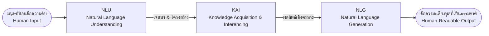
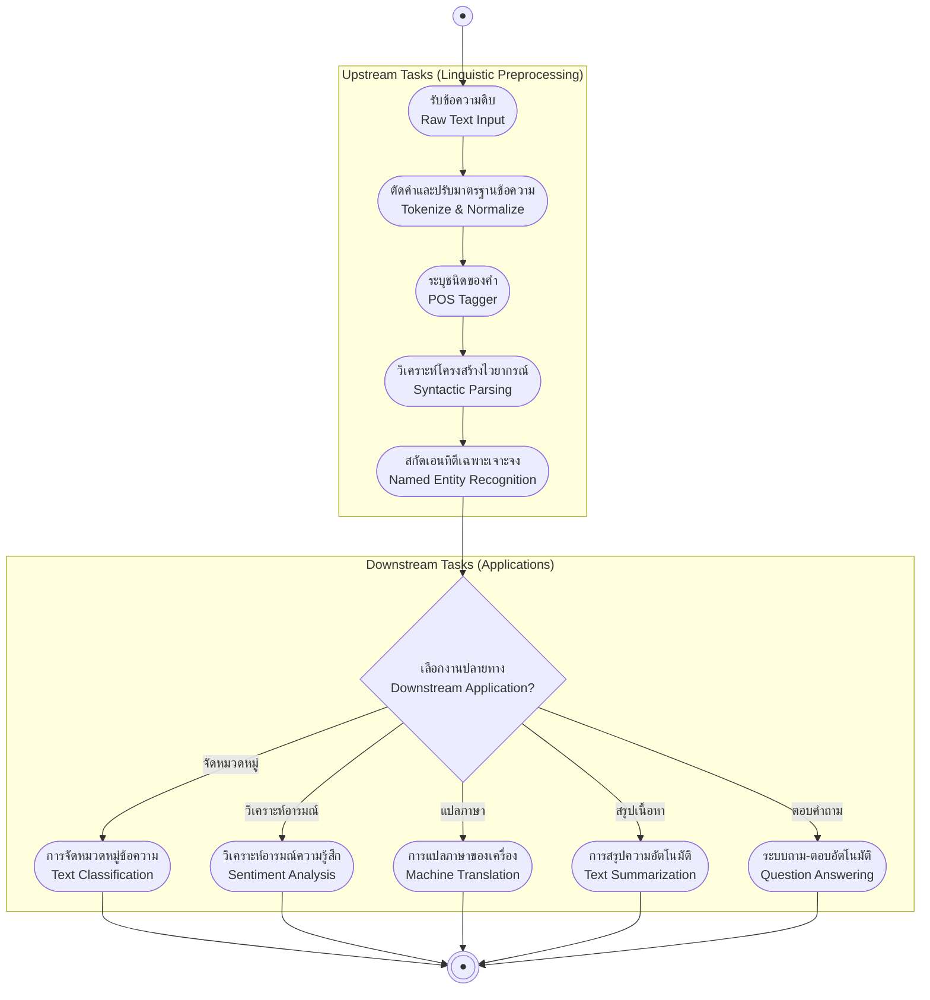

# ความรู้เบื้องต้นเกี่ยวกับ NLP (Introduction to NLP)

arrow_back กลับไปที่ [[Week1-MOC|MOC สัปดาห์ 1]] | อ่านเพิ่มเติม: [[Course-Overview|ภาพรวมรายวิชา]]

## key Keyword

- **Natural Language Processing (NLP)** — ศาสตร์ที่ผสานภาษาศาสตร์ (Linguistics), วิทยาการคอมพิวเตอร์ (Computer Science) และปัญญาประดิษฐ์ (AI) เข้าด้วยกัน เพื่อให้คอมพิวเตอร์เข้าใจ ตีความ และสร้างภาษามนุษย์ได้
- **NLU (Natural Language Understanding)** — โมดูลขาเข้าที่ทำหน้าที่ตีความความหมาย โครงสร้าง และเจตนา (Intent) จากข้อความของมนุษย์
- **KAI (Knowledge Acquisition and Inferencing)** — โมดูลแกนกลางที่นำการแทนความรู้ (Knowledge Representation) และการอนุมานเชิงตรรกะ (Inference/Reasoning) มาประมวลผลเจตนา
- **NLG (Natural Language Generation)** — โมดูลขาออกที่สร้างข้อความหรือเสียงพูดที่เป็นธรรมชาติและมนุษย์เข้าใจได้
- **Upstream / Downstream Tasks** — งานประมวลผลทางภาษาขั้นพื้นฐาน (Tokenization, POS, Parsing) เทียบกับงานประยุกต์ปลายทาง (Classification, Translation, QA)

## menu_book Theory (เข้าใจง่าย)

### 1. NLP คืออะไร (Definition & Foundations)

ตามสไลด์บรรยาย (อ้างอิง Huaping) นิยามของ NLP ไว้ว่า:

> "NLP is the science that integrates linguistics, computer science, and artificial intelligence to enable computers to understand, interpret, and generate human language."

NLP ทำหน้าที่เป็นสะพานเชื่อมระหว่าง **`Human Language (Meaning) <-> Computer Language`** โดยเกิดจากจุดตัดของ 3 ศาสตร์หลัก:
1. **ภาษาศาสตร์ (Linguistics):** กฎเกณฑ์ โครงสร้างไวยากรณ์ สัทศาสตร์ และความหมายของภาษา
2. **วิทยาการคอมพิวเตอร์ (Computer Science):** อัลกอริทึม โครงสร้างข้อมูล และประสิทธิภาพเชิงคำนวณ
3. **ปัญญาประดิษฐ์ (Artificial Intelligence):** การเรียนรู้ของเครื่อง (ML/DL) และการแทนความรู้เพื่ออนุมานเหตุผล

หากขาดศาสตร์ใดศาสตร์หนึ่ง จะเป็นเพียงระบบ "ประมวลผลตัวอักษร (String Manipulation)" แต่ไม่เข้าใจความหมายและบริบทที่แท้จริง

---

### 2. วิวัฒนาการของ NLP สู่ยุค LLM (6 Stages of NLP History)

ทิศทางการเปลี่ยนกระบวนทัศน์หลักของ NLP (Paradigm Shift Trajectory ตามสไลด์หน้า 6):
$$\text{Philosophy} \longrightarrow \text{Rules} \longrightarrow \text{Statistics} \longrightarrow \text{Learned Representations} \longrightarrow \text{Massively Pretrained Transformers}$$

ประวัติศาสตร์และการพัฒนาเทคโนโลยี NLP แบ่งออกเป็น 6 ยุคสำคัญ:

| ยุค (Stage) | ช่วงเวลาและแนวคิดหลัก | เทคโนโลยี / ผลงานสำคัญ | สาระสำคัญ |
| :--- | :--- | :--- | :--- |
| **Stage 1: Machine Translation** | **Before 1960s (1950s)** Rule-based & Stochastic | • 1950 Alan Turing (*"Computing Machinery and Intelligence"* & Turing Test) • 1952 International Conf. on MT • 1957 Noam Chomsky Universal Grammar & Chomsky Hierarchy | ศึกษาความสัมพันธ์ระหว่างคำและภาษา ใช้กฎเกณฑ์ทางไวยากรณ์ที่มนุษย์เป็นผู้กำหนดความรู้ (`Human define knowledge`) |
| **Stage 2: Early AI on NLP** | **1960s – 1970s** Domain Expert Systems | • 1961 **BASEBALL System** (Green et al.): ระบบ Q&A เฉพาะโดเมนในรูป Key-Value เช่น `{Month: July, Place: Boston, Team: Red Sox, Score: 5}` • 1968 **Minsky's Inference Engine** (Marvin Minsky) • 1970 **Augmented Transition Networks (ATN)** โดย William A. Woods | ระบบถาม-ตอบอิงฐานความรู้ และการเข้ารหัสความรู้โลกจริงให้อยู่ในรูปโครงสร้างที่เครื่องจักรเข้าใจได้ |
| **Stage 3: Grammatical Logic** | **1970s – 1980s** Knowledge, Logic & Reasoning | • **SRI's Core Language Engine (CLE)** • **Discourse Representation Theory (DRT)** | วิเคราะห์ข้อความตามสายโซ่ 7 ขั้น: `text (message) → morphology (โครงสร้างคำ) → syntax → semantics → logical form → context (บริบท) → meaning` และเริ่มตีความข้ามประโยค |
| **Stage 4: AI & Machine Learning** | **1980s – 2000s** Corpus Linguistics & Features | • **Hopfield Network** (Prof. John Hopfield) • Chomsky's Theory $\to$ Corpus-based ML (`Lexicalized Grammar`) • 2006 **IBM DeepQA Project** (Dr. David Ferrucci - Jeopardy!) | เปลี่ยนผ่านจากการเขียนกฎด้วยมือ มาเป็นการเรียนรู้จากคลังข้อมูลขนาดใหญ่ (Corpus) ร่วมกับ **Hand-crafted Features** |
| **Stage 5: Big Data & Deep Networks** | **2010s – 2017** Cloud, Mobile & Deep Learning | • **RNN / LSTM** Sequence Modeling Workhorse • 2013 **Word2Vec** (Google - แทนคำด้วยเวกเตอร์) • 2014 **Seq2Seq + Attention** • 2016 **Google Neural Machine Translation (GNMT)** | พลังประมวลผล Cloud และ Big Data ผลักดัน Deep Neural Networks ให้เรียนรู้ Representation อัตโนมัติ |
| **Stage 6: Transformers & Modern LLMs** | **2017 – 2026** Foundation Models & Agents | • 2017 **Transformer** (*"Attention is all you need"*, Vaswani et al. - `Self-Attention`) • 2018–2020 **Pretrained Giants**: BERT, GPT-2, GPT-3 • พ.ย. 2022 **ChatGPT** (ผู้ใช้แตะ 1 ล้านคนใน 5 วัน) • 2023–2026 **The Frontier Race**: GPT-4/5, Claude, Gemini, LLaMA, DeepSeek, Qwen, Mistral | โมเดลขนาดใหญ่รองรับ Multimodal, Reasoning, Coding และขีดความสามารถเชิง Agent |

> [!note] การติดตามวิวัฒนาการและ Benchmark ของ LLM ยุคปัจจุบัน (สไลด์หน้า 13–14)
> - แผนภูมิวิวัฒนาการ LLM (อ้างอิง Wayne Xin Zhao et al., *A Survey of Large Language Models*) แบ่งโมเดลตระกูลสำคัญตั้งแต่ปี 2019–2026 ออกเป็นกลุ่ม **Open-Weights / Publicly Available Checkpoints** (เช่น LLaMA 1–4, DeepSeek-V2/V3/R1, Qwen 2/2.5/3, Mistral/Mixtral) และกลุ่ม **Proprietary Models** (เช่น GPT-4/5, Claude 3.5/4.5, Gemini 2.0/2.5/3.0)
> - เกณฑ์มาตรฐานที่ใช้เปรียบเทียบประสิทธิภาพบน Leaderboard (เช่น `llm-stats.com`) พิจารณา 7 มิติหลัก: **Overall Score**, **Reasoning**, **Coding**, **Agent Capability**, **Context Window Size** (เช่น 1.0M tokens), **Speed** (Tokens/sec) และ **Pricing ($/Million Tokens)**

---

### 3. ระดับชั้นของโครงสร้างทางภาษา และ 5 ขั้นตอนการประมวลผล NLP (Levels of Language)

สไลด์หน้า 15–17 อธิบายโครงสร้างภาษาใน 2 มุมมองที่สอดคล้องกัน คือ **มุมมองภาษาศาสตร์ 6 ระดับชั้น** และ **มุมมองขั้นตอนการประมวลผลใน NLP 5 ขั้นตอน**:

#### 3.1 โครงสร้างภาษาศาสตร์ 6 ระดับชั้น (จากชั้นในสุดสู่ชั้นนอกสุด - สไลด์หน้า 16)
1. **Phonetics (สัทศาสตร์):** การศึกษาเสียงพูดทางกายภาพ (`Speech sounds`)
2. **Phonology (สรวิทยา):** ระบบเสียงและหน่วยเสียงที่มีความหมายในภาษา (`Phonemes`)
3. **Morphology (สัณฐานวิทยา):** โครงสร้างภายในของคำ หน่วยคำ และรากศัพท์ (`Words`)
4. **Syntax (วากยสัมพันธ์):** กฎการเรียงคำเป็นวลีและประโยค (`Phrases and sentences`)
5. **Semantics (อรรถศาสตร์):** ความหมายตรงตามตัวอักษรของวลีและประโยค (`Literal meaning of phrases and sentences`)
6. **Pragmatics (วัจนปฏิบัติศาสตร์):** ความหมายที่แท้จริงตามบริบทของการสื่อสาร (`Meaning in context of discourse`)

#### 3.2 ขั้นตอนการวิเคราะห์ภาษาใน NLP 5 ขั้นตอน (The 5 Steps in NLP - สไลด์หน้า 17)

| ลำดับขั้น | ชื่อขั้นตอน (Technical Term) | บทบาทและขอบเขตการตีความ |
| :---: | :--- | :--- |
| **Step 1** | **Lexical Analysis** | การแบ่งย่อยข้อความและวิเคราะห์ระดับคำ (`Text → Paragraph → Sentence → Word`) |
| **Step 2** | **Syntactic Analysis** | การวิเคราะห์ไวยากรณ์และความสัมพันธ์เชิงโครงสร้างระหว่างคำ (`Grammar + relationship between words`) |
| **Step 3** | **Semantic Analysis** | การตีความหมายตรงตัวของประโยคเดี่ยว (`Exact literal meaning of one sentence`) |
| **Step 4** | **Discourse Integration** | การตีความหมายของประโยคโดยอิงความเชื่อมโยงกับประโยคก่อนหน้า เช่น การอ้างอิงคำสรรพนาม (`Meaning based on previous sentence - pronoun`) |
| **Step 5** | **Pragmatic Analysis** | การตีความหมายที่แท้จริงตามบริบทสถานการณ์และความรู้รอบตัวในโลกจริง (`Actual meaning based on context - real world knowledge`) |

---

### 4. ทำไม NLP ถึงยาก: 5 ความท้าทายหลัก และกรณีศึกษาภาษาไทย (Core Challenges)

> **คำกล่าวสำคัญจากสไลด์หน้า 22:** *“ ภาษาไทยง่ายเพราะเราเป็นคนไทย ”* — สิ่งที่คนไทยเข้าใจได้โดยสัญชาตญาณ กลับเต็มไปด้วยความกำกวมและข้อยกเว้นที่ยากมากสำหรับคอมพิวเตอร์

ความท้าทายสากลของ NLP มี 5 มิติ พร้อมตัวอย่างจริงในบริบทของ **ภาษาไทย (Thai NLP Challenges)**:

| มิติความท้าทาย | นิยามทางทฤษฎี | ตัวอย่างรูปธรรมในภาษาไทยจากสไลด์ |
| :--- | :--- | :--- |
| **1. Abstractness (ความเป็นนามธรรม)** | ความหมายแท้จริงมักไม่ได้อยู่ตรงๆ ที่รูปคำ คำเดี่ยวเข้ารหัสแนวคิดที่ลึกซึ้งและประชดประชันได้ | • *"ไปให้แม่แกทำ"* (สำนวนปฏิเสธ/ประชด ไม่ได้สั่งให้แม่ทำจริง) • *"สวย $\to$ สวยกี่โมง"* = **ไม่สวย** • *"ได้ $\to$ ได้อยู่"* = **ไม่ได้ / แย่** |
| **2. Combinability (ผสมกันได้ไม่จำกัด)** | คำเดี่ยวสามารถนำมาผสมกันจนเกิดความหมายใหม่ที่คาดเดาไม่ได้จากคำเดิม | • คำว่า **แม่**: *แม่น้ำ*, *แม่ยก*, *แม่ไม้มวยไทย* • **กับ** = with + **ข้าว** = rice $\implies$ **กับข้าว** = side dish (ไม่มีข้าวสาร) • **ไป** (to go) + **สบาย** (comfortable) $\implies$ **ไปสบาย** = เสียชีวิต (passed away) |
| **3. Evolutiveness (มีวิวัฒนาการ)** | ภาษาเปลี่ยนแปลงตลอดเวลา มีศัพท์สแลง คำย่อ และรูปแบบการสะกดใหม่เกิดขึ้นเสมอ | • *"ใช่ไหม"* $\to$ *"ใช่ปะ"* $\to$ *"ช้ะ"* • *"เลิศ"* $\to$ *"เริ่ด"* • *"จะรั่ว"* (สแลงหมายถึง ขำมากจนทนไม่ไหว) |
| **4. Nonstandardness (ไม่มีหลักการที่แน่นอน)** | คำพิมพ์ผิด ภาษาพูด และการเรียงลำดับคำที่ยืดหยุ่นเบี่ยงเบนจากไวยากรณ์ทางการ | • คำขยายเวลาและสถานะที่สลับที่หรือซ้อนกันได้: *"กำลัง จะ ไป กินข้าว อยู่ แล้ว"* • แตกเป็น *"กำลังจะไปกินข้าว"*, *"กินข้าวอยู่"*, *"กินข้าวแล้ว"* |
| **5. Subjectivity (ขึ้นกับบุคคลและบริบท)** | น้ำเสียง อารมณ์ และความหมายแปรผันตามผู้พูด ภูมิภาค วัฒนธรรม และวรรณยุกต์ | • **ความต่างตามภูมิภาค:** *"แกงส้ม"* (ภาคกลาง) vs *"แกงส้ม/แกงเหลือง"* (ภาคใต้) • **ความกำกวมตามภาษาถิ่น:** *"“ไปส่ง”กินข้าวหน่อย"* (ภาษาเหนือ/อีสาน = ไปกินเป็นเพื่อนหน่อย, ภาคกลาง = ขับรถไปส่ง) • **ความละเอียดอ่อนของวรรณยุกต์และสระ (Minimal Pairs):** `คาว` (Fishy), `เข้า` (Enter), `เข่า` (Knee), `เขา` (He), `ข่าว` (News), `ขาว` (White), `ข้าว` (Rice) • **การประชดเชิงวัจนปฏิบัติศาสตร์ (Pragmatic Irony):** *"นกอยู่ข้างพี่ตานะคะ"* (รูปประโยคเป็นบวกแต่เจตนาจริงตรงกันข้าม) |

> [!important] ความท้าทายสูงสุดของภาษาไทย: Segmentation (การตัดคำและตัดประโยค - สไลด์หน้า 28)
> ภาษาไทยเขียนติดกันโดย **ไม่มีช่องว่างคั่นคำ (No whitespace boundary)** และไม่มีจุด Full Stop คั่นประโยคชัดเจน ทำให้งาน **Word Segmentation** และ **Sentence Segmentation** เป็นด่านแรกที่ยากที่สุด ดังตัวอย่างในสไลด์:
> - **กลอนไทยที่เขียนติดกันยาวและมีคำพ้องรูป:** *"ฝนตกปรอยกรกนกคนตลกชวนดวงกมล..."*
> - **ประโยคที่มีคำรูปและเสียงใกล้เคียงกันเรียงติดกัน:** *"..หมาหันมา หาหมู เห็นหูหมา หูหมาหนา หมูหนี หมีเห็นหมู..."*

---

### 5. สถาปัตยกรรมหลักของระบบ NLP (NLP Architecture: NLU, KAI, NLG)

ระบบประมวลผลภาษาธรรมชาติประกอบด้วย 3 เสาหลัก (สไลด์หน้า 19–20):

| องค์ประกอบ | ชื่อเต็ม | หน้าที่หลัก |
| :--- | :--- | :--- |
| **NLU** | **Natural Language Understanding** | ตีความความหมาย เจตนา (Intent) และโครงสร้างไวยากรณ์จากข้อความอินพุตของมนุษย์ |
| **KAI** | **Knowledge Acquisition and Inferencing** | จัดเก็บและแทนความรู้ (Knowledge Representation) พร้อมทำการอนุมานด้วยเหตุผล (Inference & Reasoning) เพื่อประมวลผลเจตนา |
| **NLG** | **Natural Language Generation** | สังเคราะห์และสร้างข้อความหรือเสียงพูดที่เป็นธรรมชาติ ไวยากรณ์ถูกต้อง และสละสลวยส่งกลับให้ผู้ใช้ |

> [!tip] เทคนิคช่วยจำ
> **NLU = ขาเข้า (Input $\to$ Meaning)** เหมือนหูฟังและสมองส่วนตีความ  
> **KAI = สมองส่วนคิดวิเคราะห์และเชื่อมโยงความรู้**  
> **NLG = ขาออก (Meaning $\to$ Output)** เหมือนปากที่พูดสื่อสารออกมา

---

### 6. Pipeline: Upstream Tasks vs Downstream Tasks

งานในสายงาน NLP แบ่งออกเป็น 2 ระดับตามบทบาทใน Pipeline (สไลด์หน้า 18):

- **Upstream Tasks (งานประมวลผลทางภาษาขั้นพื้นฐาน):** เป็นการเตรียมข้อมูลและสกัดคุณลักษณะทางภาษาศาสตร์ (Linguistic Preprocessing) และการ Pre-train โมเดล เช่น การตัดคำและปรับมาตรฐาน (Tokenize + Normalize), การกำกับชนิดคำ (POS Tagging), การแจกแจงโครงสร้างไวยากรณ์ (Syntactic Parsing)
- **Downstream Tasks (งานประยุกต์ใช้งานจริง):** เป็นงานเฉพาะทางที่นำผลลัพธ์จาก Upstream มาต่อยอดหรือทำการ Fine-tuning เพื่อสร้างแอปพลิเคชัน เช่น การจำแนกข้อความ (Classification), การแปลภาษา (Translation), และระบบถาม-ตอบ (Q&A)

> [!note] ตำแหน่งของ NER ใน Pipeline
> ในสไลด์สอน Named Entity Recognition (NER) ถูกวางเป็นสะพานเชื่อมระหว่าง Upstream (การวิเคราะห์โครงสร้าง) และ Downstream (การนำไปประยุกต์) โดยในเชิงอัลกอริทึม NER จัดเป็นงาน **Sequence Labeling** ซึ่งจะศึกษาละเอียดใน [[Word-Segmentation-POS-Tagging-Sequence-Labeling|สัปดาห์ที่ 2]]

---

### 7. การประยุกต์ใช้งาน NLP ในโลกจริง (NLP Applications - สไลด์หน้า 29–31)

#### 7.1 งานประยุกต์หลัก 6 ประเภท (6 Core Applied Tasks)
1. **Text Classification:** การจำแนกหมวดหมู่เอกสาร เช่น การคัดกรองอีเมลขยะ (Spam Detection) หรือการจัดหมวดข่าว
2. **Sentiment Analysis:** การวิเคราะห์อารมณ์ความรู้สึกจากข้อความ (เชิงบวก เชิงลบ หรือเป็นกลาง)
3. **Machine Translation:** การแปลข้อความจากภาษาหนึ่งไปยังอีกภาษาหนึ่งอัตโนมัติ
4. **Named Entity Recognition (NER):** การสกัดชื่อเฉพาะ เช่น ชื่อบุคคล สถานที่ องค์กร และวันที่
5. **Text Summarization:** การย่อสรุปใจความสำคัญจากเอกสารขนาดยาวโดยรักษาความหมายหลักไว้
6. **Question Answering (QA):** ระบบอ่านทำความเข้าใจเนื้อหาเพื่อดึงคำตอบที่แม่นยำกลับมาให้ผู้ใช้

#### 7.2 ตัวอย่างระบบจริงในชีวิตประจำวัน 7 ระบบ (7 Real-World Systems)
1. **Voice Assistants:** ผู้ช่วยสั่งงานด้วยเสียง เช่น Alexa, Google Assistant, Siri
2. **Customer Chatbots:** ระบบแชทบอทดูแลลูกค้าและตอบคำถามอัตโนมัติ
3. **Spam Filtering:** ระบบคัดกรองอีเมลขยะและป้องกันภัยคุกคามทางไซเบอร์
4. **Predictive Typing:** ระบบเดาคำถัดไปและแก้คำผิดอัตโนมัติบนแป้นพิมพ์สมาร์ตโฟน
5. **Translation Tools:** เครื่องมือแปลภาษาข้ามวัฒนธรรมแบบเรียลไทม์
6. **Sentiment Tracking:** ระบบติดตามความคิดเห็นและกระแสสังคมบน Social Media
7. **Document Search:** ระบบค้นหาเอกสารอัจฉริยะและระบบแนะนำเนื้อหา (Search & Recommendation Systems)

---

### 8. เครื่องมือมาตรฐานในวงการ NLP (Popular NLP Libraries - สไลด์หน้า 32–33)

- **NLTK (Natural Language Toolkit):** ไลบรารีคลาสสิกของ Python เหมาะสำหรับงานสอนและวิจัย มีอัลกอริทึมพื้นฐานและคลังข้อมูล (Corpora) ครบถ้วน
- **spaCy:** ไลบรารีระดับ Production (*Industrial-Strength NLP*) เน้นความเร็วสูง รองรับ Pipeline สำเร็จรูปสำหรับ Tokenization, Tagging, Parsing และ NER
- **PyThaiNLP:** ไลบรารีโอเพนซอร์สมาตรฐานที่สร้างขึ้นเพื่องานประมวลผลภาษาไทยโดยเฉพาะ
- **Hugging Face (`transformers`):** ฮับกลางสำหรับดาวน์โหลดและ Fine-tune โมเดลภาษาและสถาปัตยกรรม Transformer ยุคใหม่

## schema Diagram

---

arrow_forward ต่อไป: [[Tokenization]]
