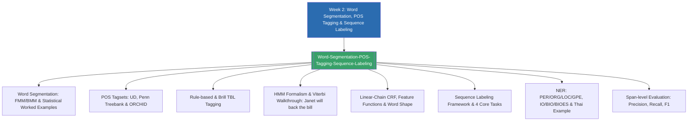

# Week 2 — Word Segmentation, POS Tagging & Sequence Labeling (MOC)

arrow_back สัปดาห์ก่อนหน้า: [[Week1-MOC|MOC สัปดาห์ 1]]

## check_circle เช็คลิสต์ก่อนเข้าเรียน

- [ ] ทบทวนความท้าทาย 3 ข้อของการตัดคำภาษาไทย (No Whitespace, Boundary Ambiguity, ไม่มีนิยามคำตายตัว) — ดู [[Word-Segmentation-POS-Tagging-Sequence-Labeling]]
- [ ] ฝึกไล่ Step อัลกอริทึม FMM และ BMM บนประโยค `"นักเรียนไปโรงเรียน"` และคำกำกวม `"ตากลม"` — ดู [[Word-Segmentation-POS-Tagging-Sequence-Labeling]]
- [ ] ทบทวนกฎความน่าจะเป็นพื้นฐาน 6 ข้อ (Prob 101) และการคำนวณ Statistical Word Segmentation บนคำว่า `"ตากลม"` ($0.0567 > 0.0170$) — ดู [[Word-Segmentation-POS-Tagging-Sequence-Labeling]]
- [ ] รู้จักชุดหมวดคำมาตรฐาน (UD 8 หมวดหลัก, Penn Treebank 45 tags, ORCHID ภาษาไทย 47 tags) และปัญหา POS Ambiguity (`"back"`, `"flies"`) — ดู [[Word-Segmentation-POS-Tagging-Sequence-Labeling]]
- [ ] เข้าใจวิธี Rule-based (`"a book"`), Stochastic Baseline และ Brill Transformation-Based Learning (TBL) — ดู [[Word-Segmentation-POS-Tagging-Sequence-Labeling]]
- [ ] เข้าใจนิยามรูปนัยของ HMM $(Q, A, B, \pi)$, สมมติฐาน 2 ข้อ และการพิสูจน์สมการ Decoding ด้วยกฎของเบย์ส — ดู [[Word-Segmentation-POS-Tagging-Sequence-Labeling]]
- [ ] ฝึกคำนวณตาราง Viterbi Decoding บนประโยค `"Janet will back the bill"` ทีละคอลัมน์ พร้อมวิเคราะห์ Complexity ($\mathcal{O}(T^N)$ vs $\mathcal{O}(N \times T^2)$ เร็วขึ้น $68.6$ เท่า) — ดู [[Word-Segmentation-POS-Tagging-Sequence-Labeling]]
- [ ] เปรียบเทียบ HMM (Generative) กับ Linear-Chain CRF (Discriminative) และการใช้ Overlapping Features / Word Shape (`X.X.X.`, `XXdd-dd`) — ดู [[Word-Segmentation-POS-Tagging-Sequence-Labeling]]
- [ ] เข้าใจกรอบคิดงาน Sequence Labeling 4 ประเภท (POS, NER, Word Segmentation, Chunking) — ดู [[Word-Segmentation-POS-Tagging-Sequence-Labeling]]
- [ ] จำแนกประเภท Entity สากล (PER, ORG, LOC, GPE), เปรียบเทียบ Tagging Schemes (IO, BIO, BIOES), ตัวอย่าง NER ภาษาไทย และการวัดผลระดับ Span-level $F_1$ — ดู [[Word-Segmentation-POS-Tagging-Sequence-Labeling]]

## assignment ภาพรวมสัปดาห์ 2 (สรุปย่อ)

สัปดาห์ที่ 2 ต่อเนื่องจากการตัดคำพื้นฐานไปสู่การวิเคราะห์โครงสร้างภาษาและการสกัดข้อมูลสำคัญระดับคำ แบ่งเป็น 3 แกนหลัก:
1. **การตัดคำ (Word Segmentation):** ทบทวนความท้าทายในภาษาที่ไร้ช่องว่าง (ไทย จีน ญี่ปุ่น), ไล่ขั้นตอนการตัดคำแบบ Dictionary-based ด้วย Forward/Backward Maximum Matching (FMM/BMM) บนประโยค `"นักเรียนไปโรงเรียน"` และชี้ให้เห็นความกำกวมบนคำว่า `"ตากลม"`, ทบทวนความน่าจะเป็นพื้นฐาน (Prob 101) เพื่อแก้ความกำกวมด้วย Statistical Segmentation ($\arg\max \prod P(w_i)$) พร้อมตารางสรุป 4 แนวทางการตัดคำ
2. **การกำกับชนิดของคำ (POS Tagging):** รู้จักมาตรฐานชุดหมวดคำ (UD, Penn Treebank, ORCHID), ศึกษาแนวทาง Rule-based และ Brill TBL ไปจนถึงโมเดลทางสถิติอย่าง Hidden Markov Model (HMM) พร้อมการถอดรหัสแบบ Dynamic Programming ด้วย Viterbi Algorithm บนประโยคตัวอย่างคลาสสิก `"Janet will back the bill"` (ลดการคำนวณจาก $16,807$ เหลือ $245$ ครั้ง) และก้าวข้ามข้อจำกัดของ HMM ด้วย Linear-Chain Conditional Random Fields (CRF) ที่รองรับการสกัด Feature Functions อิสระและ Word Shape (`X.X.X.`, `XXdd-dd`) สำหรับแก้ปัญหาคำนอกคลังคำศัพท์ (Unknown Words)
3. **การประมวลผลลำดับและการรู้จำชื่อเฉพาะ (Sequence Labeling & NER):** กำหนดกรอบแนวคิดทั่วไปที่แมปลำดับอินพุต $X$ ไปยังป้ายกำกับ $Y$ ที่ความยาวเท่ากัน นำไปประยุกต์กับ Named Entity Recognition (NER) เพื่อสกัดเอนทิตี PER, ORG, LOC, GPE ผ่าน Tagging Schemes (IO, BIO, BIOES) พร้อมตัวอย่างจริงบนประโยคภาษาไทย และการวัดผลแบบ Entity-Span Level Precision, Recall และ $F_1$-Score

## map แผนที่หัวข้อสัปดาห์ 2

## collections_bookmark โน้ตรายหัวข้อ

| หัวข้อ | เนื้อหาหลัก | แหล่งอ้างอิงต้นฉบับ |
| :--- | :--- | :---: |
| [[Word-Segmentation-POS-Tagging-Sequence-Labeling]] | FMM/BMM Worked Examples, Prob 101, Statistical Segmentation, POS Tagsets (UD/PTB/ORCHID), HMM & Viterbi Walkthrough (`Janet will back the bill`), CRF Feature Functions & Word Shape, Sequence Labeling, NER (IO/BIO/BIOES), Span-level $F_1$ | `2-1_Word_Segmentation_POS_Tagging_Sequence_Labeling.pdf` (หน้า 1–39) |

> [!tip] เคล็ดลับช่วยจำ HMM vs Viterbi vs CRF
> **HMM คือ "โมเดลเชิงกำเนิด"** ที่กำหนดความน่าจะเป็นของภาษา $P(W, T)$, **Viterbi คือ "อัลกอริทึม Dynamic Programming"** ที่ค้นหาลำดับป้ายกำกับที่ดีที่สุดจากโมเดลนั้นในเวลา $\mathcal{O}(N \times T^2)$ และ **CRF คือ "โมเดลเชิงจำแนก"** ที่คำนวณ $P(T \mid W)$ โดยตรงและเปิดให้เราใส่ฟีเจอร์คำแวดล้อมได้อย่างอิสระโดยไม่ติดกรอบสมมติฐานทางสถิติที่เข้มงวด ทั้งสามส่วนเป็นหัวใจสำคัญของงาน Sequence Modeling ก่อนก้าวสู่ยุค Deep Learning

---

arrow_forward สัปดาห์ถัดไป: [[Week3-MOC|MOC สัปดาห์ 3]]
