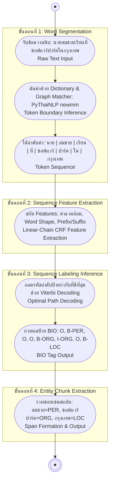

# การตัดคำ, การกำกับชนิดคำ และ Sequence Labeling (Word Segmentation, POS Tagging & Sequence Labeling)

<span class="material-symbols-outlined">arrow_back</span> กลับไปที่ [[Week2-MOC|MOC สัปดาห์ 2]] | ก่อนหน้า: [[Tokenization|สัปดาห์ที่ 1: Tokenization]]

## <span class="material-symbols-outlined">key</span> Keyword

- **Word Segmentation** — การระบุขอบเขตของคำในกระแสตัวอักษรต่อเนื่อง มีความสำคัญอย่างยิ่งในภาษาที่เขียนติดกันโดยไม่มีช่องว่าง เช่น ภาษาไทย จีน และญี่ปุ่น
- **Statistical Word Segmentation** — การแก้ความกำกวมของการตัดคำโดยเลือกลำดับคำที่ให้ความน่าจะเป็นร่วมสูงสุด $\arg\max \prod P(w_i)$ จากสถิติคลังข้อมูล
- **Part-of-Speech (POS) Tagging** — การกำกับหน้าที่และหมวดหมู่ทางไวยากรณ์ (เช่น `NOUN`, `VERB`, `ADJ`) ให้กับแต่ละคำตามบริบทในประโยค (มาตรฐาน UD, Penn Treebank, ORCHID)
- **Hidden Markov Model (HMM)** — โมเดลเชิงกำเนิด (Generative Model) ที่จำลองความน่าจะเป็นร่วม $P(\text{Words}, \text{Tags})$ และถอดรหัสลำดับ Tag ที่ดีที่สุดด้วยอัลกอริทึม Viterbi ในเวลา $\mathcal{O}(N \times T^2)$
- **Conditional Random Fields (CRF)** — โมเดลเชิงจำแนกแบบลูกโซ่เชิงเส้น (Linear-Chain Discriminative Model) ที่คำนวณ $P(\text{Tags} \mid \text{Words})$ โดยตรง ทำให้ใส่ Arbitrary Overlapping Features และ Word Shape ได้อย่างอิสระ
- **Sequence Labeling** — กรอบการทำงานสากลที่แมปอินพุตลำดับความยาว $N$ ไปสู่เอาต์พุตป้ายกำกับความยาว $N$ ที่เท่ากันเสมอ (ครอบคลุมทั้ง POS, NER, Word Segmentation, Chunking)
- **Named Entity Recognition (NER)** — งานค้นหาและระบุขอบเขตของชื่อเฉพาะ (Person, Organization, Location, GPE) ผ่านรูปแบบการติดป้าย IO / BIO / BIOES และการวัดผลระดับ Span-level $F_1$

## <span class="material-symbols-outlined">menu_book</span> Theory (เข้าใจง่าย)

### 1. การตัดคำ (Word Segmentation - สไลด์หน้า 3–11)

ในภาษาอังกฤษ ขอบเขตของคำถูกระบุไว้อย่างชัดเจนด้วยช่องว่าง (Whitespace) เช่น `"I go to school"` ในขณะที่ภาษาอย่างไทย จีน และญี่ปุ่น เขียนติดกันต่อเนื่องโดยไม่มีช่องว่าง เช่น `"ฉันไปโรงเรียน"` ระบบจึงจำเป็นต้องอนุมานขอบเขตคำขึ้นมาเอง:

`ผมชอบเรียนภาษา` $\to$ `ผม | ชอบ | เรียน | ภาษา`

#### 1.1 ความท้าทายหลัก 3 ประการของการตัดคำภาษาไทย (สไลด์หน้า 4)
1. **ไม่มีตัวคั่นคำ (No Whitespace Delimiter):** การไม่เว้นวรรคระหว่างคำทำให้ขอบเขตคำไม่ปรากฏชัดเจนบนรูปอักษร
2. **ความกำกวมของขอบเขตคำ (Boundary Ambiguity):** สายอักขระชุดเดียวกันสามารถตัดแบ่งได้หลายแบบและให้ความหมายต่างกันโดยสิ้นเชิง เช่น:
   - `"ตากลม"` $\to$ `"ตาก-ลม"` (*to air out* / นั่งตากลม) หรือ `"ตา-กลม"` (*round eyes* / เด็กตากลมโต)
   - `"ไปหามเหสี"` $\to$ `"ไป-หา-มเหสี"` หรือ `"ไป-หาม-เหสี"`
3. **ไม่มีนิยามของ "คำ" ที่ตายตัว (No Strict Definition of a Word):** ขอบเขตระหว่างคำเดี่ยว คำประสม และวลีในภาษาไทยมีความยืดหยุ่นสูง

---

#### 1.2 Worked Example 1: Forward & Backward Maximum Matching (สไลด์หน้า 6–7)

**แนวคิดของ Forward Maximum Matching (FMM):** เริ่มจากตำแหน่งซ้ายสุดของข้อความ พยายามจับคู่สายอักขระที่ **"ยาวที่สุด"** กับคำในพจนานุกรมก่อนเสมอ ถ้าไม่พบให้ลดความยาวลงทีละ 1 ตัวอักษรจนกว่าจะพบ (ส่วน **Backward Maximum Matching: BMM** ใช้หลักการเดียวกันแต่เริ่มจากขวาสุดย้อนมาซ้ายสุด)

##### ตัวอย่างที่ 1: ประโยค `"นักเรียนไปโรงเรียน"` (18 ตัวอักษร, สไลด์หน้า 6)
สมมติพจนานุกรม (ย่อ) คือ: `{"นัก", "นักเรียน", "เรียน", "ไป", "โรง", "โรงเรียน", ...}`
- **Step 1 (เริ่มที่ตำแหน่งซ้ายสุด):** ลอง `"นักเรียนไป"` (8 ตัว) ✗ $\to \dots \to$ ลอง `"นักเรียน"` (7 ตัว / 4 หน่วยเสียงพยัญชนะ-สระ) ✓ พบในพจนานุกรม! $\implies$ **ตัดคำที่ 1: `นักเรียน`**
- **Step 2 (ตำแหน่งถัดมา):** ลอง `"ไปโรงเรี"` ✗ $\to \dots \to$ ลอง `"ไป"` ✓ พบในพจนานุกรม! $\implies$ **ตัดคำที่ 2: `ไป`**
- **Step 3 (ส่วนที่เหลือ):** ลอง `"โรงเรียน"` ✓ พบในพจนานุกรม! $\implies$ **ตัดคำที่ 3: `โรงเรียน`**
- **ผลลัพธ์ FMM:** `นักเรียน | ไป | โรงเรียน`

##### ตัวอย่างที่ 2: ความกำกวมของ `"ตากลม"` เมื่อรัน FMM เทียบกับ BMM (สไลด์หน้า 7)
สมมติพจนานุกรมมีคำว่า `{"ตา", "กลม", "ตาก", "ลม"}`:
- **Forward Maximum Matching (FMM - ซ้ายไปขวา):**
  - เริ่มที่ `i = 0`: ลอง `"ตากลม"` (5) ✗ $\to$ ลอง `"ตากล"` (4) ✗ $\to$ ลอง `"ตาก"` (3) ✓ พบ! $\implies$ ตัด **`"ตาก"`**
  - ที่ `i = 3`: ลอง `"ลม"` (2) ✓ พบ! $\implies$ ตัด **`"ลม"`**
  - **ผลลัพธ์ FMM:** **`ตาก | ลม`** (*to air out*)
- **Backward Maximum Matching (BMM - ขวาไปซ้าย):**
  - เริ่มท้ายสุด `j = 5`: ลอง `"ตากลม"` (5) ✗ $\to$ ลอง `"ากลม"` (4) ✗ $\to$ ลอง `"กลม"` (3) ✓ พบ! $\implies$ ตัด **`"กลม"`**
  - เหลือด้านหน้า `j = 2`: ลอง `"ตา"` (2) ✓ พบ! $\implies$ ตัด **`"ตา"`**
  - **ผลลัพธ์ BMM:** **`ตา | กลม`** (*round eyes*)

> [!warning] ข้อจำกัดของ Maximum Matching
> เนื่องจากเป็นอัลกอริทึมแบบโลภ (Greedy) ที่ตัดสินใจจากความยาวคำเพียงอย่างเดียว จึงไม่สามารถรู้ได้เลยว่าในบริบทนั้นควรเป็น `"ตาก-ลม"` หรือ `"ตา-กลม"` จึงต้องใช้ **Statistical Segmentation** เข้ามาช่วย

---

#### 1.3 ทบทวนความน่าจะเป็นพื้นฐาน (Prob 101 - สไลด์หน้า 9)

ก่อนคำนวณการตัดคำเชิงสถิติและโมเดล HMM สไลด์หน้า 9 สรุปกฎความน่าจะเป็นพื้นฐาน 6 ข้อที่ต้องใช้ตลอดวิชา:

1. **Classical Probability (นิยามพื้นฐาน):**
   $$P(E) = \frac{N(E)}{N(S)}$$
   เมื่อ $N(E)$ คือจำนวนกรณีที่เหตุการณ์ $E$ เกิดขึ้น และ $N(S)$ คือจำนวนกรณีทั้งหมดใน Sample Space
2. **Conditional Probability (ความน่าจะเป็นแบบมีเงื่อนไข):**
   $$P(A \mid B) = \frac{P(A \cap B)}{P(B)}$$
   ("ความน่าจะเป็นที่เหตุการณ์ $A$ จะเกิดขึ้น เมื่อทราบว่าเหตุการณ์ $B$ เกิดขึ้นแล้ว")
3. **Chain Rule (กฎลูกโซ่):**
   $$P(A_1, A_2, \dots, A_n) = P(A_1) \cdot P(A_2 \mid A_1) \cdot P(A_3 \mid A_1, A_2) \cdots P(A_n \mid A_1, \dots, A_{n-1})$$
4. **Independence (ความเป็นอิสระต่อกัน):**
   $$P(A \cap B) = P(A) \cdot P(B) \quad (\text{เมื่อ } A \text{ และ } B \text{ เป็นอิสระต่อกัน})$$
5. **Bayes' Theorem (ทฤษฎีบทของเบย์ส):**
   $$P(A \mid B) = \frac{P(B \mid A) \cdot P(A)}{P(B)}$$
6. **Law of Total Probability / Marginalization:**
   $$P(A) = \sum_i P(A \mid B_i) \cdot P(B_i)$$

---

#### 1.4 การตัดคำเชิงสถิติ และตัวอย่างการคำนวณ (Statistical Word Segmentation - สไลด์หน้า 8, 10)

**แนวคิด:** แทนที่จะเลือกคำที่ยาวที่สุดแบบโลภ ให้เลือก **"ลำดับการตัดคำที่มีความน่าจะเป็นรวมสูงสุด"** โดยประมาณค่าความน่าจะเป็นของคำจากความถี่ใน Corpus ขนาดใหญ่ (ภายใต้สมมติฐาน Unigram Independence):

$$\hat{W} = \arg\max_{W} \prod_{i=1}^{k} P(w_i)$$

##### Worked Example: แก้ความกำกวมคำว่า `"ตากลม"` ด้วยสถิติ (สไลด์หน้า 10)
สมมติใน Toy Corpus มีจำนวนคำทั้งหมด $N = 500 + 80 + 60 + 200 = 840$ คำ โดยมีสถิติความถี่ดังตาราง:

| คำศัพท์ ($w$) | ตา | กลม | ตาก | ลม | รวมทั้งหมด ($N$) |
| :--- | :---: | :---: | :---: | :---: | :---: |
| **ความถี่ ($\text{count}$)** | $500$ | $80$ | $60$ | $200$ | $840$ |
| **ความน่าจะเป็น $P(w) = \frac{\text{count}}{840}$** | **$0.595$** | **$0.095$** | **$0.071$** | **$0.238$** | $1.000$ |

**เปรียบเทียบความน่าจะเป็นของทั้ง 2 วิธีตัดคำ:**
1. **กรณีที่ 1 (`"ตา + กลม"`):**
   $$P(\text{ตา}) \times P(\text{กลม}) = 0.595 \times 0.095 = \mathbf{0.0567}$$
2. **กรณีที่ 2 (`"ตาก + ลม"`):**
   $$P(\text{ตาก}) \times P(\text{ลม}) = 0.071 \times 0.238 = \mathbf{0.0170}$$

**สรุปผล:** เนื่องจาก $0.0567 > 0.0170$ ดังนั้นวิธี **Statistical Segmentation จึงเลือกตัดเป็น `"ตา | กลม"`**

---

#### 1.5 ตารางสรุปเปรียบเทียบ 4 แนวทางการตัดคำภาษาไทย (RECAP - สไลด์หน้า 11)

| วิธีตัดคำ | แนวคิดหลัก | จุดเด่น / ข้อจำกัด |
| :--- | :--- | :--- |
| **1. Maximum Matching (FMM / BMM)** | จับคู่คำยาวที่สุดกับพจนานุกรมแบบโลภ (Greedy) | เร็วมาก ไม่ต้อง Train แต่แก้ความกำกวมไม่ได้ดี และพังเมื่อเจอคำนอกพจนานุกรม (OOV) |
| **2. Statistical Segmentation** | เลือกลำดับการตัดคำที่ให้ค่าความน่าจะเป็น (N-gram) สูงสุด | แก้ความกำกวมได้ดีกว่าแบบแรก แต่ต้องมี Corpus สถิติขนาดใหญ่ที่น่าเชื่อถือ |
| **3. HMM / CRF (สถิติเชิงลำดับ)** | มองการตัดคำเป็นปัญหา Sequence Labeling ระดับตัวอักษร (`B`/`I`) | แม่นยำขึ้นและรับมือคำใหม่ได้ดีขึ้น แต่ต้องใช้ Training Data ที่กำกับป้ายแล้ว |
| **4. Deep Learning (BiLSTM / Transformer)** | เรียนรู้คุณลักษณะคำจากข้อมูลจำนวนมากโดยตรง (เช่น `DeepCut`, `PyThaiNLP`) | **แม่นยำสูงสุดในปัจจุบัน** แต่ใช้ทรัพยากรการคำนวณและข้อมูลฝึกสอนมาก |

---

### 2. การกำกับชนิดของคำ (Part-of-Speech Tagging: POS - สไลด์หน้า 12–32)

**POS Tagging** คือกระบวนการกำหนดหมวดคำทางไวยากรณ์ (Noun, Verb, Adjective, ...) ให้กับทุกคำในประโยค เพื่อบอกว่าแต่ละคำ **"ทำหน้าที่อะไร"** ในประโยค ซึ่งเป็นรากฐานสำคัญของงานขั้นสูงอย่าง Syntactic Parsing, NER, Information Extraction และ Machine Translation

```text
Janet    will    back    the    bill
 NNP      MD      VB     DT      NN
```

> [!warning] ปัญหาความกำกวมทางชนิดคำ (POS Ambiguity - สไลด์หน้า 13)
> คำรูปเดียวกันอาจมีได้หลายหมวดคำขึ้นอยู่กับบริบทแวดล้อม:
> - คำว่า **`"back"`**: ในประโยค *"Janet will **back** the bill"* ทำหน้าที่เป็นกริยา (**`VB`** = สนับสนุน) แต่ในบริบทอื่นอาจเป็นคำนาม (**`NN`** = แผ่นหลัง), คำคุณศัพท์ (**`JJ`** = ข้างหลัง) หรือคำกริยาวิเศษณ์ (**`RB`** = ย้อนกลับ)
> - คำว่า **`"flies"`**: เป็น **`VERB`** ใน *"Time flies like an arrow"* แต่เป็น **`NOUN`** ใน *"Fruit flies like a banana"*

---

#### 2.1 ชุดหมวดคำมาตรฐาน (Standard POS Tagsets - สไลด์หน้า 14–15)

ในการทำ POS Tagging มีมาตรฐานชุดป้ายกำกับ (Tagset) ที่นิยมใช้ 3 มาตรฐานหลัก:

1. **Universal Dependencies (UD Tagset):** มาตรฐานสากลที่ยุบรวมหมวดคำหลักให้ใช้ร่วมกันได้ทุกภาษา มี 8 หมวดคำหลักที่ควรจำ:
   | รหัส UD Tag | หมวดคำ | ตัวอย่างคำ |
   | :---: | :--- | :--- |
   | **`NOUN`** | คำนามทั่วไป | *algorithm, cat, mango* |
   | **`VERB`** | คำกริยา | *draw, provide, go* |
   | **`ADJ`** | คำคุณศัพท์ | *red, young, awesome* |
   | **`ADV`** | คำกริยาวิเศษณ์ | *very, slowly, yesterday* |
   | **`PROPN`** | คำนามเฉพาะ (Proper Noun) | *Regina, IBM, Colorado* |
   | **`DET`** | คำนำหน้านาม (Determiner) | *a, an, the, this* |
   | **`ADP`** | คำบุพบท (Adposition) | *in, on, by, under* |
   | **`PRON`** | คำสรรพนาม (Pronoun) | *she, who, I* |
2. **Penn Treebank Tagset (ภาษาอังกฤษ):** มีความละเอียดสูงกว่า UD โดยมีทั้งหมด **45 Tags** (รวมเครื่องหมายวรรคตอน) แยกย่อยพจน์และกาลอย่างชัดเจน เช่น `NN` (นามเอกพจน์), `NNS` (นามพหูพจน์), `NNP` (นามเฉพาะเอกพจน์), `MD` (กริยาช่วย Modal เช่น *will, can*), `VB` (กริยารูปพื้นฐาน), `VBD` (กริยาอดีตกาล), `DT`, `JJ`, `RB`
3. **ORCHID Tagset (ภาษาไทย โดย NECTEC):** มาตรฐานคลังข้อมูลภาษาไทย มีประมาณ **47 Tags** เช่น `NCMN` (คำนามทั่วไป), `NPRP` (คำนามเฉพาะ), `VACT` (กริยาแสดงการกระทำ), `VSTA` (กริยาบอกสภาพ)

---

#### 2.2 แนวทางที่ 1: Rule-Based & Hybrid (Brill TBL) POS Tagging (สไลด์หน้า 16–18)

ไปป์ไลน์ทั่วไปของการทำ POS Tagging เริ่มจากรับประโยคที่ตัดคำแล้ว $\to$ ค้นหาหมวดคำที่เป็นไปได้ทั้งหมดของแต่ละคำจากพจนานุกรม (Dictionary Lookup) $\to$ ใช้กฎหรือโมเดลสถิติตัดสินเลือกหมวดคำที่เหมาะกับบริบทที่สุด:

- **Rule-Based Tagging:** ใช้พจนานุกรมร่วมกับกฎไวยากรณ์ที่มนุษย์เขียนขึ้น (Hand-written Contextual Rules) และร่องรอยรูปคำ (`-ed` $\to$ Past Tense, `-ing` $\to$ Gerund/Participle, `-ly` $\to$ Adverb, การขึ้นต้นด้วยตัวพิมพ์ใหญ่ $\to$ Proper Noun)
  - *ตัวอย่างกฎ (สไลด์หน้า 17):* วลี `"a book"` — คำว่า `"a"` เป็น `DET` ชัดเจน ส่วน `"book"` กำกวมระหว่าง `NOUN` กับ `VERB` เมื่อใช้กฎ **"หากคำก่อนหน้าเป็น `DET` คำถัดไปต้องเป็น `NOUN`"** จึงตัดสินได้ทันทีว่า `"book"` $\to$ **`NOUN`**
- **Stochastic Baseline (Most-Frequent-Tag):** เลือกหมวดคำที่พบบ่อยที่สุดของคำนั้นจาก Tagged Corpus โดยไม่ดูบริบท
- **Hybrid (Brill Transformation-Based Learning - TBL):** ผสานวิธีสถิติเข้ากับกฎ โดยเริ่มจากการกำหนด Tag ที่พบบ่อยที่สุดเป็นค่าเริ่มต้น แล้วให้ระบบเรียนรู้กฎการแก้ไข (Transformation Rules) จากข้อมูลฝึกสอนโดยอัตโนมัติ

---

#### 2.3 แนวทางที่ 2: Hidden Markov Model (HMM POS Tagger) และ Viterbi Decoding (สไลด์หน้า 19–29)

HMM เป็น **Generative Probabilistic Model** ที่ต่อยอดจาก Markov Chain โดยมองว่าลำดับหมวดคำ (POS Tags) คือ **สถานะซ่อนเร้น (Hidden States)** ที่เราไม่เห็นโดยตรง และลำดับคำในประโยคคือ **สิ่งที่สังเกตเห็นได้ (Observations)**

```mermaid
flowchart LR
    subgraph HiddenStates ["Hidden States (POS Tags: q / t)"]
        t1[t1: NNP] -->|Transition a_12 = P MD\|NNP| t2[t2: MD]
        t2 -->|Transition a_23 = P VB\|MD| t3[t3: VB]
    end

    subgraph Observations ["Observations (Words: o / w)"]
        w1[w1: Janet]
        w2[w2: will]
        w3[w3: back]
    end

    t1 -->|Emission b_1 = P Janet\|NNP| w1
    t2 -->|Emission b_2 = P will\|MD| w2
    t3 -->|Emission b_3 = P back\|VB| w3
```

##### นิยามเชิงรูปนัยของ HMM (Formal Definition - สไลด์หน้า 21)
โมเดล HMM ประกอบด้วยองค์ประกอบหลัก $(Q, A, B, \pi)$:
- **$Q = \{q_1, q_2, \dots, q_N\}$:** เซตของสถานะซ่อนเร้น (POS Tags ทั้งหมด $N$ หมวด)
- **$A = [a_{ij}]$ (Transition Probability Matrix):** ความน่าจะเป็นในการเปลี่ยนสถานะจาก $\text{tag}_{i-1}$ ไปยัง $\text{tag}_i$:
  $$a_{ij} = P(t_i = q_j \mid t_{i-1} = q_i)$$
- **$B = [b_i(o_t)]$ (Observation / Emission Likelihoods):** ความน่าจะเป็นที่สถานะ $\text{tag}_i$ จะสร้างคำศัพท์ $w_t$ ออกมา:
  $$b_i(w_t) = P(w_t \mid t_t = q_i)$$
- **$\pi = [\pi_1, \pi_2, \dots, \pi_N]$ (Initial Distribution):** ความน่าจะเป็นเริ่มต้นที่คำแรกของประโยคจะเป็น $\text{tag}_i$ (เทียบเท่า $P(t_1 \mid \text{<s>})$)

##### สมมติฐานหลัก 2 ข้อ และการพิสูจน์สมการ HMM Decoding (สไลด์หน้า 21, 23)
เป้าหมายของเราคือการหาลำดับหมวดคำ $\hat{t}_{1:n}$ ที่มีความน่าจะเป็นสูงสุดเมื่อกำหนดประโยค $w_{1:n}$:
1. **ตั้งสมการเป้าหมาย:**
   $$\hat{t}_{1:n} = \arg\max_{t_1 \dots t_n} P(t_1 \dots t_n \mid w_1 \dots w_n)$$
2. **แปลงด้วยกฎของเบย์ส (Bayes' Rule)** และตัดตัวส่วน $P(w_1 \dots w_n)$ ทิ้งเนื่องจากมีค่าคงที่สำหรับทุกลำดับ Tag:
   $$\hat{t}_{1:n} = \arg\max_{t_1 \dots t_n} \frac{P(w_1 \dots w_n \mid t_1 \dots t_n) P(t_1 \dots t_n)}{P(w_1 \dots w_n)} = \arg\max_{t_1 \dots t_n} P(w_1 \dots w_n \mid t_1 \dots t_n) P(t_1 \dots t_n)$$
3. **ใช้สมมติฐาน Output Independence** (คำที่ตำแหน่ง $i$ ขึ้นกับ Tag ที่ตำแหน่ง $i$ เท่านั้น) และ **First-Order Markov Assumption** (Tag ปัจจุบันขึ้นกับ Tag ก่อนหน้าเพียง 1 ตำแหน่ง):
   $$P(w_1 \dots w_n \mid t_1 \dots t_n) \approx \prod_{i=1}^n P(w_i \mid t_i), \qquad P(t_1 \dots t_n) \approx \prod_{i=1}^n P(t_i \mid t_{i-1})$$
4. **ได้สมการหลักของ HMM POS Tagging (Equation 17.17):**
   $$\hat{t}_{1:n} \approx \arg\max_{t_1 \dots t_n} \prod_{i=1}^n \underbrace{P(w_i \mid t_i)}_{\text{Emission}} \cdot \underbrace{P(t_i \mid t_{i-1})}_{\text{Transition}}$$

---

##### อัลกอริทึม Viterbi Decoding และ Worked Example: `"Janet will back the bill"` (สไลด์หน้า 24–29)

**Viterbi Algorithm** คืออัลกอริทึม Dynamic Programming ที่สร้างตาราง Trellis ขนาด $N \text{ (จำนวน Tags)} \times T \text{ (จำนวนคำในประโยค)}$ โดยแต่ละเซลล์ $v_t(j)$ เก็บความน่าจะเป็นของเส้นทางที่ดีที่สุดที่สิ้นสุดที่สถานะ $q_j$ ณ คำที่ $t$ พร้อมเก็บลูกศรย้อนกลับ (**Backpointer**) เพื่อทำ Backtrace:

$$v_t(j) = \max_{i=1}^{N} \left[ v_{t-1}(i) \cdot a_{ij} \right] \cdot b_j(o_t)$$

**ข้อมูลตารางความน่าจะเป็นจาก Wall Street Journal (WSJ) Corpus (สไลด์หน้า 24, 26):**
- **ตาราง $A$ (Transition Probabilities $P(t_i \mid t_{i-1})$ เฉพาะค่าที่ใช้ในเส้นทางหลัก):**
  - $P(\text{NNP} \mid \text{<s>}) = \pi_{\text{NNP}} = 0.2767 \approx 0.28$
  - $P(\text{MD} \mid \text{NNP}) = 0.0110$, $P(\text{VB} \mid \text{NNP}) = 0.0009$, $P(\text{NN} \mid \text{NNP}) = 0.0584 \approx 0.058$
  - $P(\text{VB} \mid \text{MD}) = 0.7968$, $P(\text{DT} \mid \text{VB}) = 0.2231$, $P(\text{NN} \mid \text{DT}) = 0.4744$
- **ตาราง $B$ (Observation / Emission Likelihoods $P(\text{word} \mid \text{tag})$):**
  | POS Tag | Janet | will | back | the | bill |
  | :--- | :---: | :---: | :---: | :---: | :---: |
  | **`NNP`** | **$0.000032$** | $0$ | $0$ | $0.000048$ | $0$ |
  | **`MD`** | $0$ | **$0.308431$** | $0$ | $0$ | $0$ |
  | **`VB`** | $0$ | $0.000028$ | **$0.000672$** | $0$ | $0.000028$ |
  | **`JJ`** | $0$ | $0$ | $0.000340$ | $0$ | $0$ |
  | **`NN`** | $0$ | $0.000200$ | $0.000223$ | $0$ | **$0.002337$** |
  | **`RB`** | $0$ | $0$ | $0.010446$ | $0$ | $0$ |
  | **`DT`** | $0$ | $0$ | $0$ | **$0.506099$** | $0$ |

**การไล่คำนวณ Viterbi ทีละคอลัมน์ (สไลด์หน้า 27–28):**
1. **คอลัมน์ที่ 1 — คำว่า `"Janet"` ($t=1$):**
   - มีเพียง `NNP` เท่านั้นที่มีค่า Emission ไม่เป็นศูนย์:
     $$v_1(\text{NNP}) = \pi(\text{NNP}) \times b_{\text{NNP}}(\text{Janet}) = 0.28 \times 0.000032 = \mathbf{8.854 \times 10^{-6}}$$
   - ส่วนหมวดคำอื่นทั้งหมด (`MD`, `VB`, `JJ`, `NN`, `RB`, `DT`) มี $b_j(\text{Janet}) = 0 \implies v_1(j) = 0$
2. **คอลัมน์ที่ 2 — คำว่า `"will"` ($t=2$):**
   คำนวณจาก $v_1(\text{NNP}) = 8.854 \times 10^{-6}$ ไปยังหมวดคำที่มี $b_j(\text{will}) > 0$:
   | หมวดคำ $j$ | $v_1(\text{NNP}) \times a(\text{NNP} \to j)$ | $\times b_j(\text{will})$ | ผลลัพธ์ $v_2(j)$ | Backpointer |
   | :--- | :---: | :---: | :---: | :---: |
   | **`MD`** | $8.854\text{e-}6 \times 0.011 = 9.74\text{e-}8$ | $\times 0.308431$ | **$3.004 \times 10^{-8}$ (สูงสุด)** | `NNP` |
   | **`VB`** | $8.854\text{e-}6 \times 0.0009 = 7.97\text{e-}9$ | $\times 0.000028$ | $2.231 \times 10^{-13}$ | `NNP` |
   | **`NN`** | $8.854\text{e-}6 \times 0.058 = 5.14\text{e-}7$ | $\times 0.000200$ | $1.034 \times 10^{-10}$ | `NNP` |
   | **หมวดอื่น ๆ** | — | $\times 0$ | $0$ | — |
   $\implies$ คำว่า `"will"` จึงถูกเลือกเป็น **`MD`**
3. **ตารางสรุปค่า $v_t$ สูงสุดและ Backpointer จนจบประโยค (คอลัมน์ 1 ถึง 5 - สไลด์หน้า 28):**
   | ตำแหน่งคำ | 1: `Janet` | 2: `will` | 3: `back` | 4: `the` | 5: `bill` |
   | :--- | :---: | :---: | :---: | :---: | :---: |
   | **Best Tag** | **`NNP`** | **`MD`** | **`VB`** | **`DT`** | **`NN`** |
   | **ค่า $v_t$ สูงสุด** | $8.854 \times 10^{-6}$ | $3.004 \times 10^{-8}$ | $1.609 \times 10^{-11}$ | $1.816 \times 10^{-12}$ | $2.014 \times 10^{-15}$ |
   | **Backpointer** | `(start)` | `NNP` | `MD` | `VB` | `DT` |
4. **ย้อนรอยคำตอบ (Backtrace):** เริ่มจากคอลัมน์สุดท้ายที่ค่าสูงสุดคือ `bill/NN` แล้วไล่ตามลูกศรย้อนกลับได้คำตอบทั้งประโยค:
   $$\text{Janet/NNP} \longrightarrow \text{will/MD} \longrightarrow \text{back/VB} \longrightarrow \text{the/DT} \longrightarrow \text{bill/NN}$$

> [!tip] การวิเคราะห์ความซับซ้อนเชิงคำนวณ (Computational Complexity - สไลด์หน้า 29)
> กำหนดให้ประโยคมีความยาว $N$ คำ และมีหมวดคำทั้งหมด $T$ หมวด (ในตัวอย่างนี้ $N = 5$ คำ, $T = 7$ หมวดคำ):
> - **วิธี Brute-force (ลองทุกเส้นทางที่เป็นไปได้):** ต้องคำนวณทั้งหมด $T^N = 7^5 = \mathbf{16,807}$ ลำดับ ($\mathcal{O}(T^N)$ แบบ Exponential)
> - **วิธี Viterbi (Dynamic Programming):** เติมตาราง $N \times T$ ช่อง โดยแต่ละช่องเปรียบเทียบ $T$ ทางเลือกก่อนหน้า ใช้การคำนวณเพียง $N \times T^2 = 5 \times 7^2 = \mathbf{245}$ ครั้ง ($\mathcal{O}(N \times T^2)$) — **เร็วขึ้นถึง $68.6$ เท่า!**

---

#### 2.4 แนวทางที่ 3: Linear-Chain Conditional Random Fields (CRF - สไลด์หน้า 30–31)

**ทำไมต้องมี CRF ทั้งที่มี HMM แล้ว?**
- HMM เป็น **Generative Model** ที่ต้องคำนวณ $P(W \mid T)P(T)$ และถูกจำกัดด้วยสมมติฐานความเป็นอิสระที่เข้มงวด (มองคำได้ทีละคำเดียว ไม่สามารถใส่คุณลักษณะของรูปคำหรือคำที่อยู่ถัดไปข้างหน้าหลายตำแหน่งได้สะดวก)
- **Linear-Chain CRF** (Lafferty et al., 2001) เป็น **Discriminative Log-Linear Model** (เหมือนการขยาย Logistic Regression มาทำงานกับลำดับ) ที่คำนวณความน่าจะเป็นแบบมีเงื่อนไข $P(Y \mid X)$ โดยตรง:

$$\hat{Y} = \arg\max_{Y \in \mathcal{Y}} P(Y \mid X)$$

$$P(Y \mid X) = \frac{1}{Z(X)} \exp\left(\sum_{k=1}^K w_k F_k(X, Y)\right) = \frac{1}{Z(X)} \exp\left(\sum_{i=1}^n \sum_{k=1}^K w_k f_k(y_{i-1}, y_i, X, i)\right)$$

โดยที่มีฟังก์ชันปรับค่าให้ผลรวมความน่าจะเป็นเท่ากับ 1 (Partition Function $Z(X)$):
$$Z(X) = \sum_{Y' \in \mathcal{Y}} \exp\left(\sum_{k=1}^K w_k F_k(X, Y')\right)$$

- $w_k$ คือค่าน้ำหนัก (Weight) ของ Feature ที่เรียนรู้จากการเทรน
- $f_k(y_{i-1}, y_i, X, i)$ คือ **Local Feature Function** ที่สามารถดึงบริบทใดๆ ในประโยค $X$ ได้อย่างอิสระ

##### ตัวอย่าง Feature Functions ใน CRF POS Tagger (สไลด์หน้า 31)
สมมติประโยคคือ: `"Janet/NNP will/MD back/VB the/DT bill/NN"` เมื่อพิจารณาที่ตำแหน่งคำว่า $x_i = \text{"back"}$:
- $f_{3743}$: ถ้าระบุ $y_i = \text{VB}$ และคำปัจจุบัน $x_i = \text{"back"}$ $\implies$ **Active ($= 1$)**
- $f_{156}$: ถ้าระบุ $y_i = \text{VB}$ และ Tag ก่อนหน้า $y_{i-1} = \text{MD}$ $\implies$ **Active ($= 1$)**
- $f_{99732}$: ถ้าระบุ $y_i = \text{VB}$ และคำก่อนหน้า $x_{i-1} = \text{"will"}$ และคำถัดไปอีก 2 ตำแหน่ง $x_{i+2} = \text{"bill"}$ $\implies$ **Active ($= 1$)**

##### การจัดการกับคำที่ไม่เคยเห็นมาก่อน (Unknown Words Handling)
CRF โดดเด่นอย่างมากในการทายคำที่ไม่เคยเห็นในคลังคำศัพท์ เพราะสามารถผสาน Feature เหล่านี้ได้พร้อมกัน:
- **Word Shape:** แปลงตัวอักษรเป็นรหัสแพทเทิร์น เช่น ตัวพิมพ์เล็ก $\to x$, ตัวพิมพ์ใหญ่ $\to X$, ตัวเลข $\to d$
  - เช่น `"I.M.F."` $\to$ `X.X.X.` (เดาได้ทันทีว่าเป็นชื่อย่อองค์กร/คำนามเฉพาะ `NNP`)
  - เช่น `"DC10-30"` $\to$ `XXdd-dd` (รูปแบบรหัสสินค้า/รุ่นเครื่องบิน)
- **Prefix / Suffix Features:** สกัดส่วนนำหน้าและส่วนต่อท้ายความยาว $\le 2\text{–}3$ ตัวอักษร เช่น คำลงท้าย `"-ing"`, `"-ly"`, `"-tion"` หรือขึ้นต้นด้วย `"un-"`

---

### 3. ตารางสรุปเปรียบเทียบ: Rule-Based vs HMM vs CRF (สไลด์หน้า 32)

| แนวทาง | ประเภทโมเดล | จุดเด่น (Strengths) | ข้อจำกัด (Limitations) |
| :--- | :--- | :--- | :--- |
| **Rule-Based<br>(+ Brill TBL)** | Knowledge-Based / Hybrid | • อธิบายเหตุผลได้ชัดเจน (Interpretable)<br>• ไม่ต้องใช้ชุดข้อมูลขนาดใหญ่มาก | • ต้องใช้ผู้เชี่ยวชาญภาษาเขียนกฎ<br>• ปรับขยายขนาด (Scale) ให้ครอบคลุมทุกบริบทได้ยาก |
| **Hidden Markov Model<br>(HMM)** | **Generative Model**<br>(สร้าง $P(W, T)$) | • คำนวณรวดเร็ว<br>• ถอดรหัสได้ง่ายด้วย Viterbi Dynamic Programming | • สมมติฐานความเป็นอิสระ (Independence Assumption) เข้มงวดเกินจริง<br>• เพิ่ม Feature พิเศษที่ซ้อนทับกันได้ยาก |
| **Conditional Random Field<br>(CRF)** | **Discriminative Model**<br>(สร้าง $P(T \mid W)$ ตรง) | • **ใส่ Feature ได้อิสระและซ้อนทับกันได้** (Overlapping Features)<br>• แม่นยำกว่า HMM มากในโจทย์จริง | • ใช้เวลาฝึกสอน (Training) นานกว่า<br>• ต้องการข้อมูลที่กำกับป้าย (Labeled Data) มากพอ |

---

### 4. กรอบแนวคิดงาน Sequence Labeling (Sequence Labeling General Task)

**นิยาม:** งานที่กำหนดป้ายกำกับ (Label) $y_i$ ให้กับทุกๆ สัญลักษณ์อินพุต $x_i$ ในลำดับ $X = (x_1, \dots, x_n)$ โดยผลลัพธ์ $Y = (y_1, \dots, y_n)$ มีความยาวเท่ากับอินพุตเสมอ:

$$\text{Input: } x_1, x_2, \dots, x_n \implies \text{Labels: } y_1, y_2, \dots, y_n$$

| งานใน NLP (Task) | สิ่งที่แทนในแต่ละ $x_i$ (Input Unit) | ความหมายของ $y_i$ (Label Unit) | เครื่องมือที่ใช้แก้ปัญหา |
| :--- | :--- | :--- | :--- |
| **POS Tagging** | คำ (Word) | หมวดคำทางไวยากรณ์ (`NNP`, `VB`, `ADJ`) | HMM, CRF, BiLSTM, Transformer |
| **Named Entity Recognition (NER)** | คำ / โทเค็น (Token) | ประเภท Entity (`B-PER`, `I-PER`, `O`) | CRF, BiLSTM-CRF, BERT/RoBERTa |
| **Word Segmentation** | ตัวอักษร (Character) | ตำแหน่งขอบเขตคำ (`B` = เริ่มคำ, `I` = ในคำ) | CRF, CNN, BiLSTM (เช่น DeepCut) |
| **Chunking / Shallow Parsing** | คำ (Word) | ส่วนของวลี (`B-NP`, `I-NP`, `B-VP`) | CRF, Structured Perceptron |

---

### 5. การรู้จำเอนทิตีที่มีชื่อ (Named Entity Recognition: NER)

**NER** คืองานค้นหาและจำแนก "กลุ่มคำ" (Span) ที่อ้างถึงชื่อเฉพาะในข้อความออกเป็นหมวดหมู่มาตรฐาน:

| ประเภท Entity | คำอธิบาย | ตัวอย่างสากล | ตัวอย่างภาษาไทย |
| :--- | :--- | :--- | :--- |
| **PER (Person)** | ชื่อบุคคล | *Marie Curie, Steve Jobs* | *สมชาย, ลิซ่า* |
| **ORG (Organization)** | ชื่อองค์กร บริษัท มหาวิทยาลัย | *Google, United Nations* | *ปัญญาภิวัฒน์, ปตท.* |
| **LOC (Location)** | สถานที่ทางภูมิศาสตร์ แม่น้ำ ภูเขา | *Sunshine Canyon, Mount Fuji* | *แม่น้ำเจ้าพระยา, ดอยอินทนนท์* |
| **GPE (Geo-Political)** | ประเทศ รัฐ เมือง เขตการปกครอง | *Bangkok, Palo Alto, Thailand* | *กรุงเทพมหานคร, เชียงใหม่* |

> [!important] ความกำกวมของประเภทเอนทิตี (Type Ambiguity)
> คำเดียวกันอาจเป็น Entity ต่างประเภทกันได้ขึ้นอยู่กับบริบท เช่น คำว่า `"Washington"`:
> - เป็น **PER:** *"George Washington was the first president."*
> - เป็น **ORG:** *"Washington defeated New York in the playoffs."* (ทีมกีฬา)
> - เป็น **GPE / LOC:** *"The conference was held in Washington."* (เมืองหลวง/มลรัฐ)

---

### 6. รูปแบบการติดป้ายกำกับ: เปรียบเทียบ IO vs BIO vs BIOES

เนื่องจากชื่อเฉพาะอาจมีความยาวหลาย Token (เช่น *"Steve Jobs"* หรือ *"United Airlines Holding"*) จึงต้องใช้ Tagging Scheme เพื่อระบุขอบเขตคำ:

- **IO Tagging:** มีแค่ `I` (Inside) และ `O` (Outside) — มีจุดอ่อนคือไม่สามารถแยก Entity ชนิดเดียวกันที่อยู่ติดกันได้
- **BIO Tagging (IOB):** เพิ่ม `B` (Begin) เพื่อระบุจุดเริ่มต้นของ Entity (จำนวน Tag ทั้งหมด = $2n + 1$ เมื่อ $n$ คือจำนวนประเภท Entity)
- **BIOES Tagging (BILOU):** เพิ่ม `E` (End) เพื่อระบุจุดสิ้นสุด และ `S` (Single) สำหรับ Entity ที่มีความยาวเพียง 1 Token โดดๆ

#### ตัวอย่างการเปรียบเทียบ Tagging Schemes จากสไลด์
ประโยค: *"Jane Villanueva of United Airlines Holding discussed the Chicago route"*

| Token | IO Scheme | BIO Scheme | BIOES Scheme | คำอธิบายความหมายเชิงลึก |
| :--- | :---: | :---: | :---: | :--- |
| **Jane** | I-PER | **B-PER** | **B-PER** | จุดเริ่มต้นชื่อบุคคล |
| **Villanueva** | I-PER | **I-PER** | **E-PER** | จุดสิ้นสุดชื่อบุคคล (End) |
| **of** | O | **O** | **O** | ไม่ใช่เอนทิตี |
| **United** | I-ORG | **B-ORG** | **B-ORG** | จุดเริ่มต้นชื่อองค์กร |
| **Airlines** | I-ORG | **I-ORG** | **I-ORG** | ส่วนต่อเนื่องภายในชื่อองค์กร |
| **Holding** | I-ORG | **I-ORG** | **E-ORG** | จุดสิ้นสุดชื่อองค์กร (End) |
| **discussed** | O | **O** | **O** | ไม่ใช่เอนทิตี |
| **the** | O | **O** | **O** | ไม่ใช่เอนทิตี |
| **Chicago** | I-LOC | **B-LOC** | **S-LOC** | สถานที่ซึ่งมีความยาวเพียง 1 คำเดี่ยว (Single) |
| **route** | O | **O** | **O** | ไม่ใช่เอนทิตี |

---

### 7. ตัวอย่างการทำ NER บนประโยคภาษาไทย (Thai NER Worked Example)

ประโยคทดสอบ: `"นายสมชายเรียนที่ซอฟแวร์ปาร์คในกรุงเทพ"`

> [!important] กฎสำคัญ: ต้องตัดคำก่อนทำ NER เสมอ
> เนื่องจากภาษาไทยไม่มีช่องว่าง ระบบจึงต้องผ่านขั้นตอน **Word Segmentation** ก่อน แล้วจึงนำ Token แต่ละตัวมาทำ Sequence Labeling:

```text
นาย    สมชาย    เรียน    ที่    ซอฟแวร์    ปาร์ค    ใน    กรุงเทพ
 O     B-PER     O      O     B-ORG     I-ORG    O     B-LOC
```

**บทวิเคราะห์การติดป้าย:**
1. คำว่า `"นาย"`: เป็นคำนำหน้านาม (Title) ไม่ถือเป็นส่วนหนึ่งของชื่อเฉพาะทางกฎเกณฑ์ จึงติดป้ายเป็น **`O`**
2. คำว่า `"สมชาย"`: เป็นจุดเริ่มต้นของชื่อบุคคล จึงติดป้ายเป็น **`B-PER`**
3. คำว่า `"ซอฟแวร์"` และ `"ปาร์ค"`: ชื่อองค์กรที่ตัดคำออกมาได้ 2 Token โดยคำแรกคือจุดเริ่มต้น (**`B-ORG`**) และคำหลังคือส่วนต่อเนื่อง (**`I-ORG`**)
4. คำว่า `"กรุงเทพ"`: สถานที่เดี่ยว ติดป้ายเป็น **`B-LOC`** (หรือ `S-LOC` ใน BIOES)

---

### 8. การประเมินผลประสิทธิภาพ NER (NER Evaluation Metrics)

ในการวัดประสิทธิภาพของระบบ NER จะ **ไม่วัดที่ความถูกต้องระดับ Token (Token-level Accuracy)** เพราะคำส่วนใหญ่ในประโยคเป็นป้าย `O` ซึ่งทำให้ค่าความแม่นยำสูงเกินจริง แต่จะวัดที่ **ระดับขอบเขตของ Entity ที่สมบูรณ์ (Span-Level / Entity-Level Evaluation)**:

$$\text{Precision} = \frac{\text{TP}}{\text{TP} + \text{FP}} \quad (\text{ในบรรดา Entity ที่ระบบทำนายมาทั้งหมด ถูกต้องกี่เปอร์เซ็นต์})$$

$$\text{Recall} = \frac{\text{TP}}{\text{TP} + \text{FN}} \quad (\text{ในบรรดา Entity ที่มีอยู่จริงทั้งหมด ระบบตรวจจับได้กี่เปอร์เซ็นต์})$$

$$F_1\text{-score} = \frac{2 \times \text{Precision} \times \text{Recall}}{\text{Precision} + \text{Recall}} \quad (\text{ค่าเฉลี่ยฮาร์โมนิกระหว่าง Precision และ Recall})$$

> [!warning] กฎ Strict Span Matching
> หากประโยคมีชื่อจริงว่า *"Jane Villanueva"* แต่ระบบทายออกมาเพียง *"Villanueva"* กรณีนี้จะถือว่าระบบทายผิด (นับเป็น 1 False Positive จากการทายผิดขอบเขต และนับเป็น 1 False Negative จากการตรวจจับตัวจริงไม่ครบถ้วน)

## <span class="material-symbols-outlined">schema</span> Diagram



---

<span class="material-symbols-outlined">arrow_forward</span> กลับไปที่ [[Week2-MOC|MOC สัปดาห์ 2]]
