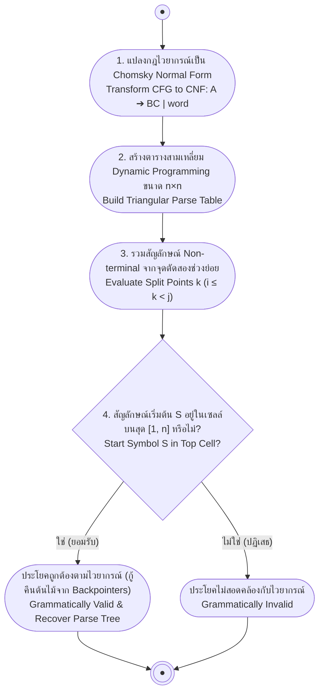

# วากยสัมพันธ์และการแจงส่วนประโยค (Syntax and Parsing)

<span class="material-symbols-outlined">arrow_back</span> กลับไปที่ [[Week3-MOC|MOC สัปดาห์ 3]]

## <span class="material-symbols-outlined">key</span> Keyword

- **Syntax Tree / Parse Tree** — โครงสร้างต้นไม้ที่แสดงความสัมพันธ์ทางไวยากรณ์ของคำในประโยค
- **Constituency Parsing** — การแจงประโยคเป็นวลีที่ซ้อนกัน (nested phrases) ตาม phrase-structure grammar
- **Dependency Parsing** — การแจงประโยคเป็นความสัมพันธ์แบบมีทิศทางระหว่างคำต่อคำโดยตรง (Head $\rightarrow$ Dependent)
- **Context-Free Grammar (CFG)** — ชุดกฎการเขียนแทนสัญลักษณ์ $(N, \Sigma, R, S)$ ที่ใช้นิยามโครงสร้างประโยค
- **Chomsky Normal Form (CNF)** — รูปแบบมาตรฐานของ CFG ที่จำกัดให้ทุกกฎอยู่ในรูป $A \rightarrow BC$ หรือ $A \rightarrow w$
- **Probabilistic CFG (PCFG)** — CFG ที่แนบค่าความน่าจะเป็นให้แต่ละกฎเพื่อแก้ปัญหาความกำกวมเชิงโครงสร้าง
- **CYK Algorithm** — อัลกอริทึม dynamic programming แบบ bottom-up ที่แจงประโยคตามกฎ CNF ในเวลา $\mathcal{O}(n^3 \cdot |G|)$
- **Transition-Based Dependency Parsing** — การสร้าง dependency tree ด้วยลำดับการกระทำ (`SHIFT`, `LEFTARC`, `RIGHTARC`) บน Stack และ Buffer ในเวลา $\mathcal{O}(n)$
- **PARSEVAL / UAS / LAS** — ตัวชี้วัดมาตรฐานสำหรับประเมินผล Constituency Parsing และ Dependency Parsing

---

## <span class="material-symbols-outlined">menu_book</span> Theory & Worked Examples (เข้าใจง่าย + พร้อมสอบ)

### 1. ทำไมต้องมี Syntax และ Parsing? (Why Syntax Matters)

ในสัปดาห์ที่ 2 เราเรียนการทำ **POS Tagging** และ **Chunking** ซึ่งให้ผลลัพธ์เป็นลำดับแบบแบนราบ (flat sequence) เช่น:

```text
I [B-NP] shot [B-VP] an [B-NP] elephant [I-NP] in [B-PP] my [B-NP] pajamas [I-NP]
```

**ข้อจำกัดของ Flat Sequence:** แม้จะรู้ชนิดของคำและขอบเขตวลีเบื้องต้น แต่ไม่สามารถบอกได้ว่าบุพบทวลี `"in my pajamas"` ขยายคำนาม `"an elephant"` หรือขยายคำกริยา `"shot"` กันแน่

**Syntax Tree (หรือ Parse Tree)** คือการแสดงโครงสร้างไวยากรณ์ของประโยคในรูปแบบต้นไม้ — แบ่งประโยคออกเป็นคำและวลี แล้วแสดงความสัมพันธ์เชิงลำดับชั้นตามกฎไวยากรณ์ที่กำหนดไว้ เปรียบเสมือน **"พิมพ์เขียว"** ที่บังคับให้ parser ต้องตัดสินใจอย่างชัดเจนว่าคำหรือวลีไหนขยายส่วนใดของประโยค

> [!important] ตัวอย่างความกำกวมเชิงโครงสร้างคลาสสิก (Structural / PP-Attachment Ambiguity)
> 1. **ประโยคคลาสสิกของ Groucho Marx:** *"I shot an elephant in my pajamas."*
>    - **การตีความที่ 1 (`PP` แนบกับ `NP`):** `[NP an elephant [PP in my pajamas]]` $\rightarrow$ ช้างสวมชุดนอนของฉันอยู่ แล้วฉันยิงมัน
>    - **การตีความที่ 2 (`PP` แนบกับ `VP`):** `[VP [VP shot an elephant] [PP in my pajamas]]` $\rightarrow$ ฉันสวมชุดนอนอยู่ตอนที่ยิงช้าง
> 2. **ประโยคกล้องโทรทรรศน์:** *"I saw the man with the telescope."*
>    - **การตีความที่ 1 (`PP` แนบกับ `VP`):** ผู้พูดใช้กล้องโทรทรรศน์ส่องดูผู้ชาย
>    - **การตีความที่ 2 (`PP` แนบกับ `NP`):** ผู้พูดเห็นผู้ชายคนที่ถือกล้องโทรทรรศน์อยู่

#### ประโยชน์หลักของ Syntactic Parsing
- **Disambiguation (การแก้ความกำกวม):** บังคับให้ระบบเลือกโครงสร้างที่สอดคล้องกับความหมายเดียวที่ชัดเจน
- **Information Extraction & QA:** สกัดความสัมพันธ์ว่า *ใคร ทำอะไร กับใคร ที่ไหน เมื่อไร* แม้อยู่ในประโยคซับซ้อน
- **Machine Translation:** ช่วยจัดเรียงลำดับคำข้ามภาษาที่มีโครงสร้างต่างกัน (เช่น อังกฤษ `Adj + Noun` vs ไทย `Noun + Adj`, หรือภาษาแบบ SVO vs SOV)
- **Grammar Checking:** เครื่องมืออย่าง Grammarly หรือ Microsoft Word ใช้ parse tree ตรวจสอบความสอดคล้องระหว่างประธานและกริยา (Subject–Verb Agreement) แม้มีวลีคั่นกลางยาว ๆ

---

### 2. สองแนวทางหลักของ Syntax Tree: Constituency vs. Dependency

ประโยคเดียวกันสามารถแจงโครงสร้างได้ 2 รูปแบบหลัก ขึ้นกับทฤษฎีภาษาศาสตร์หรือเครื่องมือที่ใช้:
1. **Constituency Trees (Phrase-Structure Grammar)** — มองประโยคเป็นการจัดกลุ่มวลีที่ซ้อนกันเป็นลำดับชั้น (nested phrases) ตั้งแต่ระดับคำจนถึงทั้งประโยค
2. **Dependency Trees (Dependency Grammar)** — มองประโยคเป็นความสัมพันธ์ทางไวยากรณ์แบบมีทิศทางระหว่างคำต่อคำโดยตรง (Head $\rightarrow$ Dependent)

#### 2.1 Constituency-based Parse Tree และการทดสอบ Constituent

**Constituent (หน่วยวากยสัมพันธ์)** คือกลุ่มของคำที่ทำหน้าที่ร่วมกันเสมือนเป็นหน่วยเดียวในประโยค โดยประกอบด้วยสัญลักษณ์หลักดังนี้:
- **S (Sentence):** ประโยค (รากของต้นไม้)
- **NP (Noun Phrase):** นามวลี เช่น `"แมวดำ"`, `"A cat with long tail"`, `"The smart professor"`
- **VP (Verb Phrase):** กริยาวลี เช่น `"วิ่งเร็ว"`, `"show me the cat"`, `"taught data science"`
- **PP (Prepositional Phrase):** บุพบทวลี เช่น `"ด้วยกล้อง"`, `"ที่โรงเรียน"`, `"in my pajamas"`
- **ADJP / ADVP:** คุณศัพท์วลี (`"สวยมาก"`) / กริยาวิเศษณ์วลี
- **POS Tags (Pre-terminals):** เช่น `DT`, `JJ`, `NN`, `VB` อยู่เหนือคำจริง (terminal nodes)

##### 4 วิธีทดสอบว่ากลุ่มคำเป็น Constituent หรือไม่ (Constituency Tests)
1. **Substitution Test (การแทนที่ด้วยคำสรรพนาม/คำเดี่ยว):**
   - ตัวอย่าง: `[NP เด็กผู้ชายคนนั้น] กินข้าว` $\rightarrow$ แทนด้วย `"เขา"` ได้เป็น `"เขากินข้าว"`
2. **Movement / Preposing Test (การย้ายตำแหน่งทั้งก้อน):**
   - ตัวอย่าง: `ฉันเจอเขา [PP ที่โรงเรียน]` $\rightarrow$ ย้ายไปต้นประโยคได้เป็น `[PP ที่โรงเรียน] ฉันเจอเขา`
3. **Coordination Test (การเชื่อมด้วยคำสันธาน `และ` / `หรือ`):**
   - ตัวอย่าง: Constituent ประเภทเดียวกันสามารถเชื่อมกันได้ เช่น `[NP แมวดำ] และ [NP หมาขาว]`
4. **Standalone / Question-Answer Fragment Test (การใช้ตอบคำถามเดี่ยว ๆ):**
   - ตัวอย่าง: ถาม *"ฉันเห็นใคร?"* $\rightarrow$ ตอบด้วยวลีเดี่ยว ๆ ได้ว่า `"[NP ช้างใส่ชุดนอน]"`

##### รูปแบบโครงสร้างประโยคพื้นฐานในภาษาอังกฤษ 7 รูปแบบ (7 Common English Syntactic Patterns)
1. **S $\rightarrow$ V** (Intransitive): *"The cat meowed."*
2. **S $\rightarrow$ V $\rightarrow$ DO** (Monotransitive): *"The cat plays the ball."*
3. **S $\rightarrow$ V $\rightarrow$ SC** (Copular / Subject Complement): *"The cat is playful."*
4. **S $\rightarrow$ V $\rightarrow$ AdvC** (Adverbial Complement): *"The cat paced slowly."*
5. **S $\rightarrow$ V $\rightarrow$ IO $\rightarrow$ DO** (Ditransitive): *"The cat gave me the ball."*
6. **S $\rightarrow$ V $\rightarrow$ DO $\rightarrow$ DC** (Object Complement): *"The cat made the ball dirty."*
7. **S $\rightarrow$ V $\rightarrow$ DO $\rightarrow$ AdvC** (Transitive + Adverbial): *"The cat perked its ears up."*

**ตัวอย่าง Constituency Tree — *"The smart professor taught data science."***

```text
S
├── NP
│   ├── DT   "The"
│   ├── JJ   "smart"
│   └── NN   "professor"
└── VP
    ├── VB   "taught"
    └── NP
        ├── NN   "data"
        └── NN   "science"
```

#### 2.2 Dependency-based Parse Tree

Dependency tree ข้ามการจัดกลุ่มวลีแบบนามธรรม (`NP`, `VP`) และมุ่งไปที่ความสัมพันธ์แบบทวิภาคที่มีทิศทาง (directed binary grammatical relations) ระหว่างคำต่อคำโดยตรง:
- **ROOT:** มักเป็นคำกริยาหลักของประโยค (Main Verb) ทำหน้าที่เป็นจุดยึดโครงสร้างทั้งหมด
- **Head (Governor) $\rightarrow$ Dependent (Modifier):** ลูกศรชี้จากคำหลักไปยังคำขยาย พร้อมกำกับป้ายชื่อความสัมพันธ์ (dependency relation)

**ตัวอย่างประโยคเดียวกัน — *"The smart professor taught data science."*** (`taught` เป็น ROOT):

| ความสัมพันธ์ (Relation) | ทิศทาง (Head $\rightarrow$ Dependent) | ความหมาย |
| :--- | :--- | :--- |
| `nsubj` | `taught` $\rightarrow$ `professor` | ประธานของกริยา (Nominal Subject) |
| `obj` (`dobj`) | `taught` $\rightarrow$ `science` | กรรมตรงของกริยา (Direct Object) |
| `det` | `professor` $\rightarrow$ `The` | คำนำหน้านาม (Determiner) |
| `amod` | `professor` $\rightarrow$ `smart` | คำคุณศัพท์ขยายนาม (Adjectival Modifier) |
| `compound` | `science` $\rightarrow$ `data` | คำนามประสม (Compound Modifier) |

#### 2.3 ตารางเปรียบเทียบ Constituency vs. Dependency Trees

| มิติเปรียบเทียบ | Constituency Trees | Dependency Trees |
| :--- | :--- | :--- |
| **โครงสร้างหลัก (Structure)** | วลีที่ซ้อนกันเป็นลำดับชั้น (`S`, `NP`, `VP`, `PP`) | ความสัมพันธ์แบบมีทิศทางระหว่างคำต่อคำโดยตรง |
| **รากของต้นไม้ (Root)** | สัญลักษณ์ประโยค (`S`) | คำกริยาหลักของประโยค (Main Verb / `ROOT`) |
| **จำนวน Node ทั้งหมด** | คำจริง (terminals) + โหนดชนิดคำ/วลี (non-terminals) | เท่ากับจำนวนคำในประโยคพอดี (1 node ต่อ 1 คำ + `ROOT`) |
| **สิ่งที่สื่อถึงได้ดีที่สุด** | การจัดกลุ่มระดับวลี (Sub-phrases / Constituency) | หน้าที่ทางไวยากรณ์ (ใครทำอะไรกับใคร: `nsubj`, `obj`) |
| **ความเหมาะสมกับลำดับคำ** | เหมาะกับภาษาที่มีลำดับคำค่อนข้างตายตัว (Fixed word order) | ยืดหยุ่นต่อภาษาที่มีลำดับคำอิสระ (Free word order) และภาษาไทย |
| **เครื่องมือที่นิยม** | Stanford PCFG Parser, Berkeley Neural Parser | `spaCy`, `Stanza`, `UDPipe`, Universal Dependencies |

> [!tip] เคล็ดลับจำเร็ว
> จำ constituency vs dependency ด้วยภาพ:
> - **Constituency** = **"กล่องซ้อนกล่อง"** (วลีอยู่ในวลี)
> - **Dependency** = **"ลูกศรเชื่อมระหว่างคำ"** (ไม่มีโหนดวลีคั่นกลาง)
> - หากต้องการเช็คเร็ว ๆ ว่าวาด dependency tree ถูกหรือไม่ **ให้นับจำนวนโหนดคำ**: ต้องเท่ากับจำนวนคำในประโยคพอดี!

---

### 3. Context-Free Grammar (CFG) และ Chomsky Normal Form (CNF)

#### 3.1 นิยามเชิงรูปนัยของ Context-Free Grammar (CFG)

**Context-Free Grammar (CFG)** หรือ Phrase-Structure Grammar ถูกนิยามด้วย 4-tuple:

$$G = (N, \Sigma, R, S)$$

1. **$N$ (Non-terminal symbols):** เซตของสัญลักษณ์นามธรรมแทนวลีหรือชนิดคำ เช่น $\{\text{S}, \text{NP}, \text{VP}, \text{PP}, \text{N}, \text{V}, \text{ADJ}\}$
2. **$\Sigma$ (Terminal symbols):** เซตของคำศัพท์จริงในภาษา (แยกจาก $N$ โดยเด็ดขาด: $N \cap \Sigma = \emptyset$) เช่น $\{\text{แมว}, \text{ดำ}, \text{กิน}, \text{ปลา}\}$
3. **$R$ (Production / Rewrite rules):** เซตของกฎการเขียนแทนในรูป $A \rightarrow \beta$ โดยที่ $A \in N$ (ฝั่งซ้ายต้องเป็น non-terminal เดี่ยว 1 ตัว) และ $\beta \in (N \cup \Sigma)^*$ (ฝั่งขวาเป็นลำดับของทั้ง terminal และ non-terminal)
4. **$S$ (Start symbol):** สัญลักษณ์เริ่มต้นของประโยค ($S \in N$)

> [!note] ทำไมจึงเรียกว่า "Context-Free" (ไม่พึ่งบริบท)?
> เพราะกฎ $A \rightarrow \beta$ อนุญาตให้เขียนแทนสัญลักษณ์ $A$ ด้วย $\beta$ ได้เสมอ **โดยไม่ขึ้นกับสัญลักษณ์ที่อยู่รอบข้าง $A$** เลย

##### เปรียบเทียบกฎ CFG ระหว่างภาษาอังกฤษและภาษาไทย
- **ภาษาอังกฤษ (Adjective นำหน้า Noun):**
  ```text
  S  -> NP VP
  NP -> DT JJ NN | NN NN
  VP -> VB NP
  DT -> "the"
  JJ -> "smart"
  NN -> "professor" | "data" | "science"
  VB -> "taught"
  ```
- **ภาษาไทย (Adjective ตามหลัง Noun):**
  ```text
  S   -> NP VP
  NP  -> N ADJ | N
  VP  -> V NP
  N   -> "แมว" | "ปลา"
  ADJ -> "ดำ"
  V   -> "กิน"
  ```
  สังเกตความแตกต่างสำคัญ: ภาษาอังกฤษใช้ `Nom -> Adj Nom` (*"black cat"*) แต่ภาษาไทยใช้ `NP -> N ADJ` (*"แมว ดำ"*)

##### การไล่แทนค่า (Derivation) ของประโยค *"แมว ดำ กิน ปลา"*
การสร้างประโยคจากสัญลักษณ์เริ่มต้น $S$ ทีละขั้น (Leftmost Derivation):

$$\begin{aligned}
\text{S} &\Rightarrow \text{NP VP} \\
&\Rightarrow \text{N ADJ VP} \\
&\Rightarrow \text{แมว ADJ VP} \\
&\Rightarrow \text{แมว ดำ VP} \\
&\Rightarrow \text{แมว ดำ V NP} \\
&\Rightarrow \text{แมว ดำ กิน NP} \\
&\Rightarrow \text{แมว ดำ กิน N} \\
&\Rightarrow \text{แมว ดำ กิน ปลา}
\end{aligned}$$

---

#### 3.2 Chomsky Normal Form (CNF) และขั้นตอนการแปลง 3 ขั้นตอน

อัลกอริทึมการแจงประโยคแบบ Dynamic Programming อย่าง **CYK** กำหนดให้ไวยากรณ์ CFG ต้องอยู่ในรูป **Chomsky Normal Form (CNF)** ซึ่งบังคับให้ทุกกฎใน $R$ ต้องอยู่ใน 2 รูปแบบนี้เท่านั้น (ต้นไม้แบบ Binary Tree):
1. **$A \rightarrow B C$** — ฝั่งขวาเป็น **Non-terminal 2 ตัวติดกันพอดี** ($B, C \in N$)
2. **$A \rightarrow w$** — ฝั่งขวาเป็น **Terminal (คำศัพท์จริง) เพียง 1 ตัว** ($w \in \Sigma$)

##### ขั้นตอนการแปลง CFG ใด ๆ ให้เป็น CNF (3 กฎหลัก)

| ปัญหาของกฎ CFG เดิม | วิธีแปลงให้เป็น CNF | ตัวอย่างจากสไลด์ |
| :--- | :--- | :--- |
| **1. Hybrid Rule**<br>(มีทั้ง Terminal และ Non-terminal ปนกันในฝั่งขวา) | สร้าง Dummy Non-terminal มารับคำศัพท์ Terminal แยกต่างหาก | กฎเดิม: `INF-VP -> to VP`<br>แปลงเป็น:<br>• `INF-VP -> TO VP`<br>• `TO -> to` |
| **2. Unit Production**<br>($A \rightarrow B$ มี Non-terminal ตัวเดียวในฝั่งขวา) | แทนที่ $B$ ด้วยฝั่งขวาของกฎที่ขยายจาก $B$ โดยตรง (ทำซ้ำจนหมด Unit Rule) | กฎเดิม: `NP -> N` และ `N -> แมว \| ปลา`<br>แปลงเป็น:<br>• `NP -> แมว \| ปลา`<br>• `N -> แมว \| ปลา` |
| **3. RHS ยาวเกิน 2 ตัว**<br>($A \rightarrow B C D \dots$ มี Non-terminal $\ge 3$ ตัว) | ยุบรวมทีละคู่ด้วยสัญลักษณ์ช่วย (Dummy Symbol $X_1, X_2, \dots$) หรือที่เรียกว่า **Binarization** | กฎเดิม: `VP -> V NP PP`<br>แปลงเป็น:<br>• `VP -> X1 PP`<br>• `X1 -> V NP` |

---

### 4. Probabilistic Context-Free Grammar (PCFG)

เมื่อประโยคมีความกำกวม CFG ธรรมดาจะคืน parse tree ที่ถูกไวยากรณ์มาให้หลายต้นโดยไม่รู้ว่าต้นไหนน่าจะเป็นไปได้มากที่สุด **Probabilistic CFG (PCFG)** จึงแนบค่าความน่าจะเป็นแบบมีเงื่อนไข $P(A \rightarrow \beta \mid A)$ ให้กับแต่ละกฎ โดยต้องสอดคล้องกับเงื่อนไข:

$$\sum_{\beta} P(A \rightarrow \beta \mid A) = 1 \quad \text{และ} \quad 0 \le P(A \rightarrow \beta \mid A) \le 1$$

#### 4.1 ความน่าจะเป็นของ Parse Tree และการเลือกต้นไม้ที่ดีที่สุด

ความน่าจะเป็นของ Parse Tree $T$ ทั้งต้น คือ **ผลคูณของความน่าจะเป็นของทุกกฎย่อย** ที่ใช้สร้างโหนด $n$ ในต้นไม้นั้น:

$$P(T, S) = P(T) = \prod_{n \in T} p(r(n))$$

เมื่อมีหลาย Parse Tree ที่เป็นไปได้สำหรับประโยค $S$ (เซต $\tau(S)$) อัลกอริทึมจะเลือกต้นไม้ที่มีความน่าจะเป็นสูงสุด:

$$\hat{T}(S) = \arg\max_{T \in \tau(S)} P(T)$$

##### ข้อสมมติความอิสระ 3 ประการของ PCFG (3 Independence Assumptions)
1. **Place Invariance:** ความน่าจะเป็นของกฎย่อยไม่ขึ้นกับตำแหน่งของคำในประโยค
2. **Context-Free (Ancestor-Free):** ความน่าจะเป็นของกฎไม่ขึ้นกับคำหรือสัญลักษณ์ที่อยู่นอก subtree นั้น
3. **Ancestor-Free / Independence of Rule Choices:** การขยายโหนดหนึ่งเป็นอิสระจากโหนดแม่และโหนดพี่น้อง

---

#### 4.2 Worked Example: การใช้ PCFG แก้ความกำกวมประโยค *"I shot an elephant in my pajamas"*

กำหนดกฎ PCFG สมมติจากสไลด์ดังนี้:

```text
S  -> NP VP           [1.0]
VP -> V NP            [0.6] | VP PP          [0.4]
NP -> N               [0.5] | N ADJ          [0.3] | NP PP          [0.2]
PP -> P NP            [1.0]
```

*(สมมติให้การแปลงระดับคำศัพท์มีค่าความน่าจะเป็นเท่ากันทั้งสองโครงสร้าง และคิดเฉพาะความน่าจะเป็นของโครงสร้างวลีหลัก)*

##### เปรียบเทียบ 2 Parse Trees:
1. **Parse A (`PP` ขยาย `NP` — "ช้างสวมชุดนอน"):**
   - กฎที่ใช้: `S -> NP VP` $[1.0]$, `NP(ประธาน) -> N` $[0.5]$, `VP -> V NP` $[0.6]$, `NP(ช้างในชุดนอน) -> NP PP` $[0.2]$, `NP(ช้าง) -> N` $[0.5]$, `PP -> P NP` $[1.0]$, `NP(ชุดนอน) -> N` $[0.5]$
   - คำนวณความน่าจะเป็น:
     $$P(\text{Parse A}) = 1.0 \times 0.5 \times 0.6 \times 0.2 \times 0.5 \times 1.0 \times 0.5 = \mathbf{0.01500}$$

2. **Parse B (`PP` ขยาย `VP` — "ฉันสวมชุดนอนตอนยิงช้าง"):**
   - กฎที่ใช้: `S -> NP VP` $[1.0]$, `NP(ประธาน) -> N` $[0.5]$, `VP(หลัก) -> VP PP` $[0.4]$, `VP(ย่อย) -> V NP` $[0.6]$, `NP(ช้าง) -> N` $[0.5]$, `PP -> P NP` $[1.0]$, `NP(ชุดนอน) -> N` $[0.5]$
   - คำนวณความน่าจะเป็น:
     $$P(\text{Parse B}) = 1.0 \times 0.5 \times 0.4 \times 0.6 \times 0.5 \times 1.0 \times 0.5 = \mathbf{0.03000}$$

> [!check] สรุปผลการตัดสินใจของ PCFG
> เนื่องจาก $P(\text{Parse B}) = 0.03000 > P(\text{Parse A}) = 0.01500$ ดังนั้น PCFG จึงเลือก **Parse B (`PP` แนบกับ `VP`)** เพราะในคลังข้อความทั่วไป กฎ `VP -> VP PP` ($0.4$) พบได้บ่อยกว่า `NP -> NP PP` ($0.2$) ถึงสองเท่า

#### 4.3 ข้อจำกัดของ PCFG และ Lexicalized PCFG
1. **ไม่ไวต่อคำศัพท์เฉพาะ (Lack of Lexical Sensitivity):** PCFG มองไม่เห็นความต่างของคำกริยาหรือคำบุพบท เช่น `"ดื่ม น้ำ ใน แก้ว"` (`ใน แก้ว` ขยาย `น้ำ`) กับ `"ดื่ม น้ำ ใน บ้าน"` (`ใน บ้าน` ขยาย `ดื่ม`) แต่ PCFG ธรรมดาจะให้โครงสร้างเดียวกันเสมอ
2. **ไม่ไวต่อตำแหน่งในโครงสร้าง (Lack of Structural Sensitivity):** เช่น `NP` ที่เป็นประธาน (Subject) มักเป็นคำสรรพนามบ่อยกว่า `NP` ที่เป็นกรรม (Object)

**วิธีแก้ — Lexicalized PCFG:** แนบ **คำหลัก (Lexical Head)** เข้าไปในสัญลักษณ์ Non-terminal ทุกตัว เช่น:

$$\text{VP(กิน)} \rightarrow \text{V(กิน)}\ \text{NP(ปลา)}$$

*(ใช้ใน Collins Parser, Charniak Parser และต่อยอดสู่ Span-based Neural Constituency Parsers ในปัจจุบัน)*

---

### 5. อัลกอริทึมการแจงประโยค: Top-Down vs. Bottom-Up และ CYK Algorithm

#### 5.1 เปรียบเทียบ Top-Down vs. Bottom-Up Parsing

| แนวทาง | หลักการทำงาน | ข้อดี | ข้อเสีย |
| :--- | :--- | :--- | :--- |
| **Top-Down (Goal-Directed)** | เริ่มจากสัญลักษณ์ `S` แล้วขยายกฎลงมาเรื่อย ๆ จนกว่าจะตรงกับคำในประโยค | ไม่เสียเวลาสร้างต้นไม้ที่ไม่สามารถต่อเข้ากับ `S` ได้ | เสียเวลาสร้างต้นไม้ที่ไม่ตรงกับคำจริงในประโยค และ **ค้างไม่รู้จบหากเจอกฎ Left Recursion** (`NP -> NP PP`) |
| **Bottom-Up (Data-Directed)** | เริ่มจากคำศัพท์จริงในประโยค แล้วจับคู่ยุบรวมขึ้นไปหา `S` | ยึดโยงกับคำที่มีอยู่จริงในประโยคเสมอ | อาจสร้างวลีย่อยที่สุดท้ายรวมเข้ากับ `S` ทั้งประโยคไม่ได้ |

---

#### 5.2 The CYK (Cocke–Younger–Kasami) Algorithm แบบละเอียด

**CYK Algorithm** คืออัลกอริทึม **Bottom-Up Dynamic Programming** ที่ใช้ตารางสามเหลี่ยมมุมบนขนาด $n \times n$ (`table[i, j]`) เก็บเซตของ Non-terminal ที่สามารถสร้างช่วงคำตั้งแต่ตำแหน่งที่ $i$ ถึง $j$ ได้ (โดยไวยากรณ์ต้องอยู่ในรูป **CNF** เท่านั้น)

##### หลักการเติมตาราง CYK
1. **Base Case (ความยาวช่วง $l = 1$, แนวทแยงมุม `table[i, i]`):**
   - สำหรับคำที่ $i$ ($w_i$) หากมีกฎ $A \rightarrow w_i$ ให้ใส่ $A$ ลงใน `table[i, i]`
2. **Recursive Step (ความยาวช่วง $l = 2, 3, \dots, n$):**
   - สำหรับช่วง $[i, j]$ ลองแบ่งครึ่งที่จุดตัด $k$ ทุกจุดที่เป็นไปได้ ($i \le k < j$)
   - หากมี $B \in \text{table}[i, k]$ และ $C \in \text{table}[k+1, j]$ และมีกฎ **$A \rightarrow B C$** ในไวยากรณ์ ให้เพิ่ม $A$ ลงใน `table[i, j]` พร้อมเก็บ backpointer ชี้ไปยัง $(k, B, C)$
3. **การตรวจสอบผลลัพธ์:**
   - หากสัญลักษณ์เริ่มต้น `S` ปรากฏอยู่ในช่องบนสุดขวาสุด **`table[1, n]`** แสดงว่าประโยคนี้ถูกต้องตามไวยากรณ์!

##### ความซับซ้อนเชิงเวลา (Time Complexity): $\mathcal{O}(n^3 \cdot |G|)$
- ตารางมีช่องที่ต้องคำนวณทั้งหมด $\frac{n(n+1)}{2}$ ช่อง ($\mathcal{O}(n^2)$) และแต่ละช่องต้องวนลูปหาจุดตัด $k$ อีก $\mathcal{O}(n)$ ครั้ง:
  - ประโยคยาว $n = 4$ คำ $\rightarrow$ มี $10$ ช่อง, ประมาณ $\sim 64$ การเช็คจุดตัด
  - ประโยคยาว $n = 10$ คำ $\rightarrow$ มี $55$ ช่อง, ประมาณ $\sim 1,000$ การเช็คจุดตัด
  - ประโยคยาว $n = 20$ คำ $\rightarrow$ มี $210$ ช่อง, ประมาณ $\sim 8,000$ การเช็คจุดตัด

---

#### 5.3 Worked Example: ตามรอยตาราง CYK ประโยค *"แมว ดำ กิน ปลา"* ($n = 4$)

กำหนดไวยากรณ์ในรูป **Chomsky Normal Form (CNF)** (หลังจากกำจัด Unit Production `NP -> N` แล้ว):

```text
S   -> NP VP
NP  -> N ADJ
VP  -> V NP
NP  -> "แมว" | "ปลา"
N   -> "แมว" | "ปลา"
ADJ -> "ดำ"
V   -> "กิน"
```

##### ขั้นตอนการคำนวณทีละระดับความยาว (Span Length):
- **Length 1 (แนวทแยงมุม `[i, i]`):**
  - `table[1, 1]` (`"แมว"`): `{N, NP}`
  - `table[2, 2]` (`"ดำ"`): `{ADJ}`
  - `table[3, 3]` (`"กิน"`): `{V}`
  - `table[4, 4]` (`"ปลา"`): `{NP, N}`
- **Length 2 (ช่วงยาว 2 คำ):**
  - `table[1, 2]` (`"แมว ดำ"`, $k=1$): จับคู่ `table[1,1]` $\times$ `table[2,2]` = `{N, NP}` $\times$ `{ADJ}` $\rightarrow$ พบกฎ `NP -> N ADJ` $\implies$ ได้ **`{NP}`**
  - `table[2, 3]` (`"ดำ กิน"`, $k=2$): `{ADJ}` $\times$ `{V}` $\rightarrow$ ไม่มีกฎรองรับ $\implies$ **`—`**
  - `table[3, 4]` (`"กิน ปลา"`, $k=3$): `{V}` $\times$ `{NP, N}` $\rightarrow$ พบกฎ `VP -> V NP` $\implies$ ได้ **`{VP}`**
- **Length 3 (ช่วงยาว 3 คำ):**
  - `table[1, 3]` (`"แมว ดำ กิน"`, $k=1, 2$): `{N, NP} × —` และ `{NP} × {V}` $\rightarrow$ ไม่มีกฎรองรับ $\implies$ **`—`**
  - `table[2, 4]` (`"ดำ กิน ปลา"`, $k=2, 3$): `{ADJ} × {VP}` และ `— × {NP, N}` $\rightarrow$ ไม่มีกฎรองรับ $\implies$ **`—`**
- **Length 4 (ทั้งประโยค `[1, 4]`):**
  - `table[1, 4]` (`"แมว ดำ กิน ปลา"`):
    - $k = 1$: `table[1,1]` $\times$ `table[2,4]` = `{N, NP} × —` (ไม่ได้)
    - **$k = 2$**: `table[1,2]` $\times$ `table[3,4]` = **`{NP}` $\times$ `{VP}`** $\rightarrow$ พบกฎ **`S -> NP VP`** $\implies$ ได้ **`{S}`**!
    - $k = 3$: `table[1,3]` $\times$ `table[4,4]` = `— × {NP, N}` (ไม่ได้)

##### ตาราง CYK ฉบับสมบูรณ์สำหรับ *"แมว ดำ กิน ปลา"*

| $i \backslash j$ | **1: แมว** | **2: ดำ** | **3: กิน** | **4: ปลา** |
| :---: | :---: | :---: | :---: | :---: |
| **1** | `N, NP` | **`NP`** $(k=1: \text{N}+\text{ADJ})$ | `—` | **`S`** $(k=2: \text{NP}[1,2]+\text{VP}[3,4])$ |
| **2** | | `ADJ` | `—` | `—` |
| **3** | | | `V` | **`VP`** $(k=3: \text{V}+\text{NP})$ |
| **4** | | | | `NP, N` |

**การย้อนรอย Backpointers เพื่อสร้าง Parse Tree:**
- `S @ [1,4]` มาจาก `NP @ [1,2]` + `VP @ [3,4]`
- `NP @ [1,2]` มาจาก `N @ [1,1] ("แมว")` + `ADJ @ [2,2] ("ดำ")`
- `VP @ [3,4]` มาจาก `V @ [3,3] ("กิน")` + `NP @ [4,4] ("ปลา")`

---

#### 5.4 Probabilistic CYK (PCYK) สำหรับ PCFG

เมื่อต้องการหา Parse Tree ที่มีความน่าจะเป็นสูงสุดภายใต้ PCFG เราเปลี่ยนตาราง CYK ให้เก็บค่าความน่าจะเป็นสูงสุดของแต่ละสัญลักษณ์ $A$ ในช่วง $[i, j]$:

$$\text{table}[i, j, A] = \max_{i \le k < j,\ A \rightarrow BC} \Big( P(A \rightarrow B C) \times \text{table}[i, k, B] \times \text{table}[k+1, j, C] \Big)$$

---

### 6. Dependency Grammar, Treebanks และ Transition-Based Parsing

#### 6.1 มาตรฐาน Universal Dependencies (UD)

**Universal Dependencies (UD)** คือมาตรฐานสากลที่กำหนดชุดความสัมพันธ์ทางไวยากรณ์ 37 ชนิดครอบคลุมกว่า 100 ภาษาทั่วโลก เหมาะกับภาษาไทยอย่างยิ่งเนื่องจากภาษาไทยไม่มีการผันรูปคำ (no inflection) และมีลำดับคำที่ยืดหยุ่น:

| หมวดหมู่ | Relation | ความหมาย | ตัวอย่างภาษาไทย |
| :--- | :--- | :--- | :--- |
| **Core Arguments** | `nsubj` | ประธานของกริยา (Nominal Subject) | `กิน` $\rightarrow$ `เด็ก` (*เด็กกินข้าว*) |
| | `obj` | กรรมตรง (Direct Object) | `กิน` $\rightarrow$ `ข้าว` (*เด็กกินข้าว*) |
| | `iobj` | กรรมรอง (Indirect Object) | `ให้` $\rightarrow$ `ฉัน` (*เขาให้หนังสือฉัน*) |
| | `ccomp` | อนุประโยคที่เป็นกรรม (Clausal Complement) | `พูด` $\rightarrow$ `ไป` (*เขาพูดว่าจะไป*) |
| **Nominal Modifiers** | `nmod` | คำนาม/บุพบทวลีขยายนาม (Nominal Modifier) | `โต๊ะ` $\rightarrow$ `ไม้` |
| | `amod` | คำคุณศัพท์ขยายนาม (Adjectival Modifier) | `แมว` $\rightarrow$ `ดำ` |
| | `det` | คำบ่งชี้/กำหนดนาม (Determiner) | `แมว` $\rightarrow$ `นี้` (*แมวตัวนี้*) |
| | `case` | คำบุพบทกำกับนาม (Case Marking) | `กล้อง` $\rightarrow$ `ด้วย` (*ด้วยกล้อง*) |
| **Coordination** | `conj` | คำที่เชื่อมเข้าด้วยกัน (Conjunct) | `แมว` $\rightarrow$ `หมา` (*แมวและหมา*) |
| | `cc` | คำสันธานเชื่อม (Coordinating Conjunction) | `หมา` $\rightarrow$ `และ` |

---

#### 6.2 เงื่อนไขเชิงรูปนัยของ Dependency Tree และ Projectivity

กราฟระบุทิศทาง $G = (V, A)$ จะเป็น **Dependency Tree** ที่ถูกต้องเมื่อครบ 3 เงื่อนไข:
1. **Single Root:** โหนด `ROOT` ไม่มีลูกศรพุ่งเข้าหาตัวเองเลย (In-degree $= 0$)
2. **Single Head:** ทุกโหนดคำศัพท์ (ยกเว้น `ROOT`) ต้องมีลูกศรพุ่งเข้าหาตัวเอง **เพียง 1 เส้นเท่านั้น** (มี Head เพียงตัวเดียว)
3. **Connected & Acyclic (Unique Path):** มีเส้นทางเดินจาก `ROOT` ไปยังทุกคำในประโยคได้เพียงเส้นทางเดียว (ไม่มีวงจรปิด และจำนวนเส้นเชื่อมทั้งหมดเท่ากับจำนวนคำ $n$ พอดี)

##### Projectivity (ความเป็นระนาบเดียวกันของเส้นเชื่อม)
- **Projective Dependency Tree:** เมื่อเรียงคำตามลำดับในประโยคแล้วลากเส้นเชื่อมเหนือคำ **จะไม่มีเส้นเชื่อมใดตัดกันเลย (No Crossing Arcs)** เช่น *"United canceled the morning flights to Houston"*
- **Non-Projective Dependency Tree:** มีเส้นเชื่อมข้ามตัดกัน มักเกิดในประโยคที่มีการย้ายส่วนขยายข้ามวลี เช่น *"JetBlue canceled our flight this morning which was already late"* (`flight` $\rightarrow$ `late` ข้าม `this morning`)
  - *ข้อควรจำ:* อัลกอริทึม `Arc-Standard` พื้นฐานสร้างได้เฉพาะ **Projective Trees** เท่านั้น!

##### Treebanks และการเรียนรู้ไวยากรณ์จากข้อมูล (Grammar Induction)
- **Treebanks สำคัญ:**
  1. **Penn Treebank (PTB):** คลังประโยคภาษาอังกฤษจาก Wall Street Journal (Constituency)
  2. **Universal Dependencies (UD):** คลัง Dependency มาตรฐานกว่า 100 ภาษา
  3. **ORCHID / Thai UD (NECTEC):** คลังข้อมูลภาษาไทยสำหรับงาน POS และ Parsing
- **การประมาณค่าความน่าจะเป็นกฎ PCFG จาก Treebank (MLE):**
  $$P(A \rightarrow \beta \mid A) = \frac{\text{Count}(A \rightarrow \beta)}{\text{Count}(A)}$$
- นอกจากนี้สามารถแปลง Constituency Treebank ให้เป็น Dependency Treebank ได้โดยใช้ **Head-Finding Rules** (กำหนดว่าลูกตัวใดเป็น Head ของแต่ละวลี)

---

#### 6.3 Transition-Based Dependency Parsing (Arc-Standard, Nivre 2003)

**Transition-based parser** ใช้แนวคิดคล้าย shift-reduce parser ในคอมไพเลอร์ โดยทำงานในเวลาเชิงเส้น **$\mathcal{O}(n)$** (ใช้จำนวนก้าวทั้งหมด $2n$ ก้าวสำหรับประโยคยาว $n$ คำ)

##### องค์ประกอบของสถานะ (Configuration)
ประกอบด้วย 3 ส่วน: **`(Stack, Buffer, Relations)`**
- **สถานะเริ่มต้น:** `Stack = [ROOT]`, `Buffer = [w1, w2, ..., wn]`, `Relations = {}`
- **สถานะสิ้นสุด:** `Stack = [ROOT]`, `Buffer = []` (ว่างเปล่า)
- กำหนดให้ $s_1$ คือคำบนสุดของ Stack (Top of Stack) และ $s_2$ คือคำถัดลงมา (Second on Stack)

##### การกระทำ 3 รูปแบบ (3 Transition Actions in Arc-Standard)

| การกระทำ (Action) | เงื่อนไขก่อนทำ (Precondition) | ผลลัพธ์ต่อ Stack และ Buffer | เส้นเชื่อมที่ได้ (Arc Added) |
| :--- | :--- | :--- | :--- |
| **`SHIFT`** | Buffer ยังไม่ว่าง | ย้ายคำแรกสุดของ Buffer ไปวางบนสุดของ Stack | — |
| **`LEFTARC(r)`** | Stack มี $\ge 2$ ตัว และ **$s_2 \ne \text{ROOT}$** | ลบ $s_2$ ออกจาก Stack | เพิ่มเส้นเชื่อม **$s_1 \xrightarrow{r} s_2$**<br>(บนสุด $s_1$ เป็น Head, ตัวรอง $s_2$ เป็น Dependent) |
| **`RIGHTARC(r)`** | Stack มี $\ge 2$ ตัว | ลบ $s_1$ ออกจาก Stack | เพิ่มเส้นเชื่อม **$s_2 \xrightarrow{r} s_1$**<br>(ตัวรอง $s_2$ เป็น Head, บนสุด $s_1$ เป็น Dependent) |

---

#### 6.4 Worked Example: ตามรอย Transition-Based Parser ประโยค *"เด็ก กิน ข้าว"* ($n = 3$)

ประโยคมีความยาว $n = 3$ คำ จึงใช้การกระทำทั้งหมด $2n = 6$ ขั้นตอน:

| Step | Stack | Buffer | Action ที่เลือก | Arc ที่เพิ่มเข้าเซตผลลัพธ์ |
| :---: | :--- | :--- | :--- | :--- |
| **0 (Init)** | `[ROOT]` | `[เด็ก, กิน, ข้าว]` | `SHIFT` | — |
| **1** | `[ROOT, เด็ก]` | `[กิน, ข้าว]` | `SHIFT` | — |
| **2** | `[ROOT, เด็ก, กิน]` | `[ข้าว]` | **`LEFTARC(nsubj)`** | `กิน` $\xrightarrow{\text{nsubj}}$ `เด็ก` *(ลบ `เด็ก` ออกจาก Stack)* |
| **3** | `[ROOT, กิน]` | `[ข้าว]` | `SHIFT` | — |
| **4** | `[ROOT, กิน, ข้าว]` | `[]` | **`RIGHTARC(obj)`** | `กิน` $\xrightarrow{\text{obj}}$ `ข้าว` *(ลบ `ข้าว` ออกจาก Stack)* |
| **5** | `[ROOT, กิน]` | `[]` | **`RIGHTARC(root)`** | `ROOT` $\xrightarrow{\text{root}}$ `กิน` *(ลบ `กิน` ออกจาก Stack)* |
| **6 (Done)** | `[ROOT]` | `[]` | **จบการทำงาน** | ได้ Dependency Tree ครบทั้ง 3 เส้นเชื่อม |

##### กฎของ Training Oracle (วิธีเลือก Action ตอนสร้างข้อมูลสอนโมเดล)
ในขั้นตอนฝึกสอน **Oracle** จะดู Gold Dependency Tree แล้วตัดสินใจเลือก Action ณ แต่ละก้าวดังนี้:
1. เลือก **`LEFTARC(r)`** ทันที หากในเฉลยมีเส้นเชื่อม $(s_1 \xrightarrow{r} s_2)$
2. เลือก **`RIGHTARC(r)`** หากในเฉลยมีเส้นเชื่อม $(s_2 \xrightarrow{r} s_1)$ **และคำ $s_1$ เก็บลูก (dependents) ของตัวเองครบหมดทุกตัวแล้ว** *(สำคัญมาก: เพราะ `RIGHTARC` จะลบ $s_1$ ออกจาก Stack ถาวร หากยังเก็บลูกของ $s_1$ ที่อยู่ใน Buffer ไม่ครบ จะไม่สามารถเชื่อมลูกเหล่านั้นเข้ากับ $s_1$ ได้อีก!)*
3. มิฉะนั้น ให้เลือก **`SHIFT`**

##### Neural Parsers และ Graph-Based Parsing
- **Neural Transition-Based Parser (Chen & Manning, 2014; Kiperwasser & Goldberg, 2016):** ใช้โครงข่ายประสาท (เช่น BiLSTM เข้ารหัสคำในประโยค แล้วดึงเวกเตอร์ของคำบน Stack $s_1, s_2$ และ Buffer $b_1$ เข้า MLP + Softmax) เพื่อทำนาย Action ถัดไปโดยไม่ต้องออกแบบ feature ด้วยมือ
- **Graph-Based Dependency Parsing (McDonald et al., 2005; Dozat & Manning, 2017 Biaffine Parser):** ให้คะแนนทุกคู่คำที่เป็นไปได้ในกราฟ แล้วใช้อัลกอริทึม **Chu–Liu–Edmonds Maximum Spanning Tree (MST)** ค้นหาต้นไม้ที่มีคะแนนรวมสูงสุด (รองรับ **Non-Projective Trees** ได้โดยตรง!)

---

### 7. การประเมินผล Parser (Evaluation Metrics & Worked Examples)

#### 7.1 การประเมินผล Constituency Parsing: มาตรฐาน PARSEVAL

เปรียบเทียบเซตของวลีย่อย `(Label, start_index, end_index)` ระหว่างต้นไม้ที่ระบบทำนาย (System Parse) กับเฉลย (Gold Parse):

$$\text{Labeled Precision (LP)} = \frac{\text{\# Correct Constituents in System Parse}}{\text{\# Total Constituents in System Parse}}$$

$$\text{Labeled Recall (LR)} = \frac{\text{\# Correct Constituents in System Parse}}{\text{\# Total Constituents in Gold Parse}}$$

$$F_1 = \frac{2 \times \text{LP} \times \text{LR}}{\text{LP} + \text{LR}}$$

*(นอกจากนี้ยังมี **Cross-Brackets** ซึ่งนับจำนวนครั้งที่ขอบเขตวลีของระบบไขว้ทับซ้อนกับเฉลย เช่น ระบบจัด `((A B) C)` แต่เฉลยคือ `(A (B C))`)*

##### Worked Example: คำนวณ PARSEVAL บนประโยค *"แมว ดำ กิน ปลา"* (ตำแหน่งคำ 1 ถึง 4)
- **Gold Constituents (4 ก้อน):** `S(1,4)`, `NP(1,2)`, `VP(3,4)`, `NP(4,4)`
- **System Constituents (4 ก้อน):** `S(1,4)`, `NP(1,2)`, `VP(3,4)`, `NP(3,4)` *(ทำนายขอบเขต `NP` ตัวสุดท้ายผิดเป็น `(3,4)` แทนที่จะเป็น `(4,4)`)*
- **คำนวณคะแนน:**
  - จำนวน Constituent ที่ตรงกันทั้งป้ายชื่อและขอบเขต $= 3$ ก้อน (`S(1,4)`, `NP(1,2)`, `VP(3,4)`)
  - $\text{Precision} = \frac{3}{4} = \mathbf{0.750}$ ($75\%$)
  - $\text{Recall} = \frac{3}{4} = \mathbf{0.750}$ ($75\%$)
  - $F_1 = \mathbf{0.750}$ ($75\%$)

---

#### 7.2 การประเมินผล Dependency Parsing: UAS และ LAS

วัดความแม่นยำรายคำ (คำนวณจากคำทั้งหมด $N$ คำในประโยค):
1. **UAS (Unlabeled Attachment Score):** สัดส่วนของคำที่ทาย **Head ถูกต้อง** (ไม่สนใจว่าป้ายชื่อความสัมพันธ์จะถูกหรือไม่)
   $$\text{UAS} = \frac{\text{\# Words with Correct Head}}{\text{Total Words } N}$$
2. **LAS (Labeled Attachment Score):** สัดส่วนของคำที่ทาย **ทั้ง Head และ Dependency Label ถูกต้องพร้อมกัน**
   $$\text{LAS} = \frac{\text{\# Words with Correct Head AND Correct Label}}{\text{Total Words } N}$$

##### Worked Example: คำนวณ UAS และ LAS บนประโยค *"เด็ก เห็น ผู้ชาย ด้วย กล้อง"* ($N = 5$ คำ)

| ลำดับคำ | คำศัพท์ | Gold (Head / Label) | System (Head / Label) | Head ถูกไหม? (UAS) | Head + Label ถูกไหม? (LAS) |
| :---: | :--- | :--- | :--- | :---: | :---: |
| 1 | `เด็ก` | `เห็น` / `nsubj` | `เห็น` / `nsubj` | ✓ | ✓ |
| 2 | `เห็น` | `ROOT` / `root` | `ROOT` / `root` | ✓ | ✓ |
| 3 | `ผู้ชาย` | `เห็น` / `obj` | `เห็น` / `iobj` | ✓ *(Head ถูก)* | ✗ *(Label ผิด)* |
| 4 | `ด้วย` | `กล้อง` / `case` | `กล้อง` / `case` | ✓ | ✓ |
| 5 | `กล้อง` | `เห็น` / `obl` | `ผู้ชาย` / `nmod` | ✗ *(แนบผิดที่)* | ✗ |

- **สรุปคะแนน:**
  - $\text{UAS} = \frac{4}{5} = \mathbf{80\%}$
  - $\text{LAS} = \frac{3}{5} = \mathbf{60\%}$

---

## <span class="material-symbols-outlined">schema</span> Diagram



**สรุปความซับซ้อน:**
- **CYK / PCYK (Constituency Parsing):** $\mathcal{O}(n^3 \cdot |G|)$ — รับประกันการหา parse tree ทั้งหมด (หรือต้นไม้ที่ความน่าจะเป็นสูงสุด) ตามกฎ CNF
- **Arc-Standard Transition-Based (Dependency Parsing):** $\mathcal{O}(n)$ ($2n$ ก้าว) — เร็วมากและนิยมใช้ในระบบ NLP ใช้งานจริง (`spaCy`, `Stanza`)

---
<span class="material-symbols-outlined">arrow_forward</span> กลับไปที่ [[Week3-MOC|MOC สัปดาห์ 3]]
