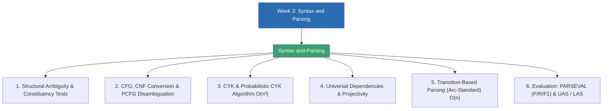

# Week 3 — Syntax and Parsing (MOC)

arrow_back สัปดาห์ก่อนหน้า: [[Week2-MOC|MOC สัปดาห์ 2]]

## check_circle เช็คลิสต์ก่อนเข้าเรียนและเตรียมสอบ

- [ ] เข้าใจปัญหาความกำกวมเชิงโครงสร้าง (PP-Attachment Ambiguity) เช่น *"I shot an elephant in my pajamas"* และ *"I saw the man with the telescope"* — ดู [[Syntax-and-Parsing]]
- [ ] ทบทวน 4 วิธีทดสอบหน่วยวากยสัมพันธ์ (Constituency Tests: Substitution, Movement, Coordination, Question-Answer) และเปรียบเทียบ Constituency Tree vs. Dependency Tree — ดู [[Syntax-and-Parsing]]
- [ ] ฝึกแปลงกฎ Context-Free Grammar (CFG) ให้เป็น **Chomsky Normal Form (CNF)** ทั้ง 3 กรณี (Hybrid Rules, Unit Productions, RHS $> 2$) — ดู [[Syntax-and-Parsing]]
- [ ] ฝึกคำนวณความน่าจะเป็นของต้นไม้ด้วย **PCFG** เพื่อเลือก Parse Tree ที่ดีที่สุด — ดู [[Syntax-and-Parsing]]
- [ ] ฝึกไล่ตาราง **CYK Algorithm** ขนาด $n \times n$ บนประโยค `"แมว ดำ กิน ปลา"` และเข้าใจความซับซ้อน $\mathcal{O}(n^3 \cdot |G|)$ — ดู [[Syntax-and-Parsing]]
- [ ] ฝึกไล่สถานะ `(Stack, Buffer, Relations)` ของ **Transition-Based Dependency Parsing (Arc-Standard)** ด้วย `SHIFT`, `LEFTARC`, `RIGHTARC` บนประโยค `"เด็ก กิน ข้าว"` ($\mathcal{O}(n)$, $2n$ ก้าว) — ดู [[Syntax-and-Parsing]]
- [ ] คำนวณตัวชี้วัด **PARSEVAL (Precision, Recall, $F_1$)** และ **Dependency Metrics (UAS vs. LAS)** ได้ด้วยมือ — ดู [[Syntax-and-Parsing]]

## assignment ภาพรวมสัปดาห์ 3 (สรุปย่อ)

สัปดาห์นี้เจาะลึกการวิเคราะห์โครงสร้างไวยากรณ์ของประโยค (**Syntax & Parsing**) ครอบคลุม 6 หัวใจสำคัญจากสไลด์บรรยาย 53 หน้า:
1. **Why Syntax Matters & Structural Ambiguity** — ทำไมลำดับ POS/Chunk แบบแบนราบจึงไม่เพียงพอ และการแก้ความกำกวมด้วยโครงสร้างต้นไม้
2. **Constituency Trees & Syntactic Patterns** — การจัดกลุ่มวลีซ้อนกัน (`S`, `NP`, `VP`, `PP`), การทดสอบ Constituency 4 วิธี และรูปแบบประโยคพื้นฐาน 7 แบบ
3. **CFG, CNF & PCFG** — นิยามเชิงรูปนัย $(N, \Sigma, R, S)$, ความต่างของไวยากรณ์ไทย-อังกฤษ (`NP -> N ADJ` vs `Nom -> Adj Nom`), การแปลงเป็น Chomsky Normal Form (CNF) 3 ขั้นตอน และการถ่วงน้ำหนักความน่าจะเป็นด้วย PCFG / Lexicalized PCFG
4. **Constituency Parsing Algorithms (CYK & PCYK)** — เปรียบเทียบ Top-Down vs. Bottom-Up และการเติมตารางสามเหลี่ยม CYK แบบ Dynamic Programming ในเวลา $\mathcal{O}(n^3 \cdot |G|)$
5. **Dependency Grammar & Transition-Based Parsing** — มาตรฐาน Universal Dependencies (UD), เงื่อนไขกราฟ Dependency, Projectivity และอัลกอริทึม Arc-Standard (`SHIFT`, `LEFTARC`, `RIGHTARC`) พร้อมกฎของ Training Oracle
6. **Evaluation Metrics** — การวัดผล Constituency ด้วย PARSEVAL ($\text{LP}, \text{LR}, F_1$) และการวัดผล Dependency ด้วย $\text{UAS}$ และ $\text{LAS}$

## map แผนที่หัวข้อสัปดาห์ 3

## collections_bookmark โน้ตรายหัวข้อ

| หัวข้อ | เนื้อหาหลัก | หน้าสไลด์ |
| --- | --- | --- |
| [[Syntax-and-Parsing]] | Structural ambiguity, Constituency vs. Dependency, CFG & CNF conversion, PCFG worked example, CYK walkthrough (`"แมว ดำ กิน ปลา"`), UD & Projectivity, Arc-Standard trace (`"เด็ก กิน ข้าว"`), PARSEVAL & UAS/LAS | 1–53 |

> [!tip] จุดที่มักออกสอบและมักสับสน
> 1. **CFG vs. CNF vs. CYK:** **CFG** คือชุดกฎไวยากรณ์ทั่วไป ส่วน **CYK** คืออัลกอริทึมเติมตารางที่บังคับว่าต้องแปลง CFG ให้เป็น **CNF** ($A \rightarrow BC$ หรือ $A \rightarrow w$) ก่อนเสมอ
> 2. **LEFTARC vs. RIGHTARC ใน Arc-Standard:** ทั้งคู่มอง 2 คำบนสุดของ Stack (`[... s2, s1]`) โดย `LEFTARC` ชี้ลูกศรจากขวาไปซ้าย ($s_1 \rightarrow s_2$, ลบ $s_2$) ส่วน `RIGHTARC` ชี้ลูกศรจากซ้ายไปขวา ($s_2 \rightarrow s_1$, ลบ $s_1$ เมื่อ $s_1$ เก็บลูกครบแล้วเท่านั้น)
> 3. **UAS vs. LAS:** $\text{UAS}$ ดูแค่ว่าชี้หาคำหลัก (Head) ถูกตัวไหม ส่วน $\text{LAS}$ ต้องถูกทั้งคำหลักและชื่อความสัมพันธ์ (Label) ดังนั้น $\text{LAS} \le \text{UAS}$ เสมอ

arrow_forward สัปดาห์ถัดไป: [[Week4-MOC|MOC สัปดาห์ 4]]
