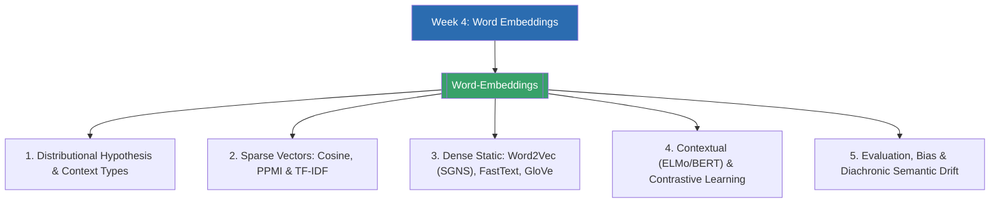

# Week 4 — Word Embeddings (MOC)

arrow_back สัปดาห์ก่อนหน้า: [[Week3-MOC|MOC สัปดาห์ 3]]

## check_circle เช็คลิสต์ก่อนเข้าเรียนและเตรียมสอบ

- [ ] อธิบายข้อจำกัดของ One-Hot Encoding และหลักการ **Distributional Hypothesis** (*"You shall know a word by the company it keeps"*, ตัวอย่างคำว่า `"ตงฉ่าย"`) — ดู [[Word-Embeddings]]
- [ ] แยกความแตกต่างระหว่างความสัมพันธ์แบบ **Paradigmatic** (`ไทย ↔ ญี่ปุ่น`) กับ **Syntagmatic** (`ไทย ↔ กรุงเทพ`) — ดู [[Word-Embeddings]]
- [ ] ฝึกคำนวณ **Cosine Similarity**, **PMI / PPMI**, และ **TF-IDF** ด้วยมือจากตารางตัวอย่าง (`แมว`, `หมา`, `คน` และเอกสาร `d1, d2, d3`) — ดู [[Word-Embeddings]]
- [ ] เข้าใจปัญหา **Rare Word Bias ของ PMI** (ตัวอย่างคำว่า `"เหมียว"`) และวิธีแก้ด้วย $P_\alpha(c)$ ($\alpha = 0.75$) — ดู [[Word-Embeddings]]
- [ ] เขียนสมการ Loss และเข้าใจขั้นตอนการฝึก **Word2Vec Skip-gram with Negative Sampling (SGNS)**, **FastText (Character $n$-grams)** และ **GloVe (Co-occurrence Ratios)** — ดู [[Word-Embeddings]]
- [ ] อธิบายปัญหา **Polysemy** ของ Static Embeddings (ตัวอย่างคำว่า `"ขัน"` 3 ความหมาย) และวิธีแก้ด้วย **Contextual Embeddings (ELMo, BERT)** — ดู [[Word-Embeddings]]
- [ ] เข้าใจการประเมินผลเวกเตอร์คำ (Word Similarity, Parallelogram Analogy), ปัญหาอคติทางเพศ/อาชีพ (AI Bias) และขั้นตอนวิเคราะห์ **Semantic Drift (Orthogonal Procrustes)** — ดู [[Word-Embeddings]]

## assignment ภาพรวมสัปดาห์ 4 (สรุปย่อ)

สัปดาห์นี้วางรากฐานการแทนความหมายของคำด้วยเวกเตอร์ (**Vector Semantics & Word Embeddings**) ครอบคลุมสไลด์บรรยาย 38 หน้า:
1. **Distributional Hypothesis & Contexts** — จากข้อจำกัดของ One-Hot Vector สู่การอนุมานความหมายจากบริบทแวดล้อม (Document vs. Window $\pm k$ vs. Dependency)
2. **Sparse Vector Representations & Worked Examples** — การสร้าง Term–Document และ Word–Context Matrix พร้อมการคำนวณ **Cosine Similarity**, **PMI / PPMI** (และการแก้ Rare Word Bias ด้วย $\alpha = 0.75$) และ **TF-IDF**
3. **Dense Static Embeddings (Word2Vec, FastText, GloVe)** — การเรียนรู้เวกเตอร์ความหนาแน่นสูงด้วย **Skip-gram with Negative Sampling (SGNS)**, การใช้หน่วยคำย่อยระดับอักขระใน **FastText** เพื่อแก้ปัญหา OOV และคำประสมไทย, และการแยกตัวประกอบอัตราส่วนความน่าจะเป็นทั่วคลังใน **GloVe**
4. **Contextual & Sentence Embeddings** — การก้าวข้ามข้อจำกัดเรื่องคำหลายความหมาย (`"ขัน"`) สู่เวกเตอร์ที่ปรับตามบริบทประโยค (**ELMo, BERT, RoBERTa**) และการฝึก Sentence Embeddings ด้วย **Contrastive Learning** (**MUSE, SimCSE, BGE, CLIP**)
5. **Evaluation, Visualization, Ethics & Semantic Drift** — การประเมินผลแบบ Intrinsic/Extrinsic, การลดมิติด้วย PCA/t-SNE/UMAP, ปัญหาอคติในเวกเตอร์คำ และการวิเคราะห์การเปลี่ยนแปลงความหมายของคำตามกาลเวลา (**Orthogonal Procrustes** และกฎของ Hamilton et al., 2016)

## map แผนที่หัวข้อสัปดาห์ 4

## collections_bookmark โน้ตรายหัวข้อ

| หัวข้อ | เนื้อหาหลัก | หน้าสไลด์ |
| --- | --- | --- |
| [[Word-Embeddings]] | Distributional hypothesis (`"ตงฉ่าย"`), Cosine similarity, PMI/PPMI & Rare word bias, TF-IDF worked examples, Word2Vec SGNS equations, FastText subwords, GloVe ratios, Polysemy (`"ขัน"`) & Contextual embeddings, Evaluation, Ethics, Semantic Drift (Procrustes) | หน้า 1–38 |

> [!tip] จุดที่มักออกสอบและมักสับสน
> 1. **TF-IDF / PPMI vs. Word Embeddings:** TF-IDF และ PPMI เป็น **Sparse (Explicit) Vectors** ที่มีความยาวเท่ากับจำนวนเอกสารหรือขนาดคำศัพท์ ส่วน Word2Vec/FastText/GloVe เป็น **Dense (Implicit) Vectors** มิติต่ำ ($d = 100\text{–}300$)
> 2. **Word2Vec vs. FastText เมื่อเจอคำ OOV:** Word2Vec คืนเวกเตอร์ให้คำที่ไม่เคยเห็นตอนฝึกไม่ได้เลย แต่ **FastText** สร้างเวกเตอร์ให้คำ OOV ได้จากการนำเวกเตอร์ของ Character $n$-grams ย่อยมารวมกัน
> 3. **Static vs. Contextual:** Word2Vec/GloVe ให้เวกเตอร์เดิมเสมอสำหรับคำว่า `"ขัน"` ทุกความหมาย (1 vector per **word type**) ในขณะที่ BERT ให้เวกเตอร์คนละตัวตามประโยคที่ปรากฏ (1 vector per **word instance/token**)

arrow_forward สัปดาห์ถัดไป: [[Week5-MOC|MOC สัปดาห์ 5]]
