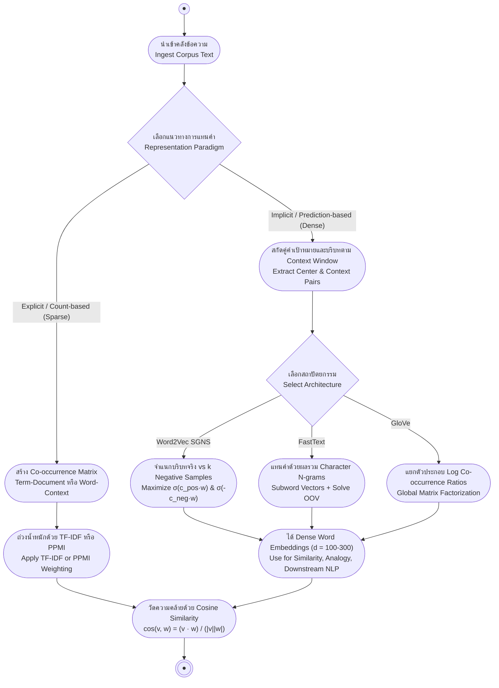

# การแทนคำด้วยเวกเตอร์ (Word Embeddings)

arrow_back กลับไปที่ [[Week4-MOC|MOC สัปดาห์ 4]]

## key Keyword

- **Distributional Hypothesis** — แนวคิด *"You shall know a word by the company it keeps"* (Firth, 1957) ที่ระบุว่าความหมายของคำอนุมานได้จากบริบทที่คำนั้นปรากฏร่วม
- **Sparse Vector (Explicit Representation)** — เวกเตอร์มิติสูงตามขนาดคำศัพท์ ($|V|$ หรือ $D$) ที่สร้างจากการนับความถี่และถ่วงน้ำหนักด้วย **TF-IDF** หรือ **PPMI**
- **Dense Vector (Word Embedding)** — เวกเตอร์ค่าจริงความหนาแน่นสูงมิติต่ำ ($d \approx 50\text{–}1000$, นิยม $100\text{–}300$) ที่เรียนรู้ความหมายแฝงจากคลังข้อความ
- **Cosine Similarity** — ตัวชี้วัดความคล้ายคลึงระหว่างเวกเตอร์สองตัวจากค่าโคไซน์ของมุม ($\frac{\mathbf{v} \cdot \mathbf{w}}{|\mathbf{v}||\mathbf{w}|}$)
- **PMI / PPMI (Positive Pointwise Mutual Information)** — มาตรวัดทางทฤษฎีสารสนเทศที่วัดว่าคำ $w$ และบริบท $c$ ปรากฏร่วมกันมากกว่าความบังเอิญเพียงใด
- **Word2Vec (Skip-gram with Negative Sampling - SGNS / CBOW)** — โมเดลฝึกเวกเตอร์คำแบบ self-supervised จากการจำแนกบริบทจริง (positive) เทียบกับคำสุ่มรบกวน (negative samples)
- **FastText** — โมเดลแทนคำด้วยผลรวมของ **Character N-grams** ช่วยแก้ปัญหาคำนอกคลัง (OOV) และคำประสมภาษาไทย
- **GloVe (Global Vectors)** — โมเดลที่เรียนรู้เวกเตอร์จากอัตราส่วนความน่าจะเป็นการปรากฏร่วมทั่วทั้งคลังข้อความ (Global Co-occurrence Ratios)
- **Static vs. Contextual Embeddings** — ความแตกต่างระหว่างการให้ 1 เวกเตอร์ต่อ **word type** (Word2Vec/GloVe) กับการให้เวกเตอร์ตามบริบทต่อ **word token/instance** (ELMo/BERT)
- **Diachronic Analysis (Semantic Drift)** — การวิเคราะห์การเปลี่ยนแปลงความหมายของคำตามกาลเวลาด้วยการหมุนจัดแนวปริภูมิเวกเตอร์ (Orthogonal Procrustes)

---

## menu_book Theory & Worked Examples (เข้าใจง่าย + พร้อมสอบ)

### 1. จาก Symbolic (One-Hot) สู่ Distributional Representation

#### 1.1 ข้อจำกัดของ One-Hot Encoding (Symbolic Representation)
การแทนคำแบบ **One-Hot Vector** กำหนดเวกเตอร์ขนาดเท่ากับจำนวนคำศัพท์ทั้งหมดในคลัง ($|V|$, เช่น $50,000$ มิติ) โดยมีค่าเป็น $1$ ที่ดัชนีของคำนั้นเพียงตำแหน่งเดียว และเป็น $0$ ในทุกตำแหน่งที่เหลือ:
- **ปัญหาความเบาบางและมิติสูง (High-dimensional & Sparse):** สิ้นเปลืองหน่วยความจำและการคำนวณ
- **ปัญหาความตั้งฉาก (Orthogonality / No Similarity):** ผลคูณภายใน (dot product) ระหว่างคำที่ต่างกันเป็น $0$ เสมอ ไม่ว่าคำคู่นั้นจะมีความหมายใกล้กันหรือไม่:
  $$\mathbf{v}_{\text{แมว}} \cdot \mathbf{v}_{\text{หมา}} = 0 \quad \text{และ} \quad \mathbf{v}_{\text{แมว}} \cdot \mathbf{v}_{\text{คอมพิวเตอร์}} = 0$$
- **ปัญหา OOV (Out-of-Vocabulary):** ไม่สามารถแทนคำใหม่ที่ไม่เคยเห็นตอนสร้างพจนานุกรมได้เลย

#### 1.2 Distributional Hypothesis (Firth, 1957)
> *"You shall know a word by the company it keeps."* (เราจะรู้ความหมายของคำได้จากเพื่อนบ้านที่อยู่รอบ ๆ คำนั้น)

**การทดลองเดาความหมายจากบริบทภาษาไทย (สไลด์หน้า 4):** สมมติเราไม่รู้จักคำว่า **`"ตงฉ่าย"`** แต่เห็นประโยคตัวอย่างต่อไปนี้:
- *"เขาสั่ง **ตงฉ่าย** มากินกับข้าวต้ม"*
- *"ใส่ **ตงฉ่าย** ในต้มจืดหมูสับเพิ่มรสชาติ"*
- *"**ตงฉ่าย** เค็มไปหน่อย ต้องล้างน้ำก่อน"*

แม้ไม่เคยเห็นคำนี้มาก่อน เราก็อนุมานได้ทันทีว่า **`"ตงฉ่าย"`** คือของกิน/เครื่องปรุงที่มีรสเค็มและใช้ใส่ในอาหารน้ำหรือกินกับข้าวต้ม เพราะมันปรากฏในบริบทเดียวกับคำอาหารอื่น ๆ

##### ความสัมพันธ์ทางภาษาศาสตร์ 2 มิติ และชนิดของบริบท (Context Types)
- **Paradigmatic Relation (ความสัมพันธ์แนวตั้ง / แทนที่กันได้):** คำที่ปรากฏในบริบทเดียวกันและสลับแทนที่กันได้ เช่น `ไทย` $\leftrightarrow$ `ญี่ปุ่น`, `แมว` $\leftrightarrow$ `หมา`
- **Syntagmatic Relation (ความสัมพันธ์แนวนอน / ปรากฏร่วมกัน):** คำที่มักวางคู่หรือปรากฏในประโยคเดียวกัน เช่น `ไทย` $\leftrightarrow$ `กรุงเทพ`, หรือ **Collocations** เช่น `น้ำ+ตก`, `ตั้ง+ใจ`, `ทำ+งาน`, `ข้าว+ผัด`
- **3 รูปแบบของการนิยาม Context:**
  1. **Document Context:** คำที่ปรากฏในเอกสารเดียวกัน $\rightarrow$ จับความสัมพันธ์เชิงหัวข้อ (**Topical similarity** เช่น `หมอ`–`โรงพยาบาล`)
  2. **Window Context ($\pm k$ คำรอบข้าง):**
     - หน้าต่างแคบ ($k = \pm 1\text{ ถึง }\pm 2$): จับหน้าที่ทางไวยากรณ์และชนิดคำ (**Syntactic / Paradigmatic**)
     - หน้าต่างกว้าง ($k = \pm 5\text{ ถึง }\pm 10$): จับความหมายเชิงหัวข้อและบริบทแวดล้อม (**Semantic / Syntagmatic**)
  3. **Syntactic Dependency Context:** คำที่เชื่อมกันด้วยเส้น Dependency (เช่น กริยากับกรรมตรง)

---

### 2. Sparse Vector Representations: Co-occurrence Matrix, Cosine, PPMI และ TF-IDF

การแทนคำแบบ **Explicit (Sparse) Vectors** สร้างจากเมทริกซ์การปรากฏร่วมกัน (Co-occurrence Matrix) 2 รูปแบบหลัก:
1. **Term–Document Matrix ($|V| \times D$):** แถวคือคำศัพท์ ($|V|$) คอลัมน์คือเอกสาร ($D$) นิยมถ่วงน้ำหนักด้วย **TF-IDF** (ใช้ในระบบค้นคืนสารสนเทศ Information Retrieval)
2. **Term–Term / Word–Context Matrix ($|V| \times |V|$):** ทั้งแถวและคอลัมน์คือคำศัพท์ในคลัง บันทึกจำนวนครั้งที่คำเป้าหมาย $w$ ปรากฏใกล้คำบริบท $c$ ภายในหน้าต่าง $\pm k$ นิยมถ่วงน้ำหนักด้วย **PPMI**

---

#### 2.1 Worked Example 1: การคำนวณ Cosine Similarity จาก Word–Context Matrix (สไลด์หน้า 9)

เพื่อวัดความคล้ายคลึงของเวกเตอร์สองตัวโดยไม่ให้ขนาดความยาวของเวกเตอร์ (ความถี่รวมของคำ) มาบิดเบือนผลลัพธ์ เราใช้ **Cosine Similarity**:

$$\text{cosine}(\mathbf{v}, \mathbf{w}) = \frac{\mathbf{v} \cdot \mathbf{w}}{|\mathbf{v}||\mathbf{w}|} = \frac{\sum_{i=1}^{N} v_i w_i}{\sqrt{\sum_{i=1}^{N} v_i^2} \sqrt{\sum_{i=1}^{N} w_i^2}}$$

กำหนดตารางความถี่การปรากฏร่วมระหว่างคำเป้าหมาย 3 คำ (`แมว`, `หมา`, `คน`) กับคำบริบท 4 คำ (`กิน`, `อาหาร`, `อ่าน`, `หนังสือ`):

| คำเป้าหมาย ($w$) \ บริบท ($c$) | `กิน` | `อาหาร` | `อ่าน` | `หนังสือ` | **ผลรวมแถว $\text{count}(w)$** |
| :--- | :---: | :---: | :---: | :---: | :---: |
| **`แมว`** | $50$ | $30$ | $1$ | $0$ | **$81$** |
| **`หมา`** | $45$ | $35$ | $0$ | $1$ | **$81$** |
| **`คน`** | $40$ | $25$ | $35$ | $50$ | **$150$** |
| **ผลรวมคอลัมน์ $\text{count}(c)$** | **$135$** | **$90$** | **$36$** | **$51$** | **รวมทั้งหมด $N = 312$** |

##### ขั้นตอนคำนวณ $\cos(\text{แมว}, \text{หมา})$:
1. **Dot Product ($\mathbf{v}_{\text{แมว}} \cdot \mathbf{v}_{\text{หมา}}$):**
   $$\mathbf{v}_{\text{แมว}} \cdot \mathbf{v}_{\text{หมา}} = (50 \times 45) + (30 \times 35) + (1 \times 0) + (0 \times 1) = 2250 + 1050 + 0 + 0 = \mathbf{3300}$$
2. **ขนาดของแต่ละเวกเตอร์ ($|\mathbf{v}|$):**
   $$|\mathbf{v}_{\text{แมว}}| = \sqrt{50^2 + 30^2 + 1^2 + 0^2} = \sqrt{2500 + 900 + 1} = \sqrt{3401} \approx \mathbf{58.318}$$
   $$|\mathbf{v}_{\text{หมา}}| = \sqrt{45^2 + 35^2 + 0^2 + 1^2} = \sqrt{2025 + 1225 + 1} = \sqrt{3251} \approx \mathbf{57.018}$$
3. **หารเพื่อหาค่า Cosine Similarity:**
   $$\cos(\text{แมว}, \text{หมา}) = \frac{3300}{58.318 \times 57.018} = \frac{3300}{3325.18} \approx \mathbf{0.9924}$$
4. **เปรียบเทียบกับคู่คำอื่น:**
   - $\cos(\text{แมว}, \text{คน}) \approx \mathbf{0.6191}$
   - $\cos(\text{หมา}, \text{คน}) \approx \mathbf{0.6196}$
   - สรุป: `แมว` และ `หมา` มีเวกเตอร์ชี้ไปในทิศทางเดียวกันเกือบสนิท ($0.9924$) เพราะมีรูปแบบการปรากฏร่วมกับบริบทเหมือนกัน

---

#### 2.2 Worked Example 2: PMI และ PPMI (Positive Pointwise Mutual Information) (สไลด์หน้า 10–11)

ความถี่ดิบ (Raw Frequency) มีข้อเสียคือคำที่พบบ่อยในทุกบริบท (เช่น `"กิน"` หรือคำเชื่อม `"ที่"`, `"ของ"`) จะมีค่าสูงเสมอแม้ไม่ได้มีความจำเพาะเจาะจงกับคำนั้น **Pointwise Mutual Information (PMI)** จึงวัดว่าคำ $w$ และบริบท $c$ ปรากฏร่วมกันบ่อยกว่ากรณีที่ทั้งสองเป็นอิสระต่อกันกี่เท่า:

$$\text{PMI}(w, c) = \log_2 \frac{P(w, c)}{P(w)P(c)} = \log_2 \frac{\frac{\text{count}(w, c)}{N}}{\frac{\text{count}(w)}{N} \cdot \frac{\text{count}(c)}{N}} = \log_2 \frac{N \cdot \text{count}(w, c)}{\text{count}(w) \cdot \text{count}(c)}$$

เนื่องจากค่า PMI ที่ติดลบ ($\text{PMI} < 0$) มักไม่น่าเชื่อถือในคลังข้อความขนาดจำกัด เราจึงตัดค่าติดลบให้เป็น $0$ เรียกว่า **Positive PMI (PPMI)**:

$$\text{PPMI}(w, c) = \max\big(\text{PMI}(w, c),\ 0\big)$$

##### ขั้นตอนคำนวณ $\text{PPMI}(\text{แมว}, \text{กิน})$ จากตารางเดิม ($N = 312$):
- $P(\text{แมว}, \text{กิน}) = \frac{50}{312} \approx 0.1603$
- $P(\text{แมว}) = \frac{81}{312} \approx 0.2596$
- $P(\text{กิน}) = \frac{135}{312} \approx 0.4327$
- แทนค่าในสูตร PMI:
  $$\text{PMI}(\text{แมว}, \text{กิน}) = \log_2 \left(\frac{0.1603}{0.2596 \times 0.4327}\right) = \log_2 \left(\frac{0.1603}{0.1123}\right) = \log_2(1.4266) \approx \mathbf{+0.513}$$

##### ตารางเมทริกซ์ PPMI ฉบับสมบูรณ์:

| คำเป้าหมาย ($w$) \ บริบท ($c$) | `กิน` | `อาหาร` | `อ่าน` | `หนังสือ` |
| :--- | :---: | :---: | :---: | :---: |
| **`แมว`** | **$0.513$** | **$0.361$** | $0$ $(\text{PMI} < 0)$ | $0$ |
| **`หมา`** | **$0.361$** | **$0.583$** | $0$ | $0$ $(\text{PMI} < 0)$ |
| **`คน`** | $0$ $(\text{PMI} < 0)$ | $0$ $(\text{PMI} < 0)$ | **$1.016$** | **$1.028$** |

> [!check] ผลลัพธ์หลังแปลงเป็น PPMI
> เมื่อใช้ PPMI คำนวณ Cosine Similarity อีกครั้ง จะได้ $\cos_{\text{PPMI}}(\text{แมว}, \text{คน}) = \mathbf{0.00}$! เพราะ PPMI ตัดอิทธิพลของคำทั่วไป (`กิน`, `อาหาร` ที่คนก็ทำแต่ไม่ได้เด่นเท่ากับ `อ่าน`, `หนังสือ`) ออกไป ทำให้แยกกลุ่มสัตว์เลี้ยงออกจากคนได้อย่างเด็ดขาด

---

#### 2.3 Worked Example 3: ปัญหาอคติต่อคำหายากของ PMI (Rare Word Bias) และวิธีแก้ (สไลด์หน้า 12)

**จุดอ่อนสำคัญของ PMI:** หากคำบริบท $c$ เป็นคำที่หายากมาก (เช่น ปรากฏเพียง $1$ ครั้งในคลัง) ค่า $\text{PMI}(w, c)$ จะพุ่งสูงผิดปกติ!
- **ตัวอย่างการคำนวณ:** สมมติแทนคอลัมน์ `หนังสือ` ด้วยคำหายาก **`"เหมียว"`** ซึ่งปรากฏคู่กับ `แมว` เพียง $1$ ครั้งเดียวในคลัง ($N = 262$, $\text{count}(\text{แมว}) = 82$, $\text{count}(\text{เหมียว}) = 1$):
  $$\text{PMI}(\text{แมว}, \text{เหมียว}) = \log_2 \frac{262 \times 1}{82 \times 1} = \log_2(3.195) = \mathbf{1.676}$$
  สังเกตว่า $\text{PMI}(\text{แมว}, \text{เหมียว}) = 1.676$ สูงกว่า $\text{PMI}(\text{แมว}, \text{กิน}) = 0.513$ เกือบ 3 เท่า ทั้งที่เห็นแค่ครั้งเดียว!

##### 2 วิธีแก้ปัญหา Rare Word Bias ใน PPMI:
1. **Laplace Add-$k$ Smoothing** (เช่น บวกค่าคงที่ $k = 2$ ลงในทุกช่องก่อนคำนวณความน่าจะเป็น)
2. **Context Distribution Smoothing ($P_\alpha(c)$):** ยกกำลังความถี่ของคำบริบทด้วยค่า $\alpha = 0.75$ เพื่อเพิ่มความน่าจะเป็นของคำบริบทหายากในตัวส่วน:
   $$\text{PPMI}_\alpha(w, c) = \max\left(\log_2 \frac{P(w, c)}{P(w) P_\alpha(c)},\ 0\right), \qquad P_\alpha(c) = \frac{\text{count}(c)^\alpha}{\sum_{c'} \text{count}(c')^\alpha}$$

---

#### 2.4 Worked Example 4: การถ่วงน้ำหนักด้วย TF-IDF (สไลด์หน้า 13)

สำหรับ Term–Document Matrix เราถ่วงน้ำหนักคำ $t$ ในเอกสาร $d$ ด้วยผลคูณของ **Term Frequency (TF)** และ **Inverse Document Frequency (IDF)**:

$$\text{tf}_{t, d} = \log_{10}(\text{count}(t, d) + 1), \qquad \text{idf}_t = \log_{10}\left(\frac{N}{\text{df}_t}\right), \qquad \text{tf-idf}(t, d) = \text{tf}_{t, d} \times \text{idf}_t$$

*(หมายเหตุ: ในบางตำราอาจนิยาม $\text{tf}_{t,d} = 1 + \log_{10}\text{count}(t,d)$ เมื่อ $\text{count} > 0$ ส่วนในตารางสไลด์หน้า 13 คำนวณด้วยสูตร $\log_{10}(\text{count}(t,d)+1)$)*

##### ตารางตัวอย่างการคำนวณ TF-IDF บนคลังเอกสาร $N = 3$ ฉบับ (`d1, d2, d3`):

| คำศัพท์ ($t$) | Count ใน `d1` | Count ใน `d2` | Count ใน `d3` | $\text{df}_t$ | $\text{idf}_t = \log_{10}(3/\text{df}_t)$ | ตัวอย่างค่า $\text{tf-idf}$ |
| :--- | :---: | :---: | :---: | :---: | :---: | :--- |
| **`เปิด`** | $3$ | $2$ | $0$ | $2$ | $\log_{10}(3/2) = \mathbf{0.176}$ | ใน `d1`: $\log_{10}(3+1) \times 0.176 = 0.602 \times 0.176 = \mathbf{0.106}$ |
| **`ที่`** *(คำทั่วไป)* | $10$ | $8$ | $9$ | $3$ | $\log_{10}(3/3) = \mathbf{0.000}$ | ในทุกเอกสาร: $\text{tf} \times 0 = \mathbf{0.000}$ *(ถูกตัดน้ำหนักทิ้งอัตโนมัติ)* |
| **`รถ`** *(คำเฉพาะ)* | $0$ | $0$ | $5$ | $1$ | $\log_{10}(3/1) = \mathbf{0.477}$ | ใน `d3`: $\log_{10}(5+1) \times 0.477 = 0.778 \times 0.477 = \mathbf{0.371}$ |

---

#### 2.5 เปรียบเทียบ Sparse (Explicit) vs. Dense (Implicit) Vectors (สไลด์หน้า 14)

| คุณสมบัติ | Explicit / Sparse Vectors (TF-IDF, PPMI) | Implicit / Dense Embeddings (Word2Vec, GloVe, FastText) |
| :--- | :--- | :--- |
| **จำนวนมิติ (Dimensionality)** | สูงมาก ($|V| \approx 50,000\text{–}500,000$ หรือจำนวนเอกสาร $D$) | ต่ำและกะทัดรัด ($d = 50\text{–}1,000$, นิยม $100\text{–}300$) |
| **ลักษณะของค่าในเวกเตอร์** | ส่วนใหญ่เป็นเลข $0$ (Sparse) | ค่าจริงเกือบทุกตำแหน่งไม่เป็นศูนย์ (Dense Real-valued) |
| **ความหมายของแต่ละมิติ** | ตีความได้โดยตรง (แต่ละมิติคือคำบริบทหรือเอกสาร 1 รายการ) | เป็นคุณลักษณะแฝง (Latent features) ตีความแยกมิติเดี่ยว ๆ ไม่ได้ |
| **ความสามารถในการวางนัยทั่วไป** | ต่ำกว่า (หากคำสองคำไม่เคยใช้คำบริบทตัวเดียวกันเป๊ะ ค่าจะห่างกัน) | สูงกว่ามาก (สรุปความหมายร่วมและลดปัญหา Overfitting ในโมเดลปลายทาง) |

---

### 3. Dense Static Embeddings: Word2Vec, FastText และ GloVe

#### 3.1 Word2Vec: Skip-gram และ CBOW (Mikolov et al., 2013)

แทนที่จะนับความถี่ทั่วคลัง **Word2Vec** เปลี่ยนโจทย์เป็นการฝึกตัวจำแนกแบบ **Self-Supervised Learning** (ไม่ต้องใช้คนนั่งติดป้ายกำกับ เพราะคำข้างเคียงในข้อความจริงคือเฉลยในตัวอยู่แล้ว):
- **Skip-gram:** รับคำเป้าหมายตรงกลาง $w$ ($1$ คำ) $\rightarrow$ ทำนายคำบริบทรอบข้าง $c$ ภายในหน้าต่าง $\pm L$ (ทำงานได้ดีมากกับข้อมูลขนาดเล็กและคำหายาก)
- **CBOW (Continuous Bag-of-Words):** รับผลรวม/ค่าเฉลี่ยของคำบริบทรอบข้าง $\rightarrow$ ทำนายคำเป้าหมายตรงกลาง $w$ (ฝึกเร็วกว่าและเด่นกับคำที่พบบ่อย)

##### สมการคณิตศาสตร์ของ Skip-gram with Negative Sampling (SGNS) (สไลด์หน้า 16–18)
การคำนวณ Softmax เต็มรูปแบบเหนือคำศัพท์ทั้งคลัง $|V|$ มีต้นทุนสูงเกินไป **SGNS** จึงลดรูปเป็น **Binary Logistic Regression** ที่แยกแยะระหว่างคู่คำบริบทจริง $(w, c_{pos})$ กับคู่คำสุ่มรบกวน $(w, c_{neg_i})$ จำนวน $k$ คำ:

1. **ความน่าจะเป็นที่ $(w, c)$ เป็นคู่บริบทจริง:**
   $$P(+ \mid w, c) = \sigma(\mathbf{c} \cdot \mathbf{w}) = \frac{1}{1 + e^{-\mathbf{c} \cdot \mathbf{w}}}$$
2. **ความน่าจะเป็นที่ $(w, c)$ ไม่ใช่คู่บริบทจริง (Negative pair):**
   $$P(- \mid w, c) = 1 - P(+ \mid w, c) = \sigma(-\mathbf{c} \cdot \mathbf{w})$$
3. **ฟังก์ชันความสูญเสีย (SGNS Loss Function ต่อ 1 คู่บวกและ $k$ คู่ลบ):**
   $$L_{\text{SGNS}}(w, c_{pos}, c_{neg_{1..k}}) = -\left[ \log \sigma(\mathbf{c}_{pos} \cdot \mathbf{w}) + \sum_{i=1}^{k} \log \sigma(-\mathbf{c}_{neg_i} \cdot \mathbf{w}) \right]$$
   - **เป้าหมาย:** ดันผลคูณภายใน $\mathbf{c}_{pos} \cdot \mathbf{w}$ ให้มีค่าสูง (เวกเตอร์ชี้ทางเดียวกัน) และผลัก $\mathbf{c}_{neg_i} \cdot \mathbf{w}$ ให้มีค่าติดลบ (เวกเตอร์ชี้คนละทาง)
4. **การสุ่มคำลบ (Noise Distribution):** สุ่มตามความถี่ยกกำลัง $\alpha = 0.75$ เพื่อเพิ่มโอกาสให้คำหายากถูกสุ่มมาเป็นตัวล่อมากขึ้น:
   $$P_\alpha(w) = \frac{\text{count}(w)^{0.75}}{\sum_{w'} \text{count}(w')^{0.75}}$$
5. **สมการอัปเดตพารามิเตอร์ด้วย Stochastic Gradient Descent (Eq. 5.25–5.27):**
   $$\mathbf{c}_{pos}^{t+1} = \mathbf{c}_{pos}^{t} - \eta \big[\sigma(\mathbf{c}_{pos}^{t} \cdot \mathbf{w}^{t}) - 1\big]\mathbf{w}^{t}$$
   $$\mathbf{c}_{neg_i}^{t+1} = \mathbf{c}_{neg_i}^{t} - \eta \big[\sigma(\mathbf{c}_{neg_i}^{t} \cdot \mathbf{w}^{t})\big]\mathbf{w}^{t}$$
   $$\mathbf{w}^{t+1} = \mathbf{w}^{t} - \eta \left[ \big(\sigma(\mathbf{c}_{pos}^{t} \cdot \mathbf{w}^{t}) - 1\big)\mathbf{c}_{pos}^{t} + \sum_{i=1}^{k} \sigma(\mathbf{c}_{neg_i}^{t} \cdot \mathbf{w}^{t})\mathbf{c}_{neg_i}^{t} \right]$$
   *(โดยแต่ละคำจะมี 2 เมทริกซ์คือ Target Matrix $\mathbf{W}$ และ Context Matrix $\mathbf{C}$ หลังฝึกเสร็จนิยมใช้ $\mathbf{W}$ เดี่ยว ๆ หรือนำ $\mathbf{W} + \mathbf{C}$ มาบวกกัน)*

##### ตาราง Hyperparameters สำคัญในการฝึก Word2Vec (สไลด์หน้า 19)

| Hyperparameter | ค่ามาตรฐานที่นิยม | ผลกระทบต่อเวกเตอร์ที่ได้ |
| :--- | :---: | :--- |
| **Embedding Dimension ($d$)** | $100\text{–}300$ | สูงขึ้นจับความหมายละเอียดขึ้น แต่ถ้าสูงเกินไปจะ Overfit และใช้เวลาฝึกนาน |
| **Context Window Size ($L$)** | $\pm 2\text{ ถึง }\pm 10$ | เล็ก ($\pm 2$) จับชนิดคำ/ไวยากรณ์ (Syntactic); ใหญ่ ($\pm 5\text{–}10$) จับหัวข้อ/ความหมาย (Semantic) |
| **Negative Samples ($k$)** | $5\text{–}20$ | คลังใหญ่ใช้ $k = 2\text{–}5$, คลังเล็กใช้ $k = 5\text{–}20$ |
| **Minimum Word Count (`min_count`)** | $5$ | ตัดคำที่ปรากฏน้อยกว่าเกณฑ์ทิ้งเพื่อลด Noise และขนาดพจนานุกรม |
| **Subsampling Frequent Words ($t$)** | $10^{-3}\text{ ถึง }10^{-5}$ | สุ่มข้ามคำที่พบบ่อยมาก (เช่น `"ที่"`, `"การ"`, `"the"`) เพื่อให้ฝึกเร็วขึ้นและเวกเตอร์คำสำคัญแม่นขึ้น |

> [!warning] ข้อควรระวังสำหรับภาษาไทย
> คุณภาพของ Word2Vec ภาษาไทยขึ้นอยู่กับ **คุณภาพของการตัดคำ (Word Segmentation)** โดยตรง! หากตัดคำผิด เช่น ตัด `"ตากลม"` หรือ `"แม่ค้า"` ผิดตั้งแต่ต้น เวกเตอร์ที่ได้จะปะปนความหมายทันที

---

#### 3.2 FastText: Subword Embeddings ด้วย Character N-grams (Bojanowski et al., 2017)

**ข้อจำกัดของ Word2Vec:** มองแต่ละคำเป็นหน่วยทึบ (atomic unit) จึงไม่เข้าใจโครงสร้างหน่วยคำย่อย (morphology) และ **สร้างเวกเตอร์ให้คำที่ไม่เคยเห็นตอนฝึก (OOV) ไม่ได้เลย**

**FastText** แก้ปัญหานี้โดยแทนแต่ละคำด้วย **ผลรวมของเวกเตอร์คำเต็มและ Character $n$-grams** (ปกติใช้ $n = 3$ ถึง $6$) พร้อมใส่สัญลักษณ์ขอบคำ `<` และ `>`:
- **ตัวอย่างภาษาอังกฤษ ($n = 3$):** คำว่า `"where"`
  - ขอบเขตคำเต็ม: `<where>`
  - Character 3-grams: `<wh`, `whe`, `her`, `ere`, `re>`
- **ตัวอย่างภาษาไทย ($n = 3$):** คำว่า `"ความสุข"`
  - แยกเป็น: `<คว`, `ควา`, `วาม`, `ามส`, `มสุ`, `สุข`, `ุข>` + `<ความสุข>`
- **จุดเด่นสำคัญต่อภาษาไทย:**
  1. สร้างเวกเตอร์ให้คำ **OOV หรือคำสะกดผิดเล็กน้อย** ได้ทันทีจากการรวมเวกเตอร์ตัวอักษรย่อย
  2. แชร์ความรู้ระหว่างคำประสมที่มีหน่วยคำร่วมกัน เช่น `ความ+สุข`, `ความ+รัก`, `ความ+สงบ` หรือ `นัก+เรียน`, `นัก+ร้อง`

---

#### 3.3 GloVe: Global Vectors for Word Representation (Pennington et al., 2014)

**GloVe** ผสานจุดเด่นของ 2 โลกเข้าด้วยกัน คือใช้ **สถิติการปรากฏร่วมทั่วทั้งคลังข้อความ (Global Co-occurrence Matrix $X_{ij}$)** เหมือน PPMI/SVD แต่ฝึกให้ได้เวกเตอร์ความหนาแน่นสูงที่จับโครงสร้างเชิงเส้นเหมือน Word2Vec

##### แนวคิดหลักจากอัตราส่วนความน่าจะเป็นร่วม (Co-occurrence Probability Ratios — สไลด์หน้า 21)
พิจารณาคำเป้าหมาย 2 คำคือ $i = \text{ice}$ (น้ำแข็ง) และ $j = \text{steam}$ (ไอน้ำ) เทียบกับคำบริบททดสอบ $k$:

| ค่าที่วัด | $k = \text{solid}$ (ของแข็ง) | $k = \text{gas}$ (ก๊าซ) | $k = \text{water}$ (น้ำ — เกี่ยวกับทั้งคู่) | $k = \text{fashion}$ (แฟชั่น — ไม่เกี่ยวเลย) |
| :--- | :---: | :---: | :---: | :---: |
| $P(k \mid \text{ice})$ | $1.9 \times 10^{-4}$ | $6.6 \times 10^{-5}$ | $3.0 \times 10^{-3}$ | $1.7 \times 10^{-5}$ |
| $P(k \mid \text{steam})$ | $2.2 \times 10^{-5}$ | $7.8 \times 10^{-4}$ | $2.2 \times 10^{-3}$ | $1.8 \times 10^{-5}$ |
| **อัตราส่วน $\dfrac{P(k \mid \text{ice})}{P(k \mid \text{steam})}$** | **$8.9$** $(\gg 1)$ | **$0.085$** $(\ll 1)$ | **$1.36$** $(\approx 1)$ | **$0.96$** $(\approx 1)$ |

**สมการฟังก์ชันวัตถุประสงค์ของ GloVe (Weighted Least Squares):**

$$J = \sum_{i, j=1}^{|V|} f(X_{ij}) \left( \mathbf{w}_i^T \tilde{\mathbf{w}}_j + b_i + \tilde{b}_j - \log X_{ij} \right)^2$$

โดยที่ $f(X_{ij}) = \min\left(1, \left(\frac{X_{ij}}{x_{\max}}\right)^\alpha\right)$ ทำหน้าที่ถ่วงน้ำหนักไม่ให้คู่คำที่พบบ่อยเกินไปครอบงำการฝึก

> [!note] Pretrained Vectors และการนำไปใช้งานจริง
> ในทางปฏิบัติสามารถดาวน์โหลด Pretrained Embeddings มาใช้ต่อได้ทันที เช่น `word2vec-google-news-300` (Hugging Face: `fse/word2vec-google-news-300`) หรือสำหรับภาษาไทย เช่น **`thai2fit`** และ **`fastText-th` (`cc.th.300.bin`)** ในไลบรารี **PyThaiNLP** และ **Gensim**

---

### 4. จาก Static สู่ Contextual Embeddings และ Sentence Embeddings

#### 4.1 ปัญหาคำหลายความหมาย (Polysemy Problem) ใน Static Embeddings
โมเดลยุคแรก (Word2Vec, FastText, GloVe) เป็น **Static Embeddings** คือให้ **เวกเตอร์คงที่เพียง 1 ตัวต่อ 1 รูปคำศัพท์ (1 vector per word type)** ไม่ว่าคำนั้นจะอยู่ในประโยคใด

> [!important] ตัวอย่างคำพ้องรูป/หลายความหมายในภาษาไทย: คำว่า `"ขัน"` (สไลด์หน้า 23)
> 1. *"ไก่ **ขัน** ตอนเช้า"* $\rightarrow$ **กริยา** หมายถึง ส่งเสียงร้องของไก่ (Crow)
> 2. *"เรื่องนี้น่า **ขัน** มาก"* $\rightarrow$ **วิเศษณ์/กริยา** หมายถึง ตลก ขบขัน (Funny)
> 3. *"ตักน้ำใส่ **ขัน** เงิน"* $\rightarrow$ **คำนาม** หมายถึง ภาชนะตักน้ำ (Bowl)
>
> ใน Word2Vec คำว่า `"ขัน"` ทั้ง 3 ประโยคจะได้เวกเตอร์ตัวเดียวกันเป๊ะ ซึ่งเป็นการฉายรวมทุกความหมายเข้าด้วยกัน!

#### 4.2 Contextual Embeddings (ELMo, BERT, RoBERTa)
โมเดลยุคใหม่สร้างเวกเตอร์แบบ **Dynamic / Contextual** คือให้ **เวกเตอร์ที่เปลี่ยนไปตามบริบทของประโยค (1 vector per word token/instance)**:

| มิติเปรียบเทียบ | Static Embeddings (Word2Vec, GloVe, FastText) | Contextual Embeddings (ELMo, BERT, RoBERTa) |
| :--- | :--- | :--- |
| **หน่วยของการแทนค่า** | 1 เวกเตอร์ต่อ **Word Type** (ตายตัวในตาราง Lookup) | 1 เวกเตอร์ต่อ **Word Instance / Token** ในประโยค |
| **การจัดการคำหลายความหมาย (Polysemy)** | แยกความหมายของ `"ขัน"` ในแต่ละประโยคไม่ได้ | สร้างเวกเตอร์คนละตัวให้ `"ขัน"` ตามบริบทรอบข้างได้ |
| **สถาปัตยกรรมหลัก** | Shallow Log-bilinear / 1-layer Neural Net | Multi-layer BiLSTM (**ELMo**, 2018) หรือ Transformer (**BERT**, 2018; **RoBERTa**, 2019) |
| **ต้นทุนการคำนวณขณะใช้งาน** | เร็วมาก (เพียงดึงค่าจากตาราง $O(1)$) | ต้องรัน Forward pass ผ่านโครงข่ายลึกทุกครั้งที่มีประโยคใหม่ |

#### 4.3 Sentence Embeddings และ Contrastive Learning
แนวคิดเวกเตอร์ขยายจากระดับคำไปสู่การเข้ารหัสทั้งประโยคเป็นเวกเตอร์เดียว (**Sentence Embedding** เช่น `sentence-transformers/all-MiniLM-L6-v2`) โดยอาศัย **Contrastive Learning** ที่ดึงคู่ความหมายเหมือนกัน (Positive pair) เข้าใกล้กัน และผลักคู่ที่ไม่เกี่ยวข้องกัน (Negative pair) ออกจากกัน:

| โมเดล | แนวคิดหลัก |
| :--- | :--- |
| **MUSE** | จัดแนว Word Embeddings ข้ามหลายภาษาให้อยู่ในปริภูมิเวกเตอร์ร่วมกัน (Shared Multilingual Space) |
| **SimCSE** | สร้าง Sentence Embedding แบบ Contrastive โดยใช้ Dropout Noise เป็น Data Augmentation อย่างง่าย |
| **BGE** | โมเดล Embedding อเนกประสงค์สำหรับงานค้นคืนสารสนเทศและ RAG (Retrieval-Augmented Generation) |
| **CLIP** | ฝึกคู่ภาพและข้อความด้วย Contrastive Learning จนได้ Joint Multimodal Embedding Space |

---

### 5. การประเมินผล การแสดงภาพ (Visualization) และจริยธรรม AI

#### 5.1 การประเมินผล Word Embeddings: Intrinsic vs. Extrinsic (สไลด์หน้า 28)
1. **Extrinsic Evaluation:** นำเวกเตอร์ไปเป็น Feature ในงานปลายทางจริง (เช่น NER, Sentiment Analysis, Parsing) แล้ววัดว่าคะแนน $F_1$ หรือ Accuracy ดีขึ้นหรือไม่
2. **Intrinsic Evaluation:** วัดคุณภาพของเวกเตอร์โดยตรงผ่าน 2 งานมาตรฐาน:
   - **Word Similarity / Relatedness:** คำนวณค่าสหสัมพันธ์ลำดับที่ (**Spearman's Rank Correlation $\rho$**) ระหว่างค่า Cosine Similarity ของโมเดลกับคะแนนความคล้ายที่มนุษย์ให้ (เช่น ชุดข้อมูล WordSim-353, SimLex-999 หรือคู่คำไทย เช่น `แมว–หมา` ได้คะแนนมนุษย์ $8.5/10$, `หมอ–โรงพยาบาล` $7.8/10$, `แมว–รถยนต์` $1.2/10$)
   - **Word Analogy (Parallelogram Model):** แก้โจทย์อุปมาอุปไมย *"$\mathbf{a}$ ต่อ $\mathbf{b}$ เหมือนกับ $\mathbf{a}^*$ ต่ออะไร ($\mathbf{b}^*$)"* ด้วยเลขคณิตเวกเตอร์:
     $$\hat{\mathbf{b}}^* = \arg\max_{\mathbf{x} \in V \setminus \{a, b, a^*\}} \cos(\mathbf{x},\ \mathbf{b} - \mathbf{a} + \mathbf{a}^*)$$
     - ตัวอย่างภาษาอังกฤษ: $\mathbf{v}(\text{king}) - \mathbf{v}(\text{man}) + \mathbf{v}(\text{woman}) \approx \mathbf{v}(\text{queen})$
     - ตัวอย่างภาษาไทย: $\mathbf{v}(\text{กรุงเทพ}) - \mathbf{v}(\text{ไทย}) + \mathbf{v}(\text{ญี่ปุ่น}) \approx \mathbf{v}(\text{โตเกียว})$

#### 5.2 การลดมิติเพื่อแสดงภาพ 2 มิติ (Dimensionality Reduction — สไลด์หน้า 29)
- **PCA (Principal Component Analysis):** การฉายเชิงเส้น (Linear projection) ที่รักษาความแปรปรวนสูงสุด รวดเร็วและรักษาโครงสร้างระดับมหภาค (Global structure)
- **t-SNE:** การลดมิติแบบไม่เชิงเส้น (Non-linear) ที่เน้นรักษาระยะห่างของเพื่อนบ้านใกล้เคียง (Local neighborhoods) เหมาะกับการดูกลุ่มคำ (Clusters)
- **UMAP:** เร็วกว่า t-SNE และรักษาสมดุลทั้งโครงสร้าง Local และ Global ได้ดีกว่า

#### 5.3 จริยธรรมและอคติใน Word Embeddings (Bias & Ethics — สไลด์หน้า 30)
เนื่องจากเวกเตอร์เรียนรู้จากข้อความที่มนุษย์เขียน จึงซึมซับ **อคติทางเพศ เชื้อชาติ และอาชีพ (Historical & Social Biases)** เข้ามาโดยตรง เช่น:
$$\mathbf{v}(\text{"computer programmer"}) - \mathbf{v}(\text{"man"}) + \mathbf{v}(\text{"woman"}) \approx \mathbf{v}(\text{"homemaker"})$$
- **Allocational Harm:** ระบบคัดกรองเรซูเม่อัตโนมัติให้คะแนนผู้สมัครหญิงต่ำกว่าในสายงานวิศวกรรม (เกิดความเสียเปรียบในการจัดสรรโอกาสจริง)
- **Representational Harm:** การตอกย้ำภาพเหมารวมทางสังคม (Stereotyping)
- **Bias Amplification:** โมเดลมักขยายอคติที่มีอยู่ในข้อมูลฝึกให้รุนแรงขึ้นกว่าเดิม และงานวิจัย *"Lipstick on a Pig"* (Gonen & Goldberg, 2019) ชี้ว่าการลบแกนเพศออกในเชิงเรขาคณิตเพียงผิวเผินยังไม่สามารถกำจัดกลุ่มคำที่มีอคติแฝงออกได้ทั้งหมด

---

### 6. การประยุกต์ใช้: การวิเคราะห์การเปลี่ยนความหมายตามกาลเวลา (Semantic Drift / Diachronic Analysis)

หนึ่งในงานวิจัยที่โดดเด่นที่สุดของ Word Embeddings คือการศึกษาว่าระบบความหมายของคำเปลี่ยนแปลงไปอย่างไรในแต่ละยุคสมัย (**Diachronic Historical Linguistics**, Hamilton et al., 2016 — สไลด์หน้า 32–38)

#### 6.1 5 รูปแบบของการเปลี่ยนแปลงความหมายของคำ (Types of Semantic Change)
1. **Broadening (ความหมายกว้างขึ้น):** เช่น คำว่า **`"เมาส์"`** (จากหนู $\rightarrow$ อุปกรณ์คอมพิวเตอร์)
2. **Narrowing (ความหมายแคบลง):** เช่น คำภาษาอังกฤษโบราณ **`"meat"`** (เดิมแปลว่าอาหารทุกชนิด $\rightarrow$ ปัจจุบันหมายถึงเนื้อสัตว์เท่านั้น)
3. **Pejoration (ความหมายเลวลง/กลายเป็นแง่ลบ):** เช่น **`"awful"`** (เดิมแปลว่า น่าเกรงขาม/น่าทึ่ง $\rightarrow$ ปัจจุบันแปลว่า แย่มาก)
4. **Amelioration (ความหมายดีขึ้น/กลายเป็นแง่บวก):** เช่น คำสแลงไทย **`"ปัง"`** (จากเสียงดัง $\rightarrow$ ยอดเยี่ยม/ประสบความสำเร็จมาก)
5. **Metaphorical / Slang Shift (การเปรียบเปรย/ความหมายแฝงใหม่):** เช่น คำว่า **`"เท"`** (จากกริยาเทน้ำทิ้ง $\rightarrow$ ทิ้งนัด/ทอดทิ้งเพื่อน) หรือคำอังกฤษ **`"gay"`** (จากร่าเริงสดใสในยุค 1900s $\rightarrow$ รสนิยมทางเพศในยุค 1990s) และ **`"broadcast"`** (จากการหว่านเมล็ดพันธุ์ทางการเกษตร $\rightarrow$ การกระจายเสียงวิทยุและโทรทัศน์)

#### 6.2 ขั้นตอน 5 ขั้นของการวิเคราะห์ Semantic Drift ด้วย Orthogonal Procrustes
เนื่องจาก Word2Vec มีความสุ่มในการตั้งค่าเริ่มต้น แม้ฝึกด้วยข้อมูลเดิมสองครั้ง แกนของปริภูมิเวกเตอร์ก็จะหมุนไปคนละทิศทาง จึงนำเวกเตอร์ข้ามยุคสมัยมาหา Cosine Similarity ตรง ๆ ไม่ได้ ต้องทำตาม 5 ขั้นตอนนี้:
1. **Slice Corpus by Time:** แบ่งคลังข้อความตามช่วงเวลา (เช่น ทศวรรษ $t_1, t_2, \dots$)
2. **Train Separate Embeddings:** ฝึกโมเดล Word2Vec/SGNS แยกกันในแต่ละช่วงเวลา ได้เมทริกซ์ $\mathbf{W}^{(t_1)}$ และ $\mathbf{W}^{(t_2)}$
3. **Align Vector Spaces (Orthogonal Procrustes):** หาเมทริกซ์การหมุนเชิงตั้งฉาก $\mathbf{R}$ ที่หมุนปริภูมิเวลา $t_2$ ให้ซ้อนทับกับ $t_1$ ได้สนิทที่สุด:
   $$\mathbf{R} = \arg\min_{\mathbf{\Omega} : \mathbf{\Omega}^T\mathbf{\Omega} = \mathbf{I}} \left\| \mathbf{W}^{(t_1)} - \mathbf{W}^{(t_2)}\mathbf{\Omega} \right\|_F$$
   *(คำนวณคำตอบปิดได้ด้วยการแยกค่าเอกฐาน SVD: หาก $\mathbf{M} = (\mathbf{W}^{(t_2)})^T \mathbf{W}^{(t_1)} = \mathbf{U}\mathbf{\Sigma}\mathbf{V}^T$ จะได้ $\mathbf{R} = \mathbf{U}\mathbf{V}^T$)*
4. **Measure Cosine Drift:** คำนวณระยะการเปลี่ยนความหมาย $\text{drift}(w) = 1 - \cos\big(\mathbf{w}^{(t_1)}, \mathbf{w}^{(t_2)}\mathbf{R}\big)$
5. **Qualitative Inspection:** ตรวจสอบเพื่อนบ้านที่ใกล้ที่สุด ($k$-Nearest Neighbors) ของคำนั้นในแต่ละยุคเพื่อยืนยันการเปลี่ยนบริบท

#### 6.3 กฎทางสถิติ 2 ข้อของการเปลี่ยนแปลงความหมาย (Hamilton et al., 2016)
1. **Law of Conformity (กฎแห่งความคงตัวของคำพบบ่อย):** อัตราการเปลี่ยนความหมายของคำ **แปรผกผันกับความถี่ของคำนั้น** (คำที่ใช้บ่อยมากในชีวิตประจำวันจะเปลี่ยนความหมายช้า ส่วนคำที่ใช้น้อยจะเปลี่ยนความหมายเร็วกว่า)
2. **Law of Innovation (กฎแห่งนวัตกรรมของคำหลายความหมาย):** คำที่มีหลายความหมายอยู่แล้ว (**Polysemous words**) มีแนวโน้มเกิดความหมายใหม่และเปลี่ยนความหมายเร็วกว่าคำที่มีความหมายเดียว

---

## schema Diagram

---
arrow_forward กลับไปที่ [[Week4-MOC|MOC สัปดาห์ 4]]
