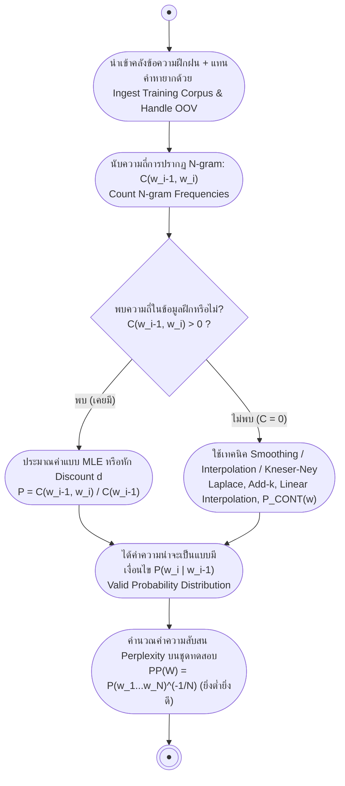

# โมเดลภาษาและ N-grams (Language Models and N-grams)

arrow_back กลับไปที่ [[Week5-MOC|MOC สัปดาห์ 5]]

## key Keyword

- **Language Model (LM)** — โมเดลที่กำหนดความน่าจะเป็นให้กับลำดับคำ $P(w_1, \dots, w_n)$ หรือทำนายคำถัดไป $P(w_n \mid w_1, \dots, w_{n-1})$
- **Chain Rule of Probability** — กฎลูกโซ่ที่แยกความน่าจะเป็นร่วมของทั้งประโยคออกเป็นผลคูณของความน่าจะเป็นแบบมีเงื่อนไขทีละคำ
- **Markov Assumption** — ข้อสมมติที่ตัดประวัติบริบทให้เหลือเพียง $N-1$ คำก่อนหน้า เพื่อให้สามารถนับความถี่และประมาณค่าได้จริง
- **N-gram** — ลำดับของคำที่ต่อเนื่องกัน $N$ ตัว (เช่น Unigram $N=1$, Bigram $N=2$, Trigram $N=3$)
- **Perplexity ($\text{PP}$)** — ตัวชี้วัดคุณภาพ LM แบบ Intrinsic ซึ่งมีค่าเท่ากับค่าเฉลี่ยเรขาคณิตผกผันของความน่าจะเป็นในชุดทดสอบ (ยิ่งต่ำยิ่งดี)
- **Out-of-Vocabulary (OOV) & `<UNK>`** — คำที่ไม่เคยปรากฏในพจนานุกรมตอนฝึก แก้ด้วยการแทนคำหายากด้วยสัญลักษณ์ `<UNK>`
- **Smoothing (Laplace, Add-$k$, Backoff, Interpolation, Kneser-Ney)** — เทคนิคกระจายมวลความน่าจะเป็นเพื่อแก้ปัญหาความถี่เป็นศูนย์ ($C = 0$)

---

## menu_book Theory & Worked Examples (เข้าใจง่าย + พร้อมสอบ)

### 1. Language Model (LM) คืออะไร และกฎลูกโซ่แห่งความน่าจะเป็น

**Language Model (LM)** คือโมเดลทางสถิติหรือโครงข่ายประสาทที่ทำหน้าที่คำนวณความน่าจะเป็นของลำดับคำ $P(w_1, w_2, \dots, w_n)$ หรือทำนายคำถัดไปจากบริบทก่อนหน้า $P(w_n \mid w_1, \dots, w_{n-1})$

#### ตัวอย่างการประยุกต์ใช้งานจริง 4 ด้าน (สไลด์หน้า 2)
1. **Speech Recognition (การรู้จำเสียงพูด):** เลือกประโยคที่เป็นธรรมชาติกว่าเมื่อเสียงคล้ายกัน เช่น:
   $$P(\text{"ฉันกินข้าว"}) > P(\text{"ฉันกินค่าว"})$$
2. **Machine Translation (การแปลภาษา):** เลือกลำดับคำที่ถูกไวยากรณ์ของภาษาปลายทาง เช่น $P(\text{"high winds tonight"}) > P(\text{"large winds tonight"})$
3. **Spelling Correction / Autocomplete:** แนะนำคำถัดไปขณะพิมพ์บนคีย์บอร์ดหรือตรวจคำผิดตามบริบท
4. **Foundation of Modern LLMs:** เป็นแกนกลางของโมเดลภาษาขนาดใหญ่ยุคปัจจุบัน (GPT, Claude, Gemini) ที่ทำงานแบบ Autoregressive Next-Token Prediction

#### Chain Rule of Probability (กฎลูกโซ่)
ความน่าจะเป็นร่วมของลำดับคำ $w_1^n = (w_1, w_2, \dots, w_n)$ แยกตัวประกอบออกได้เป็นผลคูณของความน่าจะเป็นแบบมีเงื่อนไขทีละคำ:

$$P(w_1, w_2, \dots, w_n) = P(w_1) \cdot P(w_2 \mid w_1) \cdot P(w_3 \mid w_1, w_2) \cdots P(w_n \mid w_1, \dots, w_{n-1}) = \prod_{i=1}^{n} P(w_i \mid w_1^{i-1})$$

**ตัวอย่างภาษาไทย:** สำหรับประโยค *"กิน ข้าว ผัด กระเพรา"*:

$$P(\text{กิน, ข้าว, ผัด, กระเพรา}) = P(\text{กิน}) \times P(\text{ข้าว} \mid \text{กิน}) \times P(\text{ผัด} \mid \text{กิน ข้าว}) \times P(\text{กระเพรา} \mid \text{กิน ข้าว ผัด})$$

**ปัญหาของการใช้ Chain Rule ตรง ๆ:** ประวัติคำก่อนหน้า $w_1^{i-1}$ ยาวขึ้นเรื่อย ๆ และประโยคยาว ๆ มักไม่เคยปรากฏซ้ำแบบคำต่อคำในคลังข้อมูลฝึกเลย ทำให้ไม่สามารถนับความถี่เพื่อหาค่า $P(w_n \mid w_1^{n-1})$ ได้โดยตรง

---

### 2. Markov Assumption และการประมาณค่า N-gram ด้วย MLE

#### 2.1 Markov Assumption (สไลด์หน้า 3)
เพื่อแก้ปัญหาประวัติยาวเกินไป **Markov Assumption** สมมติว่าความน่าจะเป็นของคำถัดไปขึ้นอยู่กับคำก่อนหน้าเพียง $N-1$ คำล่าสุดเท่านั้น:

$$P(w_n \mid w_1^{n-1}) \approx P(w_n \mid w_{n-N+1}^{n-1})$$

- **Bigram ($N = 2$, First-order Markov):** มองย้อนหลัง $1$ คำ $\implies P(w_n \mid w_1^{n-1}) \approx P(w_n \mid w_{n-1})$
  - ตัวอย่าง: $P(\text{ผัด} \mid \text{ฉัน กิน ข้าว}) \approx P(\text{ผัด} \mid \text{ข้าว})$
- **Trigram ($N = 3$, Second-order Markov):** มองย้อนหลัง $2$ คำ $\implies P(w_n \mid w_1^{n-1}) \approx P(w_n \mid w_{n-2}, w_{n-1})$
  - ตัวอย่าง: $P(\text{ผัด} \mid \text{ฉัน กิน ข้าว}) \approx P(\text{ผัด} \mid \text{กิน ข้าว})$

#### 2.2 การประมาณค่าความน่าจะเป็นด้วย Maximum Likelihood Estimation (MLE) (สไลด์หน้า 4)
เราประมาณค่าความน่าจะเป็นจากสัดส่วนความถี่ที่นับได้จริงในคลังข้อมูลฝึก (Relative Frequency):

$$P_{\text{MLE}}(w_n \mid w_{n-N+1}^{n-1}) = \frac{C\big(w_{n-N+1}^{n-1}\ w_n\big)}{C\big(w_{n-N+1}^{n-1}\big)}$$

- **กรณี Bigram ($N = 2$):**
  $$P_{\text{MLE}}(w_n \mid w_{n-1}) = \frac{C(w_{n-1}, w_n)}{C(w_{n-1})}$$

##### ตารางเปรียบเทียบลำดับ N-gram และ Bias–Variance Trade-off

| ลำดับ N-gram | สูตรความน่าจะเป็น | บริบทที่มองเห็น | ความเบาบางของข้อมูล (Sparsity) | สมดุล Bias–Variance |
| :--- | :--- | :---: | :---: | :--- |
| **Unigram ($N=1$)** | $P(w_i) = \dfrac{C(w_i)}{N_{\text{tokens}}}$ | $0$ คำ (อิสระจากบริบท) | ต่ำสุด | **High Bias** (ไม่รู้ลำดับคำเลย), Low Variance |
| **Bigram ($N=2$)** | $P(w_i \mid w_{i-1}) = \dfrac{C(w_{i-1}, w_i)}{C(w_{i-1})}$ | $1$ คำก่อนหน้า | ปานกลาง | สมดุลพื้นฐานสำหรับคลังขนาดเล็ก–กลาง |
| **Trigram ($N=3$)** | $P(w_i \mid w_{i-2}, w_{i-1}) = \dfrac{C(w_{i-2}, w_{i-1}, w_i)}{C(w_{i-2}, w_{i-1})}$ | $2$ คำก่อนหน้า | สูง | จับบริบทได้ดีขึ้น แต่เริ่มเจอ Count $= 0$ บ่อย |
| **4-gram ($N=4$)** | $P(w_i \mid w_{i-3}, w_{i-2}, w_{i-1})$ | $3$ คำก่อนหน้า | สูงมาก ($|V|^4$ รูปแบบที่เป็นไปได้) | Low Bias, **High Variance** (ต้องใช้คลังใหญ่มาก) |

---

### 3. การประเมินผล Language Model และ Perplexity ($\text{PP}$)

#### 3.1 Extrinsic vs. Intrinsic Evaluation และการแบ่งชุดข้อมูล (สไลด์หน้า 5)
- **Extrinsic Evaluation:** นำ LM ไปใส่ในระบบปลายทางจริง (เช่น Speech Recognition หรือ Machine Translation) แล้ววัดว่าความแม่นยำปลายทางดีขึ้นหรือไม่ — แม่นยำที่สุดแต่ใช้เวลาและทรัพยากรสูงมาก
- **Intrinsic Evaluation:** วัดความสามารถของ LM ในการทำนาย **ชุดข้อมูลทดสอบที่แยกไว้ต่างหาก (Held-out Test Set)** โดยตรงด้วยค่า **Perplexity**
- **กฎเหล็กของการแบ่งข้อมูล (Train / Dev / Test Split):** ห้ามให้ข้อมูล Test รั่วไหล (Data Leakage) เข้าไปในขั้นตอนฝึกหรือปรับพารามิเตอร์เด็ดขาด มิฉะนั้นค่า Perplexity จะต่ำเกินจริง

#### 3.2 สมการและการตีความค่า Perplexity (สไลด์หน้า 6)
**Perplexity ($\text{PP}$)** ของชุดข้อมูลทดสอบ $W = w_1 w_2 \dots w_N$ (ความยาว $N$ tokens รวม `</s>`) คือค่าเฉลี่ยเรขาคณิตผกผันของความน่าจะเป็นที่โมเดลให้กับลำดับคำทดสอบ:

$$\text{PP}(W) = P(w_1 w_2 \dots w_N)^{-\frac{1}{N}} = \sqrt[N]{\frac{1}{P(w_1 w_2 \dots w_N)}} = \sqrt[N]{\prod_{i=1}^{N} \frac{1}{P(w_i \mid w_1 \dots w_{i-1})}}$$

สำหรับ **Bigram Language Model**:

$$\text{PP}(W) = \sqrt[N]{\prod_{i=1}^{N} \frac{1}{P(w_i \mid w_{i-1})}} = \exp\left(-\frac{1}{N} \sum_{i=1}^{N} \ln P(w_i \mid w_{i-1})\right)$$

##### การตีความค่า Perplexity
1. **ยิ่งให้ความน่าจะเป็นกับชุดทดสอบสูง $\implies$ ค่า Perplexity ยิ่งต่ำ** (ดังนั้น **Perplexity ยิ่งต่ำ = โมเดลยิ่งดี**)
2. **Weighted Average Branching Factor:** ค่า Perplexity แทน "จำนวนตัวเลือกคำถัดไปเฉลี่ยที่โมเดลลังเลในแต่ละก้าว" (เช่น หากโยนลูกเต๋า 6 หน้าที่ความน่าจะเป็นเท่ากัน $\frac{1}{6}$ ทุกหน้า จะได้ $\text{PP} = \left(\left(\frac{1}{6}\right)^N\right)^{-1/N} = 6$)

##### ผลการทดลองมาตรฐานบนคลัง Wall Street Journal (WSJ Benchmark — สไลด์หน้า 6)
ฝึกบนคลัง WSJ ขนาด $38$ ล้านคำ ($|V| = 19,979$) และวัดผลบนชุดทดสอบ $1.5$ ล้านคำ:

| โมเดล N-gram | Unigram ($N=1$) | Bigram ($N=2$) | Trigram ($N=3$) |
| :--- | :---: | :---: | :---: |
| **Perplexity ($\text{PP}$) บน WSJ Test Set** | **$962$** | **$170$** | **$109$** |

*(ยิ่งเพิ่มบริบทจาก Unigram $\rightarrow$ Bigram $\rightarrow$ Trigram ความสับสนของโมเดลยิ่งลดลงอย่างชัดเจน)*

---

### 4. ปัญหา Sparsity: Zero Counts และคำนอกคลัง (`<UNK>`)

#### 4.1 ปัญหาความถี่เป็นศูนย์ (The Zero Probability Problem — สไลด์หน้า 7)
สมมติในคลังข้อมูลฝึกมีประโยคเกี่ยวกับการกินข้าว แต่ไม่เคยมีคำว่า `"ฉัน ผลไม้"` ติดกันเลย ($C(\text{ฉัน}, \text{ผลไม้}) = 0$) เมื่อเจอประโยคทดสอบที่มีคู่นี้:
1. $P_{\text{MLE}}(\text{ผลไม้} \mid \text{ฉัน}) = 0$
2. ส่งผลให้ความน่าจะเป็นของทั้งประโยคกลายเป็นศูนย์ทันที: $P(W) = \prod P(w_i \mid w_{i-1}) = 0$
3. **ไม่สามารถคำนวณค่า Perplexity ได้** เพราะต้องหารด้วยศูนย์ ($\text{PP}(W) = \frac{1}{0} = \infty$)!

#### 4.2 การจัดการคำที่ไม่เคยเห็นมาก่อน (Out-of-Vocabulary: OOV & `<UNK>`)
เพื่อสร้างระบบ **Open Vocabulary** ที่รับมือคำใหม่ตอนทดสอบได้ เราใช้ขั้นตอน 4 ขั้นดังนี้:
1. กำหนดพจนานุกรมคงที่ $V$ ตอนเริ่มต้น (เช่น เลือกเฉพาะคำที่พบบ่อยที่สุด $K$ อันดับแรก หรือคำที่มีความถี่ $\ge \text{min\_count}$)
2. แปลงทุกคำในคลังฝึกที่ **ไม่อยู่ใน $V$** ให้กลายเป็นสัญลักษณ์พิเศษ **`<UNK>`**
3. นับความถี่และประมาณค่าความน่าจะเป็นของ `<UNK>` เสมือนเป็นคำศัพท์ปกติคำหนึ่งในพจนานุกรม
4. ตอนทดสอบ (Test time) หากพบคำที่ไม่รู้จัก ให้แทนด้วย `<UNK>` แล้วดึงความน่าจะเป็นของ `<UNK>` มาใช้

---

### 5. เทคนิคการปรับเรียบความน่าจะเป็น 5 วิธี (5 Smoothing Techniques & Worked Examples)

**Smoothing (หรือ Discounting)** คือการเจียดมวลความน่าจะเป็นเล็กน้อยจากเหตุการณ์ที่พบความถี่สูง ไปแบ่งให้กับเหตุการณ์ที่มีความถี่เป็น $0$ เพื่อให้ความน่าจะเป็นทุกตัว $> 0$ และผลรวมความน่าจะเป็นยังคงเท่ากับ $1$ เสมอ

#### 5.1 วิธีที่ 1: Laplace (Add-1) Smoothing (สไลด์หน้า 8)
บวก $1$ เข้าไปในตัวเศษของทุก $n$-gram และบวกขนาดพจนานุกรม $V$ เข้าไปในตัวส่วน:

$$P_{\text{Laplace}}(w_n \mid w_{n-1}) = \frac{C(w_{n-1}, w_n) + 1}{C(w_{n-1}) + V}$$

- **ข้อดี:** เรียบง่ายที่สุด ไม่ต้องจูนพารามิเตอร์
- **ข้อเสียร้ายแรง:** ในงาน NLP จริง ขนาดคำศัพท์ $V$ ใหญ่มาก (เช่น $V = 50,000$) การบวก $+V$ ในตัวส่วนจะ **ดึงมวลความน่าจะเป็นออกจากคู่คำที่เคยพบจริงมากเกินไป** ไปแจกให้คู่คำที่ไม่เคยพบจำนวนมหาศาล ทำให้ความน่าจะเป็นเพี้ยนอย่างหนัก

#### 5.2 วิธีที่ 2: Add-$k$ Smoothing (สไลด์หน้า 8)
แทนที่จะบวก $1$ เต็ม ๆ ให้เปลี่ยนเป็นบวกค่าเศษส่วนน้อย ๆ $k$ (โดยที่ $0 < k < 1$ เช่น $k = 0.05$ หรือ $0.01$ ซึ่งเลือกปรับจูนบนชุดข้อมูล Dev set):

$$P^*_{\text{Add-}k}(w_n \mid w_{n-1}) = \frac{C(w_{n-1}, w_n) + k}{C(w_{n-1}) + kV}$$

---

#### 5.3 วิธีที่ 3 & 4: Backoff และ Linear Interpolation (สไลด์หน้า 9)
แทนที่จะแจกความน่าจะเป็นเท่ากันทุกคำ เราใช้ความรู้จาก **$N$-gram ลำดับที่ต่ำกว่า (Lower-order N-grams)** มาช่วยประเมิน:
1. **Backoff (เช่น Katz Backoff):**
   - ถ้ามีข้อมูล Trigram ($C(w_{n-2}, w_{n-1}, w_n) > 0$) $\rightarrow$ ให้ใช้ค่าจาก Trigram (ที่หักส่วนลด discounting เล็กน้อย)
   - ถ้าไม่มี Trigram เลย ($C = 0$) $\rightarrow$ ค่อย **ถอยกลับ (Backoff)** ไปใช้ Bigram $P(w_n \mid w_{n-1})$ และถ้ายังเป็น $0$ อีก จึงถอยไปใช้ Unigram $P(w_n)$
2. **Linear Interpolation (การถ่วงน้ำหนักผสมกันทุกชั้น):**
   - ผสมความน่าจะเป็นจาก Trigram, Bigram และ Unigram เข้าด้วยกันเสมอในทุกกรณี:
     $$\hat{P}(w_n \mid w_{n-2}, w_{n-1}) = \lambda_1 P(w_n \mid w_{n-2}, w_{n-1}) + \lambda_2 P(w_n \mid w_{n-1}) + \lambda_3 P(w_n)$$
     โดยที่ $\lambda_1 + \lambda_2 + \lambda_3 = 1$ และ $\lambda_i \ge 0$ (หาค่า $\lambda$ ที่เหมาะสมที่สุดจาก **Held-out Dev Corpus** ด้วยอัลกอริทึม EM)

##### Worked Example: การคำนวณ Linear Interpolation บนวลี *"กิน ข้าว ผัด"* (สไลด์หน้า 9)
ต้องการหาความน่าจะเป็นของคำว่า **`"ผัด"`** เมื่อเห็นบริบทก่อนหน้าคือ **`"กิน ข้าว"`** โดยกำหนดค่าน้ำหนัก $\lambda_1 = 0.6,\ \lambda_2 = 0.3,\ \lambda_3 = 0.1$ และสมมติว่าในคลังฝึกมีสถิติดังนี้:
- ไม่เคยพบ Trigram `"กิน ข้าว ผัด"` เลย $\implies P_{\text{MLE}}(\text{ผัด} \mid \text{กิน ข้าว}) = \mathbf{0.00}$
- พบ Bigram `"ข้าว ผัด"` บ่อย $\implies P_{\text{MLE}}(\text{ผัด} \mid \text{ข้าว}) = \mathbf{0.20}$
- พบ Unigram `"ผัด"` ในคลัง $\implies P_{\text{MLE}}(\text{ผัด}) = \mathbf{0.01}$

**แทนค่าในสูตร Linear Interpolation:**

$$\begin{aligned}
\hat{P}(\text{ผัด} \mid \text{กิน ข้าว}) &= \lambda_1 P(\text{ผัด} \mid \text{กิน ข้าว}) + \lambda_2 P(\text{ผัด} \mid \text{ข้าว}) + \lambda_3 P(\text{ผัด}) \\
&= (0.6 \times 0.00) + (0.3 \times 0.20) + (0.1 \times 0.01) \\
&= 0.000 + 0.060 + 0.001 = \mathbf{0.061}
\end{aligned}$$

*(แม้ Trigram จะเป็น $0$ แต่โมเดลยังให้ค่าความน่าจะเป็นที่สมเหตุสมผลคือ $0.061$ จากการพึ่งพา Bigram และ Unigram!)*

---

#### 5.4 วิธีที่ 5: Kneser-Ney Smoothing (Gold Standard ของ N-gram Smoothing — สไลด์หน้า 10)

**Kneser-Ney Smoothing** (Kneser & Ney, 1995; Chen & Goodman, 1999) ได้รับการยอมรับว่าเป็นเทคนิค Smoothing ที่ดีที่สุดในกลุ่มโมเดล N-gram โดยตั้งคำถามสำคัญว่า: *เมื่อต้องถอยไปพึ่ง Unigram เราควรใช้ความถี่ดิบของคำนั้นจริงหรือ?*

##### ตัวอย่างชี้ให้เห็นจุดอ่อนของ Unigram ธรรมดา: คำว่า `"ยอร์ก"` vs. `"เมือง"` (สไลด์หน้า 10)
สมมติในคลังข้อความมีจำนวนชนิดคู่คำ Bigram ที่แตกต่างกันทั้งหมด $\sum_{w'} |\{v : C(v, w') > 0\}| = 500$ แบบ และพิจารณาคำ 2 คำที่มีความถี่รวมเท่ากันเป๊ะคือ $C(\text{ยอร์ก}) = 60$ ครั้ง และ $C(\text{เมือง}) = 60$ ครั้ง:
- คำว่า **`"ยอร์ก"`** ปรากฏ $60$ ครั้งก็จริง แต่ **ปรากฏตามหลังคำว่า `"นิว"` (`"นิว ยอร์ก"`) เพียงคำเดียวเท่านั้น!** ดังนั้นหากบริบทก่อนหน้าไม่ใช่คำว่า `"นิว"` โอกาสที่คำถัดไปจะเป็น `"ยอร์ก"` ควรต่ำมาก
- คำว่า **`"เมือง"`** ปรากฏ $60$ ครั้ง โดยกระจายตามหลังคำที่หลากหลายถึง **$45$ คำ** (เช่น `"เข้า เมือง"`, `"คน เมือง"`, `"กลาง เมือง"`, `"เจ้า เมือง"`, ฯลฯ) จึงเป็นคำที่ต่อท้ายบริบทใหม่ ๆ ได้เก่งกว่ามาก

##### สมการ Continuation Probability ($P_{\text{CONT}}$)
Kneser-Ney เปลี่ยนจากการนับความถี่ดิบของคำ $w$ มาเป็นการนับว่า **คำ $w$ เคยไปปรากฏเป็นคำต่อท้าย (continuation) ของคำก่อนหน้า $v$ กี่ชนิดที่แตกต่างกัน**:

$$P_{\text{CONT}}(w) = \frac{\big|\{v : C(v, w) > 0\}\big|}{\sum_{w'} \big|\{v : C(v, w') > 0\}\big|}$$

**คำนวณเปรียบเทียบจากตัวอย่างข้างต้น:**
- $P_{\text{CONT}}(\text{ยอร์ก}) = \frac{1}{500} = \mathbf{0.0020}$
- $P_{\text{CONT}}(\text{เมือง}) = \frac{45}{500} = \mathbf{0.0900}$ *(สูงกว่า `"ยอร์ก"` ถึง $45$ เท่า!)*

##### สมการ Interpolated Kneser-Ney Bigram ฉบับสมบูรณ์
หักส่วนลดคงที่ $d$ ($0 < d < 1$, เช่น $d = 0.75$) ออกจากความถี่ที่พบ แล้วบวกด้วยมวลที่หักออกคูณกับ $P_{\text{CONT}}(w_i)$:

$$P_{\text{KN}}(w_i \mid w_{i-1}) = \frac{\max\big(C(w_{i-1}, w_i) - d,\ 0\big)}{C(w_{i-1})} + \lambda(w_{i-1}) P_{\text{CONT}}(w_i)$$

โดยที่ $\lambda(w_{i-1}) = \frac{d}{C(w_{i-1})} \cdot \big|\{w : C(w_{i-1}, w) > 0\}\big|$ คือน้ำหนักปรับสมดุล

> [!note] เครื่องมือระดับอุตสาหกรรม
> **KenLM** คือไลบรารีมาตรฐานที่ใช้ฝึกและคิวรีโมเดล N-gram ด้วย **Modified Kneser-Ney Smoothing** ได้อย่างรวดเร็วและประหยัดหน่วยความจำที่สุด นิยมใช้ร่วมกับระบบรู้จำเสียงพูดและตัวคัดกรองข้อมูลขนาดใหญ่

---

### 6. ข้อจำกัดของ N-gram และการก้าวสู่ Neural Language Models (สไลด์หน้า 11–13)

#### 4 ข้อจำกัดสำคัญของ N-gram Language Models
1. **Curse of Dimensionality & Sparsity:** เมื่อเพิ่มขนาด $N$ จำนวนพารามิเตอร์จะเติบโตแบบทวีคูณตาม $|V|^N$ และตารางความถี่จะยิ่งว่างเปล่า
2. **No Semantic Generalization across Similar Words:** N-gram มองแต่ละคำเป็นสัญลักษณ์แยกขาดจากกัน เช่น แม้เคยเห็น `"แมว กิน ปลา"` ในคลังฝึก แต่ถ้าไม่เคยเห็น `"หมา กิน ปลา"` หรือ `"ลูกแมว กิน ปลา"` โมเดลจะไม่สามารถถ่ายทอดความรู้ข้ามคำที่มีความหมายใกล้เคียงกันได้เลย
3. **Fixed Short Context Window:** มองเห็นบริบทย้อนหลังได้เพียง $N-1$ คำ (มักไม่เกิน 2–4 คำ) จึงจับ Long-range dependency ข้ามประโยคไม่ได้
4. **Memory Footprint:** ต้องจัดเก็บตารางความถี่ของ $n$-gram นับล้านรายการไว้ในหน่วยความจำ

#### ตารางเปรียบเทียบ N-gram LM vs. Neural LM (RNN / Transformer)

| มิติเปรียบเทียบ | N-gram Language Model | Neural Language Model (RNN / LSTM / Transformer) |
| :--- | :--- | :--- |
| **การแทนคำศัพท์** | สัญลักษณ์เดี่ยว (Discrete Atomic Symbols) | เวกเตอร์ความหมายหนาแน่น (**Word Embeddings** เช่น `thai2fit`, `fastText-th`) |
| **การวางนัยทั่วไป (Generalization)** | ไม่สามารถเชื่อมโยงคำคล้ายกันได้ (`แมว` $\ne$ `หมา`) | แชร์ความน่าจะเป็นข้ามคำที่มีเวกเตอร์ใกล้กันได้โดยอัตโนมัติ |
| **ขอบเขตบริบท (Context Length)** | จำกัดตายตัวแค่ $N-1$ คำก่อนหน้า | ยืดหยุ่นตามความยาวลำดับผ่าน Hidden State หรือ Self-Attention |
| **ปัญหาความถี่เป็นศูนย์ ($C=0$)** | ต้องพึ่งพาสมการ Smoothing พิเศษ (เช่น Kneser-Ney) | ให้ค่าความน่าจะเป็นต่อเนื่องผ่านชั้น Softmax เสมอโดยไม่ต้องทำ Smoothing |

---

## schema Diagram

---
arrow_forward ต่อไป: [[RNN]]
