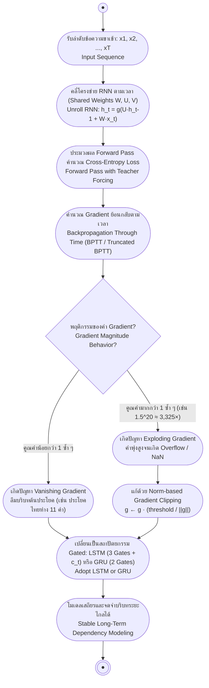

# โครงข่ายประสาทเวียนกลับ (Recurrent Neural Networks - RNN)

<span class="material-symbols-outlined">arrow_back</span> กลับไปที่ [[Week5-MOC|MOC สัปดาห์ 5]] | ก่อนหน้า: [[Language-Models-Ngrams]]

## <span class="material-symbols-outlined">key</span> Keyword

- **RNN (Recurrent Neural Network / Elman Network)** — โครงข่ายประสาทที่ประมวลผลข้อมูลลำดับทีละก้าวเวลา ($t$) พร้อมส่งต่อความจำผ่านสถานะซ่อนเร้น $h_t$
- **Hidden State ($h_t$)** — เวกเตอร์ความจำภายในที่สรุปบริบททั้งหมดตั้งแต่ต้นประโยคจนถึงเวลา $t$
- **Weight Sharing Across Time** — การใช้เมทริกซ์น้ำหนักชุดเดิม ($W, U, V$) ซ้ำในทุกก้าวเวลา ทำให้รองรับประโยคความยาวแปรผันได้
- **Teacher Forcing** — เทคนิคการฝึก RNN Language Model โดยป้อนคำเฉลยจริง $w_t$ เป็นอินพุตของก้าวถัดไป $t+1$ แทนที่จะป้อนคำที่โมเดลทายเอง
- **BPTT (Backpropagation Through Time)** — อัลกอริทึมฝึก RNN ด้วยการคลี่โครงข่ายออกตามเวลาแล้วไล่ค่าอนุพันธ์ย้อนกลับ
- **Vanishing & Exploding Gradients** — ปัญหาค่าอนุพันธ์หดหายเข้าใกล้ $0$ หรือระเบิดพุ่งสูงแบบทวีคูณจากการคูณเมทริกซ์ซ้ำ ๆ ตามความยาวลำดับ
- **LSTM (Long Short-Term Memory)** — สถาปัตยกรรมที่มี **Cell State ($c_t$)** และ **3 Gates (Forget $f_t$, Input $i_t$, Output $o_t$)** เพื่อรักษาความจำระยะยาว
- **GRU (Gated Recurrent Unit)** — สถาปัตยกรรมแบบย่อของ LSTM ที่รวมความจำไว้ใน $h_t$ เดียว และใช้ **2 Gates (Reset $r_t$, Update $z_t$)**
- **Bidirectional & Stacked RNN (BiLSTM)** — การอ่านประโยคทั้งจากซ้ายไปขวาและขวาไปซ้ายพร้อมกัน และการวางซ้อนหลายชั้นเพื่อสกัดคุณลักษณะเชิงลึก

---

## <span class="material-symbols-outlined">menu_book</span> Theory & Worked Examples (เข้าใจง่าย + พร้อมสอบ)

### 1. ทำไมต้องมี RNN? ข้อจำกัดของ Feed-Forward และ 5 รูปแบบสถาปัตยกรรม

#### 1.1 ข้อจำกัดของ Feed-Forward Neural Networks และ N-gram
- **Fixed Input Length:** โครงข่าย Feed-Forward ทั่วไปบังคับให้ขนาดเวกเตอร์ขาเข้าต้องคงที่ จึงไม่สามารถรับประโยคที่มีความยาวแปรผันได้โดยตรง
- **No Parameter Sharing Across Positions:** ไม่มีการแชร์น้ำหนักข้ามตำแหน่งคำ ทำให้สิ่งที่เรียนรู้จากตำแหน่งต้นประโยคไม่ถูกนำไปใช้ที่ท้ายประโยค
- **Short Memory Window:** มองเห็นบริบทได้แค่หน้าต่างแคบ ๆ ไม่สามารถเชื่อมโยงข้อมูลที่อยู่ห่างกันหลายคำ (Long-Range Dependency) ได้

**Recurrent Neural Network (RNN)** แก้ปัญหานี้ด้วยการประมวลผลข้อมูลทีละก้าวเวลา ($t = 1, 2, \dots, T$) พร้อมส่งต่อ **Hidden State ($h_t$)** จากก้าวก่อนหน้า ($h_{t-1}$) มาคำนวณร่วมกับคำปัจจุบัน ($x_t$)

#### 1.2 สถาปัตยกรรม RNN ทั้ง 5 รูปแบบตามลักษณะ Input–Output (สไลด์หน้า 3)

| รูปแบบ (Topology) | ลักษณะการรับ–ส่งข้อมูล | ตัวอย่างงานใน NLP |
| :--- | :--- | :--- |
| **1. Many-to-Many (Sequence Labeling)** | รับ $T$ อินพุต และให้ $T$ เอาต์พุตแบบ $1$ ต่อ $1$ ในทุกก้าวเวลา | การตัดคำภาษาไทย (Word Segmentation), POS Tagging, NER |
| **2. Many-to-One (Sequence Classification)** | อ่านลำดับคำจนจบประโยค แล้วนำ $h_T$ สุดท้ายไปทำนายผลลัพธ์เดียว | การวิเคราะห์ความรู้สึก (Sentiment Analysis), การจัดหมวดหมู่ข้อความ |
| **3. One-to-Many** | รับอินพุตก้อนเดียว (เช่น เวกเตอร์รูปภาพ) แล้วคลี่ออกเป็นลำดับคำ | การสร้างคำบรรยายภาพ (Image Captioning) |
| **4. Many-to-Many (Encoder–Decoder / Seq2Seq)** | อ่านลำดับขาเข้าทั้งหมดก่อน แล้วจึงสร้างลำดับขาออกที่มีความยาวต่างกันได้ | การแปลภาษาด้วยเครื่อง (Machine Translation), การสรุปความ (Summarization) |
| **5. Autoregressive Text Generation** | ทำนายคำถัดไปทีละคำ แล้วนำคำที่สร้างได้ป้อนกลับเป็นอินพุตของก้าวถัดไป | Language Modeling และการแต่งข้อความต่อเนื่อง |

---

### 2. สมการของ Simple RNN (Elman Network) และการแชร์น้ำหนัก (สไลด์หน้า 4–5)

เมื่อคลี่โครงข่าย RNN ออกตามเวลา (Unrolled Computation Graph) ณ ก้าวเวลา $t$ โมเดลจะรับเวกเตอร์คำขาเข้า $x_t \in \mathbb{R}^d$ และสถานะซ่อนเร้นก่อนหน้า $h_{t-1} \in \mathbb{R}^{d_h}$ มาคำนวณตามสมการ:

$$h_t = g(U h_{t-1} + W x_t + b_h)$$

$$\hat{y}_t = \text{softmax}(V h_t + b_y)$$

โดยที่:
- **$W \in \mathbb{R}^{d_h \times d}$:** เมทริกซ์น้ำหนักสำหรับข้อมูลขาเข้า (Input-to-Hidden weights)
- **$U \in \mathbb{R}^{d_h \times d_h}$:** เมทริกซ์น้ำหนักเวียนกลับจากอดีต (Hidden-to-Hidden / Recurrent weights)
- **$V \in \mathbb{R}^{|V| \times d_h}$:** เมทริกซ์น้ำหนักสำหรับแปลงสถานะซ่อนเร้นเป็นผลลัพธ์ (Hidden-to-Output weights)
- **$g(\cdot)$:** ฟังก์ชัน Activation แบบไม่เชิงเส้น (มักใช้ $\tanh$ หรือ $\text{ReLU}$)

> [!important] หัวใจของการแชร์พารามิเตอร์ (Weight Sharing Across Time)
> เมทริกซ์ **$W$, $U$, และ $V$ เป็นเมทริกซ์ชุดเดียวกันเป๊ะในทุกก้าวเวลา $t = 1, 2, \dots, T$** ข้อดีคือ:
> 1. จำนวนพารามิเตอร์ของโมเดลคงที่ ไม่ขึ้นกับความยาวของประโยค
> 2. โมเดลสามารถประมวลผลประโยคที่ยาวเท่าใดก็ได้ และจดจำรูปแบบไวยากรณ์เดียวกันได้ไม่ว่าจะปรากฏที่ต้นหรือท้ายประโยค

---

### 3. RNN Language Modeling และ Teacher Forcing (สไลด์หน้า 6)

ในการใช้ RNN เป็น **Language Model** เราฝึกแบบ **Self-Supervised Learning** โดยเลื่อนคำในประโยคไปข้างหน้า $1$ ตำแหน่งเพื่อใช้เป็นเฉลย (Target = Shifted-by-one Input):
- **Input Sequence ($x_1 \dots x_5$):** `["So", "long", "and", "thanks", "for"]`
- **Target Sequence ($y_1 \dots y_5$):** `["long", "and", "thanks", "for", "all"]`

#### สมการ Cross-Entropy Loss ณ ก้าวเวลา $t$
เมื่อคำเฉลยจริงในก้าวถัดไปคือ $w_{t+1}$ ฟังก์ชันความสูญเสียคือค่าลบของลอการิทึมความน่าจะเป็นที่โมเดลทายคำนั้น:

$$L_{CE}(\hat{y}_t, y_t) = -\sum_{w \in V} y_t[w] \log \hat{y}_t[w] = -\log \hat{y}_t[w_{t+1}]$$

#### Teacher Forcing คืออะไร?
ระหว่างการฝึก (Training) ณ ก้าวเวลา $t+1$ แทนที่เราจะนำคำที่โมเดลสุ่มทายได้ในก้าว $t$ (ซึ่งอาจทายผิด) มาป้อนเป็นอินพุต เราจะบังคับป้อน **คำเฉลยจริงจากคลังข้อมูล ($w_t$)** เข้าเป็น $x_{t+1}$ เสมอ เพื่อป้องกันไม่ให้ความผิดพลาดสะสม (Error Propagation) และช่วยให้โมเดลลู่เข้าสู่คำตอบได้เร็วขึ้นมาก

---

### 4. การฝึกด้วย BPTT และปัญหา Vanishing / Exploding Gradients (สไลด์หน้า 7–9)

#### 4.1 Backpropagation Through Time (BPTT) และ Truncated BPTT
- **Full BPTT:** คำนวณ Forward pass ตลอดทั้งลำดับเพื่อรวมค่า Loss ทั้งหมด $L = \sum_{t=1}^{T} L_t$ จากนั้นไล่คำนวณ Gradient ย้อนกลับตั้งแต่ $t = T$ ลงมาจนถึง $t = 1$ เพื่ออัปเดต $W, U, V$
- **Truncated BPTT:** สำหรับข้อความที่ยาวมาก การคลี่ย้อนกลับทั้งเอกสารสิ้นเปลืองหน่วยความจำและเวลาคำนวณ จึงตัดแบ่งการไล่ Gradient ย้อนกลับเพียงช่วงสั้น ๆ คงที่ เช่น ทุก ๆ **$k = 20\text{ ถึง }35$ ก้าวเวลา**

#### 4.2 ปัญหา Vanishing Gradient และตัวอย่างบริบทระยะไกลในภาษาไทย
เนื่องจากในการไล่กฎลูกโซ่ย้อนกลับตามเวลา อนุพันธ์ $\frac{\partial h_t}{\partial h_k}$ ต้องคูณเมทริกซ์น้ำหนัก $U$ และอนุพันธ์ของ $\tanh'$ ซ้ำกันถึง $t - k$ ครั้ง:

$$\frac{\partial L_t}{\partial h_k} = \frac{\partial L_t}{\partial h_t} \prod_{j=k+1}^{t} \frac{\partial h_j}{\partial h_{j-1}} \propto U^{t-k}$$

- **Vanishing Gradient (อนุพันธ์หดหายเข้าใกล้ศูนย์):** เมื่อค่าเจาะจง (Eigenvalue $\lambda$) หรืออนุพันธ์มีค่าน้อยกว่า $1$ (เช่น $\tanh'(x) \in (0, 1]$) การคูณซ้ำกันหลายสิบก้าวทำให้ค่า Gradient กลายเป็น $0$ ส่งผลให้โมเดล **ลืมข้อมูลที่อยู่ต้นประโยค**

> [!important] ตัวอย่างประโยคภาษาไทยที่มี Long-Range Dependency (ห่างกัน 11 คำ — สไลด์หน้า 8)
> **ประโยค:** *"นักเรียน ที่ ได้ รับ ทุน จาก มหาวิทยาลัย เมื่อ ปี ที่ แล้ว กำลัง จะ **`___`**"*
> - คำตอบที่เหมาะสมคือ **`"สำเร็จการศึกษา"`** (สอดคล้องกับคำประธานต้นประโยคคือ **`"นักเรียน"`** ไม่ใช่ `"มหาวิทยาลัย"` หรือ `"ปีที่แล้ว"`)
> - Simple RNN มักลืมคำว่า `"นักเรียน"` ไปแล้วหลังจากอ่านอนุประโยคขยายที่คั่นกลางถึง 11 คำ!

#### 4.3 ปัญหา Exploding Gradient และตัวอย่างตัวเลข + วิธีแก้ด้วย Gradient Clipping (สไลด์หน้า 9)
- **Exploding Gradient (อนุพันธ์ระเบิดพุ่งสูง):** ในทางกลับกัน หากค่า Eigenvalue ของเมทริกซ์มีค่ามากกว่า $1$ เพียงเล็กน้อย เช่น **$\lambda = 1.5$** เมื่อคูณย้อนกลับเพียง **$k = 20$ ก้าวเวลา**:
  $$\lambda^{20} = 1.5^{20} \approx \mathbf{3,325.26}\text{ เท่า!}$$
  หากประโยคยาว $50$ คำ ค่าจะพุ่งเป็น $1.5^{50} \approx 6.37 \times 10^8$ จนเกิดค่าล้น (`Overflow` / `NaN`) ทันที
- **วิธีแก้มาตรฐาน — Norm-based Gradient Clipping:** หากขนาดของเวกเตอร์อนุพันธ์ $\|g\|$ เกินค่าเพดาน $\text{threshold}$ ที่กำหนด ให้ย่อขนาดเวกเตอร์ลงโดยคงทิศทางเดิมไว้:
  $$\text{if } \|g\| > \text{threshold}: \qquad g \leftarrow g \cdot \frac{\text{threshold}}{\|g\|}$$

---

### 5. Long Short-Term Memory (LSTM): สมการครบทุก Gate และกรณีศึกษาภาษาไทย (สไลด์หน้า 10–12)

**LSTM** (Hochreiter & Schmidhuber, 1997) แก้ปัญหา Vanishing Gradient ที่ต้นตอด้วยการแยกเส้นทางความจำออกเป็น 2 เส้นทางคือ:
1. **Cell State ($c_t$):** สายพานลำเลียงความจำระยะยาว (Long-term memory highway) ที่ส่งข้อมูลผ่านด้วยการ **บวกเชิงเส้น ($+$)** แทนการคูณซ้ำ ๆ ทำให้ Gradient ไหลย้อนกลับได้ไกลโดยไม่หดหาย
2. **Hidden State ($h_t$):** ความจำระยะสั้นสำหรับส่งออกและตัดสินใจในก้าวปัจจุบัน

โดยควบคุมการไหลของข้อมูลด้วย **3 Gates** ซึ่งใช้ฟังก์ชัน Sigmoid $\sigma(\cdot) \in (0, 1)$ ทำหน้าที่เป็นวาล์วเปิด–ปิด ($0 =$ ลบทิ้ง/ปิดสนิท, $1 =$ เก็บไว้ทั้งหมด/เปิดสนิท) ร่วมกับผลคูณรายตำแหน่ง (Hadamard / Element-wise Product $\odot$):

#### 5.1 สมการคณิตศาสตร์ของ LSTM ครบทุกขั้นตอน (Eq. 13.20–13.27 ในสไลด์หน้า 11)

1. **Forget Gate ($f_t$) — ตัดสินใจว่าจะลืมข้อมูลเก่าใน $c_{t-1}$ มากน้อยเพียงใด:**
   $$f_t = \sigma(U_f h_{t-1} + W_f x_t + b_f)$$
   $$k_t = c_{t-1} \odot f_t$$
2. **Candidate Memory ($g_t$ หรือ $\tilde{c}_t$) & Input Gate ($i_t$) — สกัดข้อมูลใหม่และเลือกสิ่งที่จะจดจำ:**
   $$g_t = \tanh(U_g h_{t-1} + W_g x_t + b_g)$$
   $$i_t = \sigma(U_i h_{t-1} + W_i x_t + b_i)$$
   $$j_t = g_t \odot i_t$$
3. **Cell State Update ($c_t$) — รวมความจำเก่าที่เหลืออยู่เข้ากับความจำใหม่ที่คัดกรองแล้ว:**
   $$c_t = j_t + k_t = g_t \odot i_t + c_{t-1} \odot f_t$$
4. **Output Gate ($o_t$) & Hidden State ($h_t$) — เลือกข้อมูลจาก Cell State ออกมาใช้งานในก้าวปัจจุบัน:**
   $$o_t = \sigma(U_o h_{t-1} + W_o x_t + b_o)$$
   $$h_t = o_t \odot \tanh(c_t)$$

#### 5.2 ตัวอย่างการทำงานของแต่ละ Gate กับประโยคภาษาไทย (สไลด์หน้า 12)

| ชื่อ Gate | บทบาทหน้าที่ | ตัวอย่างสถานการณ์ในประโยคภาษาไทย |
| :--- | :--- | :--- |
| **Forget Gate ($f_t$)** | ล้างบริบทเก่าเมื่อเปลี่ยนหัวข้อหรือเปลี่ยนอนุประโยค | ในประโยครีวิว *"อาหารร้านนี้อร่อยมาก **แต่** บริการแย่สุด ๆ"* เมื่อโมเดลอ่านเจอคำสันธาน **`"แต่"`** ค่า $f_t$ จะเข้าใกล้ $0$ เพื่อล้างอารมณ์เชิงบวกชุดแรกออก แล้วเตรียมรับอารมณ์หลักที่ตามหลัง `"แต่"` |
| **Input Gate ($i_t$)** | เปิดรับคำสำคัญ (Keywords / Entities) เข้าสู่ความจำระยะยาว | เมื่ออ่านเจอคำนามเฉพาะ เช่น **`"เชียงใหม่"`** หรือคำแสดงอารมณ์ชัดเจน ค่า $i_t$ จะเข้าใกล้ $1$ เพื่อบันทึกเข้า $c_t$ แต่ถ้าเจอคำเชื่อมทั่วไปอย่าง `"ก็"`, `"นะ"`, `"ครับ"` ค่า $i_t \approx 0$ |
| **Output Gate ($o_t$)** | เก็บข้อมูลบางอย่างไว้ใน $c_t$ ก่อน แล้วค่อยปล่อยออกมาเมื่อถึงจังหวะต้องใช้ | เก็บข้อมูลสถานะหรือเพศของประธานไว้ใน $c_t$ เงียบ ๆ ตลอดอนุประโยคขยาย แล้วเปิด $o_t \approx 1$ เมื่อถึงตำแหน่งที่ต้องทำนายคำกริยาหรือคำลงท้าย (`"ครับ"` / `"ค่ะ"`) |

---

### 6. Gated Recurrent Unit (GRU) และการเปรียบเทียบกับ LSTM (สไลด์หน้า 13–14)

**GRU** (Cho et al., 2014) ลดความซับซ้อนของ LSTM ลงโดย **ยุบรวม Cell State และ Hidden State เข้าด้วยกันเหลือเพียง $h_t$ ตัวเดียว** และลดจำนวน Gate ลงจาก 3 เหลือ **2 Gates** (ทำให้มีพารามิเตอร์น้อยกว่า LSTM ถึง **25%**):

#### 6.1 สมการคณิตศาสตร์ของ GRU
1. **Reset Gate ($r_t$) — กำหนดว่าจะละทิ้งสถานะก่อนหน้า $h_{t-1}$ มากน้อยแค่ไหนในการสร้างข้อมูลใหม่:**
   $$r_t = \sigma(U_r h_{t-1} + W_r x_t + b_r)$$
2. **Update Gate ($z_t$) — ทำหน้าที่เป็นทั้ง Forget Gate และ Input Gate พร้อมกันในตัวเดียว:**
   $$z_t = \sigma(U_z h_{t-1} + W_z x_t + b_z)$$
3. **Candidate Hidden State ($h'_t$ หรือ $\tilde{h}_t$):**
   $$h'_t = \tanh\big(U_h (r_t \odot h_{t-1}) + W_h x_t + b_h\big)$$
4. **Hidden State Interpolation ($h_t$):**
   $$h_t = (1 - z_t) \odot h_{t-1} + z_t \odot h'_t$$

#### 6.2 ตารางเปรียบเทียบ Simple RNN vs. LSTM vs. GRU (สไลด์หน้า 14)

| คุณสมบัติ | Simple RNN (Elman) | LSTM | GRU |
| :--- | :---: | :---: | :---: |
| **จำนวน Gates** | $0$ (ไม่มี Gate) | **$3$ Gates** ($f_t, i_t, o_t$) | **$2$ Gates** ($r_t, z_t$) |
| **ตัวแปรสถานะที่ส่งต่อ** | $h_t$ เดียว | **$2$ ตัวแปร** ($h_t$ และ $c_t$) | $h_t$ เดียว |
| **จำนวนเมทริกซ์พารามิเตอร์ต่อชั้น** | $1\times$ (น้อยที่สุด) | **$4\times$** (มากที่สุด) | **$3\times$** (น้อยกว่า LSTM $25\%$) |
| **การแก้ปัญหา Vanishing Gradient** | แก้ไม่ได้ (จำได้แค่ระยะสั้น) | ดีเยี่ยม (มีทางด่วน $c_t$) | ดีเยี่ยม (ผ่านสมการ $(1-z_t) \odot h_{t-1}$) |
| **แนวทางการเลือกใช้งาน** | ใช้ศึกษาแนวคิดพื้นฐานเท่านั้น | เหมาะกับข้อมูลขนาดใหญ่และประโยคที่ซับซ้อน/ยาวมาก | เหมาะเมื่อต้องการฝึกเร็ว ข้อมูลมีจำกัด หรือลดความเสี่ยง Overfitting |

##### รูปแบบ Tensor มาตรฐานใน PyTorch
ในการป้อนข้อมูลเข้า `nn.RNN`, `nn.LSTM`, หรือ `nn.GRU` (เมื่อตั้ง `batch_first=True`) ข้อมูลต้องอยู่ในรูป 3D Tensor:

```text
(batch_size, sequence_length, embedding_dim)
```

---

### 7. Bidirectional RNN, Stacked Deep RNN และการประยุกต์ใช้งานจริง (สไลด์หน้า 15–16)

#### 7.1 Bidirectional RNN (BiRNN / BiLSTM)
ในงานอย่างการตัดคำภาษาไทย, POS Tagging, หรือ NER การดูเฉพาะคำข้างหน้าไม่เพียงพอ เพราะคำข้างหลังช่วยบอกชนิดและความหมายของคำปัจจุบันได้ **Bidirectional RNN** จึงใช้ RNN 2 ตัวอ่านประโยคสวนทางกัน แล้วนำเวกเตอร์มาต่อกัน (Concatenate):
- **Forward RNN ($\overrightarrow{h_t}$):** อ่านจากซ้ายไปขวา ($t = 1 \rightarrow T$)
- **Backward RNN ($\overleftarrow{h_t}$):** อ่านจากขวาไปซ้าย ($t = T \rightarrow 1$)
- **Combined Representation:**
  $$h_t = \big[\overrightarrow{h_t}\ ;\ \overleftarrow{h_t}\big]$$

> [!caution] ข้อห้ามสำคัญที่มักออกสอบ!
> **ห้ามใช้ Bidirectional RNN กับงาน Autoregressive Language Modeling (การทำนายคำถัดไป) โดยเด็ดขาด!** เพราะการอ่านจากขวาไปซ้าย ($\overleftarrow{h_t}$) เท่ากับแอบดูคำตอบในอนาคตที่กำลังจะทำนาย (Data Leakage) จึงใช้ได้เฉพาะงานที่มีประโยคครบทั้งเส้นแล้ว เช่น Sequence Labeling (`BiLSTM-CRF`) หรือ Text Classification เท่านั้น

#### 7.2 Stacked (Deep) RNNs
การนำชั้น RNN/LSTM มาวางซ้อนกันหลายชั้นในแนวตั้ง (ปกติ $2\text{–}4$ ชั้น) โดยใช้ลำดับเอาต์พุต $h_t^{(l)}$ ของชั้นที่ $l$ เป็นอินพุตของชั้นที่ $l+1$ เพื่อให้ชั้นล่างจับรูปแบบระดับคำ/ไวยากรณ์ และชั้นบนจับความหมายเชิงนามธรรมที่ซับซ้อนขึ้น

#### 7.3 กรณีศึกษา: Google Neural Machine Translation (GNMT, Wu et al., 2016) และการประยุกต์ใช้กับภาษาไทย (สไลด์หน้า 16)
- **GNMT (2016):** ระบบแปลภาษาของ Google ยุคเปลี่ยนผ่านจาก Statistical MT สู่ Neural MT ใช้สถาปัตยกรรม **Stacked LSTM 8 ชั้น** (ทั้งฝั่ง Encoder และ Decoder โดยชั้นแรกเป็น Bidirectional LSTM) ร่วมกับ Residual Connections และ Attention Mechanism ช่วยลดความผิดพลาดในการแปลลงถึง $60\%$

##### ตารางสรุป 4 งานประยุกต์ใช้ RNN/LSTM ในภาษาไทย

| งานประยุกต์ (Thai NLP Task) | สถาปัตยกรรมที่นิยม | รูปแบบ Topology |
| :--- | :--- | :--- |
| **1. การตัดคำภาษาไทย (Thai Word Segmentation)** | Character-level `BiLSTM` / `BiLSTM-CRF` | Many-to-Many (ทายป้าย `B, I, E, S` รายตัวอักษร) |
| **2. POS Tagging & Named Entity Recognition (NER)** | Word/Subword `BiLSTM-CRF` | Many-to-Many |
| **3. การวิเคราะห์ความรู้สึก (Thai Sentiment Analysis)** | `BiLSTM` / `GRU` + Pooling | Many-to-One (จำแนกรีวิวสินค้า/โซเชียลมีเดีย) |
| **4. Thai Language Modeling (เช่น `thai2fit`)** | `AWD-LSTM` (Stacked Unidirectional LSTM) | Autoregressive Many-to-Many |

---

## <span class="material-symbols-outlined">schema</span> Diagram



---
<span class="material-symbols-outlined">arrow_forward</span> กลับไปที่ [[Week5-MOC|MOC สัปดาห์ 5]]
