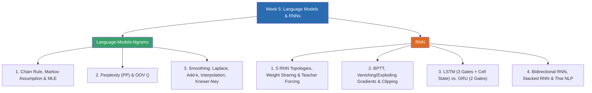

# Week 5 — Language Models & RNNs (MOC)

arrow_back สัปดาห์ก่อนหน้า: [[Week4-MOC|MOC สัปดาห์ 4]]

## check_circle เช็คลิสต์ก่อนเข้าเรียนและเตรียมสอบ

- [ ] เขียนสมการ **Chain Rule** และอธิบายว่า **Markov Assumption** ช่วยลดความซับซ้อนในการคำนวณความน่าจะเป็นของประโยคอย่างไร — ดู [[Language-Models-Ngrams]]
- [ ] คำนวณค่าความน่าจะเป็นแบบ **MLE** สำหรับ Unigram, Bigram, Trigram และคำนวณค่า **Perplexity ($\text{PP}$)** บนชุดทดสอบ — ดู [[Language-Models-Ngrams]]
- [ ] เข้าใจการจัดการคำนอกคลังด้วย **`<UNK>`** และคำนวณ **5 เทคนิค Smoothing** (Laplace Add-1, Add-$k$, Backoff, Linear Interpolation บนวลี `"กิน ข้าว ผัด"`, และ **Kneser-Ney Continuation Probability** เปรียบเทียบ `"ยอร์ก"` vs `"เมือง"`) — ดู [[Language-Models-Ngrams]]
- [ ] แยกแยะ **5 รูปแบบสถาปัตยกรรม RNN** (Many-to-Many, Many-to-One, One-to-Many, Encoder–Decoder, Autoregressive Generation) และเขียนสมการ **Elman Simple RNN** — ดู [[RNN]]
- [ ] อธิบายหลักการ **Teacher Forcing**, **BPTT / Truncated BPTT**, สาเหตุของ **Vanishing & Exploding Gradients** (เช่น $1.5^{20} \approx 3,325\times$) และสมการ **Gradient Clipping** — ดู [[RNN]]
- [ ] เขียนสมการและอธิบายหน้าที่ของทุก Gate ใน **LSTM** ($f_t, i_t, o_t$ และ Cell State $c_t$) เทียบกับ **GRU** ($r_t, z_t$) พร้อมยกตัวอย่างสถานการณ์ในภาษาไทย — ดู [[RNN]]
- [ ] เข้าใจหลักการของ **Bidirectional RNN (BiLSTM)**, **Stacked RNN**, และเหตุผลว่าทำไมจึงห้ามใช้ Bidirectional RNN กับงาน Autoregressive Language Modeling — ดู [[RNN]]

## assignment ภาพรวมสัปดาห์ 5 (สรุปย่อ)

สัปดาห์นี้เชื่อมโยงวิวัฒนาการของโมเดลภาษาจากยุคสถิติสู่ยุคโครงข่ายประสาทเทียม ผ่านสไลด์บรรยาย 2 ชุด:
1. **Language Models & N-grams (`5-1_Language_Models_Ngrams.pdf`, 13 หน้า)** — นิยามของ Language Model, การแยกตัวประกอบความน่าจะเป็นด้วย Chain Rule, การใช้ Markov Assumption ประมาณค่า N-gram ด้วย MLE, การประเมินผลด้วย **Perplexity** (พร้อมผลทดสอบบนคลัง WSJ: Unigram $962 \rightarrow$ Bigram $170 \rightarrow$ Trigram $109$), การจัดการคำไม่คุ้นเคยด้วย `<UNK>`, และเทคนิค **Smoothing ครบทั้ง 5 วิธี** (Laplace, Add-$k$, Backoff, Linear Interpolation, และ Kneser-Ney Continuation Probability)
2. **Recurrent Neural Networks (`5-2_RNN.pdf`, 16 หน้า)** — การก้าวข้ามข้อจำกัดของ N-gram ด้วยโครงข่ายประสาทเวียนกลับ, รูปแบบสถาปัตยกรรม Input–Output 5 แบบ, สมการ Simple RNN และการแชร์พารามิเตอร์ ($W, U, V$) ข้ามเวลา, การฝึกด้วย **Teacher Forcing** และ **BPTT**, การวิเคราะห์ปัญหา **Vanishing / Exploding Gradients** พร้อมวิธีแก้ด้วย **Gradient Clipping**, สมการครบทุกขั้นตอนของ **LSTM** และ **GRU**, ตลอดจนการต่อยอดสู่ **Bidirectional RNN**, **Stacked RNN (GNMT)** และการประยุกต์ใช้กับงานภาษาไทย

## map แผนที่หัวข้อสัปดาห์ 5

## collections_bookmark โน้ตรายหัวข้อ

| หัวข้อ | เนื้อหาหลัก | หน้าสไลด์ |
| --- | --- | --- |
| [[Language-Models-Ngrams]] | Chain rule, Markov assumption, N-gram MLE, Perplexity & WSJ benchmark, Zero counts & `<UNK>`, 5 Smoothing methods (Laplace, Add-$k$, Backoff, Linear Interpolation worked example, Kneser-Ney `"ยอร์ก"` vs `"เมือง"`), N-gram vs. Neural LM | 5-1 (หน้า 1–13) |
| [[RNN]] | 5 RNN topologies, Simple RNN equations & weight sharing, RNN LM & Teacher Forcing, BPTT & Truncated BPTT, Vanishing/Exploding gradients & Clipping, LSTM full equations & Thai gate examples, GRU equations & comparison, BiRNN & Stacked RNN (GNMT) | 5-2 (หน้า 1–16) |

> [!tip] จุดที่มักออกสอบและมักสับสน
> 1. **Kneser-Ney vs. Unigram ปกติ:** Kneser-Ney ไม่ได้ดูว่าคำ $w$ ปรากฏบ่อยแค่ไหน แต่ดู **Continuation Probability ($P_{\text{CONT}}$)** ว่าคำ $w$ เคยไปต่อท้ายคำก่อนหน้ากี่ชนิดที่แตกต่างกัน (เช่น `"เมือง"` ต่อท้ายได้ 45 คำ ส่วน `"ยอร์ก"` ต่อท้ายแค่คำว่า `"นิว"` คำเดียว)
> 2. **Exploding vs. Vanishing Gradient Solutions:** **Exploding Gradient** แก้ได้ง่ายด้วย **Gradient Clipping** ส่วน **Vanishing Gradient** ต้องแก้เชิงสถาปัตยกรรมด้วยการใช้ **LSTM** (ที่มีทางด่วนบวกเชิงเส้นใน Cell State $c_t$) หรือ **GRU**
> 3. **LSTM vs. GRU:** LSTM มี **3 Gates ($f_t, i_t, o_t$)** และส่งต่อ **2 สถานะ ($h_t, c_t$)** ส่วน GRU ยุบรวมเหลือ **2 Gates ($r_t, z_t$)** และส่งต่อ **สถานะเดียว ($h_t$)** ทำให้พารามิเตอร์น้อยกว่า $25\%$

arrow_forward สัปดาห์ถัดไป: [[Week6-MOC|MOC สัปดาห์ 6]]
