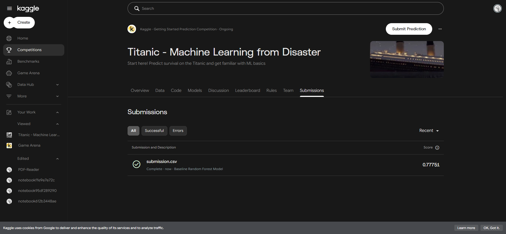

# Kaggle Titanic: Machine Learning from Disaster

## 1. Overview
This project develops a baseline Machine Learning model to predict passenger survival on the Titanic, formatted and submitted directly to the Kaggle competition: [Titanic - Machine Learning from Disaster](https://www.kaggle.com/competitions/titanic).

- **Competition URL**: https://www.kaggle.com/competitions/titanic
- **Leaderboard**: https://www.kaggle.com/competitions/titanic/leaderboard
- **Evaluation Metric**: Binary Classification Accuracy

---

## 2. Directory Structure
```
02_Labs_Assignments/Titanic/
├── data/
│   ├── train.csv                # Training dataset (891 rows)
│   └── test.csv                 # Test dataset (418 rows)
├── screenshots/
│   ├── submission_result.png    # Screenshot of successful Kaggle submission
│   └── leaderboard_rank.png     # Screenshot of position on Kaggle leaderboard
├── titanic_model.ipynb          # Interactive analysis and modeling notebook
├── train_and_predict.py         # Automated data pipeline & training script
├── submission.csv               # Kaggle prediction output
└── README.md                    # Project documentation & summary
```

---

## 3. Methodology & Feature Engineering

1. **Title Extraction**:
   - Extracted honorific titles from `Name` (`Mr`, `Mrs`, `Miss`, `Master`, and `Rare` for noble/military/clergy titles).
   - Standardized French variants (`Mlle`, `Ms` -> `Miss`, `Mme` -> `Mrs`).
2. **Family Signals**:
   - `FamilySize = SibSp + Parch + 1`
   - `IsAlone = 1` if `FamilySize == 1` else `0`.
3. **Missing Value Imputation**:
   - Imputed `Age` using median values grouped by passenger class (`Pclass`) and `Title`.
   - Imputed missing `Fare` in the test set using class medians.
   - Imputed missing `Embarked` with the most frequent port (`S`).
4. **Encoding**:
   - One-hot encoded categorical variables (`Sex`, `Embarked`, `Title`) with `drop_first=True`.
5. **Model Architecture**:
   - `RandomForestClassifier` with `n_estimators=100`, `max_depth=5`, `min_samples_split=4`, `min_samples_leaf=2`.
   - Evaluated using 5-Fold `StratifiedKFold` cross-validation.

---

## 4. Model Performance & Validation
- **Cross-Validation Accuracy (5-Fold Stratified)**: **83.16% (+/- 0.71%)**
  - Fold 1: 83.24%
  - Fold 2: 82.02%
  - Fold 3: 83.15%
  - Fold 4: 83.15%
  - Fold 5: 84.27%
- **Test Set Predictions**: 418 passengers classified (60.5% deceased, 39.5% survived).

---

## 5. Kaggle Submission & Verification

- **Participant / Team**: Phuriphat Hemakul
- **Submission Status**: Evaluated & Scored
- **Public Score**: **0.77751**
- **Public Leaderboard Rank**: **#4448** (out of 11,063+ competitors)

### Submission Confirmation


### Leaderboard Standing

